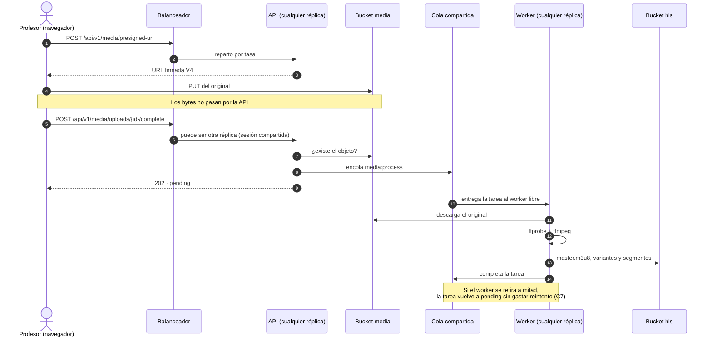
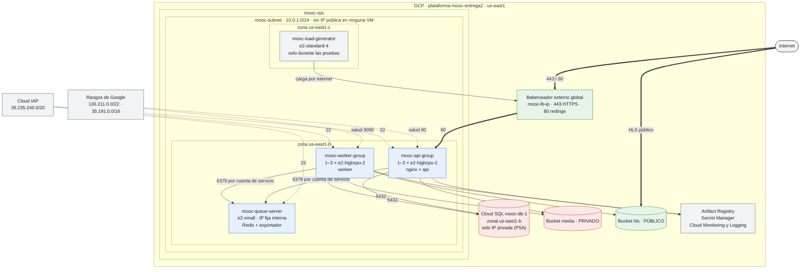

# Arquitectura de la Plataforma MOOC — Entrega 3: aplicación elástica IaaS

Describe **la solución efectivamente desplegada** en `plataforma-mooc-entrega2`
(GCP, región `us-east1`), no un diseño previsto. Cada dato sale del código de
infraestructura en [`infra/terraform/`](../../infra/terraform/) o de una
evidencia de [`evidencias/`](./evidencias/), y va enlazado.

| Sección | Qué cubre | Issue |
| :--- | :--- | :--- |
| [1](#1-servicios-del-proveedor) | Qué servicio de GCP satisface cada capacidad | I1 (#231) |
| [2](#2-modelo-de-componentes) | Modelo de componentes y comunicaciones | I1 (#231) |
| [3](#3-modelo-de-despliegue) | Modelo de despliegue: red, balanceador, grupos, persistencia y accesos | I1 (#231) |
| [4](#4-cambios-frente-a-la-entrega-2) | Cambios frente a la Entrega 2, componente por componente | I1 (#231) |
| [5](#5-decisiones-de-escalamiento) | Decisiones de escalamiento: plantillas, arranque, políticas, salud, cola y drenaje | I2 (#232) |
| [6](#6-operación-y-recuperación) | Operación y recuperación: despliegue, verificación, aparcado, retiro y secretos | I2 (#232) |
| [7](#7-capacidad-costo-y-limitaciones) | Capacidad, costo y limitaciones: configuración efectiva, costos, SPOF y pruebas | I2 (#232) |
| [8](#8-archivos-fuente-de-los-diagramas) | Archivos fuente de los diagramas Mermaid | I1 (#231) |

> **Los diagramas son Mermaid embebido, y el bloque de código es el archivo
> fuente** (§8): se versiona, se revisa en un `diff` y GitHub lo renderiza. Es la
> misma convención de la Entrega 2.

---

## 1. Servicios del proveedor

| Capacidad del enunciado | Servicio de GCP | Recurso desplegado |
| :--- | :--- | :--- |
| Punto de entrada HTTPS | Application Load Balancer externo **global** | `mooc-lb-ip`, `mooc-lb-cert`, `mooc-api-tls`, `mooc-api-backend` ([`load_balancer.tf`](../../infra/terraform/load_balancer.tf)) |
| Grupo de la API, 1–3 instancias | Compute Engine, grupo administrado zonal + autoescalador | `mooc-api-group`, `mooc-api-autoscaler` ([`api_group.tf`](../../infra/terraform/api_group.tf), [`api_autoscaler.tf`](../../infra/terraform/api_autoscaler.tf)) |
| Grupo de workers, 1–3 instancias | Compute Engine, grupo administrado zonal + autoescalador | `mooc-worker-group`, `mooc-worker-autoscaler` ([`worker_group.tf`](../../infra/terraform/worker_group.tf), [`worker_autoscaler.tf`](../../infra/terraform/worker_autoscaler.tf)) |
| Cola compartida fuera de los grupos | *VM dedicada, no servicio administrado* | `mooc-queue-server`, Redis 7 con AOF ([`queue.tf`](../../infra/terraform/queue.tf)) |
| Base de datos relacional administrada | Cloud SQL para PostgreSQL 16 | `mooc-db-1` ([`database.tf`](../../infra/terraform/database.tf)) |
| Almacenamiento de objetos | Cloud Storage | `plataforma-mooc-entrega2-media` (privado) y `…-hls` (público) ([`storage.tf`](../../infra/terraform/storage.tf)) |
| Red privada, salida y firewall | VPC, Cloud NAT, Cloud Firewall | `mooc-vpc`, `mooc-subnet`, `mooc-nat` ([`network.tf`](../../infra/terraform/network.tf)) |
| Imágenes versionadas | Artifact Registry | repositorio `mooc`: `api`, `worker`, `web`, etiqueta = SHA del commit |
| Secretos | Secret Manager | `db-password`, `smtp-password` ([`database.tf`](../../infra/terraform/database.tf), [`mail.tf`](../../infra/terraform/mail.tf)) |
| Señal de escalado de los workers | Cloud Monitoring, métrica personalizada | `custom.googleapis.com/mooc/queue/outstanding` |
| Administración | Identity-Aware Proxy (túnel TCP) | SSH solo desde `35.235.240.0/20` |
| Correo saliente | *Proveedor externo* | Brevo, SMTP 587 con STARTTLS |

La cola es una VM y no Memorystore: el enunciado admite «una instancia dedicada o
un servicio compatible», y la VM es el camino de menos coste y menos cambios
desde la Entrega 2 (B1, [`evidencias/B1/`](./evidencias/B1/README.md)).

---

## 2. Modelo de componentes

### 2.1 Vista general


Lo que cambia frente a la Entrega 2 se ve en dos sitios. **Las réplicas de API y
de workers son intercambiables**: ninguna guarda estado propio, porque todo lo
que comparten —sesiones, cola, datos y archivos— vive fuera de ellas (E1, E3). Y
**la cola ya no vive con los workers**: está en una máquina que ningún
autoescalador puede retirar.

Las dos flechas punteadas que salen del navegador siguen siendo el punto del
diseño de la Entrega 2: **los bytes de los archivos no atraviesan la API**.

### 2.2 Responsabilidades

| Componente | Responsabilidad | Código | Imagen |
| :--- | :--- | :--- | :--- |
| **Frontend** | Recorridos mínimos de estudiante y profesor; versión del build visible en el pie y en `/version.json`. Sesión solo por cookie `HttpOnly`: el cliente nunca guarda el token (D1) | [`frontend/`](../../frontend/) (React + Vite + TypeScript) | `web` = nginx con el build |
| **API** | Monolito modular: un proceso, separación por paquetes (tabla siguiente). Autoriza y firma; no transcodifica | [`cmd/api`](../../cmd/api/), `internal/*` | `api` |
| **Workers** | Consumen `media:process` de la cola compartida: audio y vídeo pasan a HLS con FFmpeg; documentos e imágenes se validan en el bucket sin generar derivados (nota 16). Actualizan el estado del recurso y drenan ordenadamente al retirarse (C7) | [`cmd/worker`](../../cmd/worker/), `internal/worker`, `internal/transcode` | `worker` |
| **Cola** | Redis 7 como servicio del sistema, con AOF. Base 0: tareas de asynq. Base 1: sesiones. También limitador de tasa y claves de idempotencia | [`queue_startup.sh`](../../infra/terraform/queue_startup.sh) | — (paquete de Debian) |
| **Exportador de la cola** | Lee `pending` y `active` y publica `outstanding` = `pending` + `active` en Cloud Monitoring cada 30 s: es la señal del autoescalador de workers (nota 42) | [`cmd/queue-exporter`](../../cmd/queue-exporter/) | `worker` (mismo binario empaquetado) |
| **Base de datos** | Estado académico: usuarios, cursos, estructura, inscripciones, intentos, progreso, recursos y auditoría | migraciones en [`scripts/migrate.sh`](../../scripts/migrate.sh) | — (Cloud SQL) |
| **Almacenamiento de objetos** | Originales, documentos y miniaturas (privado); derivados HLS (público) | [`internal/storage`](../../internal/storage/) | — (Cloud Storage) |

Módulos de la API, sin cambios de frontera desde la Entrega 2:

| Paquete | Responsabilidad |
| :--- | :--- |
| `internal/auth` | Registro, verificación de correo, sesiones, contraseñas |
| `internal/admin` | Usuarios y cambios de rol |
| `internal/course` · `internal/structure` | Cursos y su publicación; módulos, unidades y recursos |
| `internal/enrollment` · `internal/quiz` · `internal/progress` | Inscripciones; cuestionarios y calificación; avance e insignias |
| `internal/media` | URLs firmadas de carga y lectura, confirmación y encolado |
| `internal/domain` | Entidades y reglas, sin dependencias de infraestructura |
| `internal/postgres` · `internal/storage` · `internal/cache` · `internal/mailer` | Adaptadores: repositorios, Cloud Storage, Redis, SMTP |

`internal/http` registra **57 rutas**, verificadas contra el despliegue en
[`VERIFICACION_ENDPOINTS.md`](./VERIFICACION_ENDPOINTS.md). Cada respuesta lleva
`X-Instance-ID`, un resumen del ID de la instancia que atendió (A2): es lo que
permite demostrar el reparto entre réplicas sin publicar la topología.

### 2.3 Comunicaciones

| # | Origen → destino | Mecanismo | Naturaleza |
| ---: | :--- | :--- | :--- |
| 1 | Navegador → balanceador | HTTPS 443, certificado administrado por Google (`TLS_1_2` mínimo); el 80 redirige con 301 | Síncrona |
| 2 | Balanceador → nginx de una réplica | HTTP 80 dentro de la VPC, reparto por tasa (`RATE`) | Síncrona |
| 3 | nginx → API | HTTP en la red de Compose de la misma VM; `/api/` al contenedor `api`, el resto es el frontend estático | Síncrona |
| 4 | API → Cloud SQL | PostgreSQL 5432 por IP privada, `ENCRYPTED_ONLY` | Síncrona |
| 5 | API → cola | TCP 6379 por la VPC: encolar, sesiones, limitador, idempotencia | Síncrona |
| 6 | Cola → worker | asynq, tarea `media:process` | **Asíncrona** |
| 7 | Worker → Cloud SQL | PostgreSQL 5432 por IP privada | Síncrona |
| 8 | API · worker → Cloud Storage | HTTPS con la cuenta de servicio de la instancia, por Private Google Access | Síncrona |
| 9 | Navegador → Cloud Storage | HTTPS: URL firmada V4 para subir, lectura pública para HLS | Síncrona, **sin la API** |
| 10 | Exportador → Cloud Monitoring | `CreateTimeSeries` sobre `generic_node`, cada 30 s | **Asíncrona** respecto a la aplicación |
| 11 | Cloud Monitoring → autoescalador de workers | lectura de `outstanding` con filtro | **Asíncrona** |
| 12 | Balanceador → cada réplica | comprobación de salud `GET /api/v1/ready` | Síncrona, periódica |
| 13 | API → Brevo | SMTP 587 con STARTTLS, por Cloud NAT | Síncrona |

### 2.4 El flujo asíncrono con réplicas



Las dos llamadas del profesor pueden caer en réplicas distintas y el flujo no
lo nota: la sesión vive en la cola compartida y el recurso en la base (E1).

---

## 3. Modelo de despliegue

### 3.1 Topología



Para que el dibujo se lea, faltan dos cosas que valen para todas las máquinas:
la salida a internet va por Cloud NAT (§3.2) y todas, incluida la cola, se
administran por IAP. La cola y el generador también escriben en Monitoring.

Todas las instancias de aplicación están en **una sola zona**, `us-east1-b`: el
enunciado no exige alta disponibilidad multizonal, y la zona única evita tráfico
entre zonas. El generador va en **otra zona** a propósito, para que sus recursos
no compitan con los de la aplicación (G1).

### 3.2 Red

| Elemento | Valor | Para qué |
| :--- | :--- | :--- |
| VPC | `mooc-vpc`, modo personalizado | Un solo espacio privado para todos los componentes |
| Subred | `mooc-subnet`, `10.0.1.0/24`, Private Google Access activado | Las instancias sin IP pública llegan a Artifact Registry, Secret Manager, Storage y Monitoring |
| Rango para servicios administrados | `mooc-private-ip-alloc`, `/20`, peering de Service Networking | La IP privada de Cloud SQL |
| Salida a internet | `mooc-router` + `mooc-nat`, IP automáticas, `min_ports_per_vm = 2048` | Paquetes del sistema, GitHub, Brevo y salida del generador sin agotar puertos efímeros (nota 57); ninguna instancia tiene IP externa |
| IP interna fija de la cola | `mooc-queue-ip` | La cola no cambia de dirección al reiniciarse; las plantillas la llevan en su metadata |

### 3.3 Balanceador y verificaciones de salud

| Parámetro | Valor |
| :--- | :--- |
| Tipo | Application Load Balancer externo **global**, esquema `EXTERNAL_MANAGED` |
| Dirección | `mooc-lb-ip`, IPv4 global reservada |
| Dominio y certificado | `<IP>.sslip.io`, certificado administrado por Google `mooc-lb-cert` (nota 38) |
| Política TLS | `mooc-api-tls`: `profile = "MODERN"`, `min_tls_version = "TLS_1_2"` asociada a `mooc-api-https-proxy` (F1, nota 48) |
| Reglas de reenvío | `mooc-api-https` (443 → proxy HTTPS) y `mooc-api-http` (80 → redirección 301 a HTTPS). Se crean solo con `lb_enabled=true` |
| Backend | `mooc-api-backend`, HTTP por el puerto con nombre `http` (80), `timeout_sec = 60` |
| Política de distribución | `balancing_mode = RATE`, `max_rate_per_instance = 100` pet/s: la capacidad declarada que usa el autoescalador de la API (C2) |
| Drenaje de conexiones | 60 s al retirar una réplica (`connection_draining_timeout_sec = 60`) |
| Registro | 100 % de las peticiones en Cloud Logging (`log_config.sample_rate = 1.0`) |
| Salud del backend | `mooc-api-ready`: `GET /api/v1/ready` en el 80; cada 10 s, timeout 5 s, sana tras 2 aciertos, no sana tras 3 fallos |

`/api/v1/ready` comprueba la base y que la instancia terminó de arrancar; no la
tumba un fallo de otra réplica (nota 19). El frontend sale por el mismo backend:
nginx sirve el build y reenvía `/api/` a la API de la misma máquina, así que **la
interfaz y la API comparten origen** y no hace falta CORS (D1, nota 46).

### 3.4 Grupos de instancias

Las políticas de escalado y sus razones están en el §5. Aquí, lo que cada grupo
**es**:

| | `mooc-api-group` | `mooc-worker-group` |
| :--- | :--- | :--- |
| Plantilla | `mooc-api-*` | `mooc-worker-*` |
| Máquina | `e2-highcpu-2` · 2 vCPU · 2 GiB | `e2-highcpu-2` · 2 vCPU · 2 GiB |
| Disco | 30 GiB `pd-balanced`, Debian 12 | 30 GiB `pd-balanced`, Debian 12 |
| Zona | `us-east1-b` | `us-east1-b` |
| Mínimo · máximo | 1 · 3 | 1 · 3 |
| Señal de escalado | peticiones por instancia en el balanceador, objetivo 0,8 × 100 | `outstanding` de la cola, 2 por instancia |
| Etiquetas de red | `mooc-api-node`, `allow-iap-ssh` | `mooc-worker-node`, `allow-iap-ssh` |
| Cuenta de servicio | `sa-web-server` | `sa-worker-server` |
| Contenedores | `proxy` (imagen `web`: nginx + frontend) y `api` | `worker` |
| Unidad de arranque | `mooc-web.service` | `mooc-worker.service` |
| Autohealing | `/api/v1/ready`, retraso inicial 300 s | `/readyz` en el 9090, retraso inicial 420 s |
| Actualización | `PROACTIVE`, `REPLACE`, `max_surge = 1`, `max_unavailable = 0` | igual |
| Arranque medido | **62–66 s** del guion de arranque a `LISTO` (B3) | **102 s** de la creación a consumir de la cola (C5) |

Una instancia nueva arranca **sin intervención**: la plantilla lleva
[`mooc-bootstrap.sh`](../../infra/bootstrap/mooc-bootstrap.sh) como guion de
arranque, que lee el rol, la etiqueta de imagen, la IP de la base y la de la cola
de la metadata; saca la contraseña de Secret Manager; fija el repositorio en el
mismo commit que la imagen; aplica las migraciones con un *advisory lock* para
que solo una réplica las ejecute ([`mooc-migrate.sh`](../../infra/bootstrap/mooc-migrate.sh),
A3), y levanta los contenedores (B3). Todas las réplicas de un grupo corren la
misma imagen porque la etiqueta va en la plantilla, y es el SHA completo del
commit.

### 3.5 Cola compartida

| | |
| :--- | :--- |
| Máquina | `mooc-queue-server`, `e2-small`, 10 GiB `pd-balanced`, `us-east1-b`, **fuera de los dos grupos** |
| Servicio | Redis 7 como servicio del sistema; `appendonly yes`, `maxmemory 1400mb`, `maxmemory-policy noeviction` |
| Quién la alcanza | solo las cuentas `sa-web-server` y `sa-worker-server`, por la regla `mooc-allow-queue` (6379) |
| Exportador | contenedor `mooc-queue-exporter` (unidad de systemd), publica la señal de los workers |
| Si se reinicia | conserva disco y AOF: las tareas encoladas siguen ahí |

Es el **punto único de fallo** que queda en la arquitectura y está declarado: si
cae, la API no puede encolar trabajos, las peticiones con clave de idempotencia
se rechazan con 503 en vez de arriesgar un doble efecto, las sesiones caen a su
respaldo en PostgreSQL, y los workers se declaran no sanos a la vez (notas 41 y
52). El enunciado no exige redundancia de la cola; el §7 lo
retoma.

### 3.6 Persistencia

| | Cloud SQL | Bucket `…-media` | Bucket `…-hls` |
| :--- | :--- | :--- | :--- |
| Qué guarda | Todo el estado académico | `originals/`, `documents/`, `thumbnails/` | `hls/<recurso>/…` |
| Configuración | PostgreSQL 16, `db-custom-1-3840` (1 vCPU, 3,75 GiB), zonal, SSD 10 GiB con autoaumento a 20 | Acceso uniforme, `public_access_prevention = enforced` | Lectura pública por diseño |
| Acceso de red | Solo IP privada, `ENCRYPTED_ONLY`, sin redes autorizadas | HTTPS; escribe el navegador con la URL firmada que emite la API; lee el worker | HTTPS; escribe solo el worker |
| Copias | Diarias a las 03:00 UTC, 3 retenidas, PITR de 3 días | — | — |
| Compartida por | Las réplicas de los dos grupos | Las réplicas de los dos grupos | Los workers y los navegadores |

Ninguna instancia de los grupos guarda estado en su disco: `worker_scratch` es
espacio de trabajo que se limpia por trabajo, también si se interrumpe (nota 50).
Por eso el autoescalador puede retirar cualquier réplica.

### 3.7 Reglas de acceso

Firewall de `mooc-vpc`, completo. **No queda ninguna regla con origen
`0.0.0.0/0`**, y ninguna instancia tiene IP externa: desde internet solo se
alcanza el balanceador (F1).

| Regla | Origen | Destino | Puerto | Para qué |
| :--- | :--- | :--- | :--- | :--- |
| `mooc-allow-lb-health` | `130.211.0.0/22`, `35.191.0.0/16` | etiqueta `mooc-api-node` | 80/tcp | Balanceador y su comprobación de salud hacia la API |
| `mooc-allow-worker-health` | `130.211.0.0/22`, `35.191.0.0/16` | etiqueta `mooc-worker-node` | 9090/tcp | Comprobación de salud del autohealing de workers |
| `mooc-allow-queue` | cuentas `sa-web-server`, `sa-worker-server` | cuenta `sa-queue-server` | 6379/tcp | Cola compartida |
| `mooc-allow-ssh-iap` | `35.235.240.0/20` | etiqueta `allow-iap-ssh` | 22/tcp | Administración por IAP |
| `mooc-allow-internal-icmp` | `10.0.1.0/24` | toda la subred | ICMP | Diagnóstico; no abre puertos de servicio |

Cada componente tiene su cuenta de servicio (`sa-web-server`, `sa-worker-server`,
`sa-queue-server` y, durante las pruebas, `sa-load-generator`) y ninguna usa
llaves: toman credenciales del servidor de metadatos. Los permisos de cada una,
recortados al mínimo, están en F2 ([`evidencias/F2/`](./evidencias/F2/README.md)); la
superficie de red verificada desde fuera, en F1
([`evidencias/F1/`](./evidencias/F1/README.md)).

---

## 4. Cambios frente a la Entrega 2

| Componente | Entrega 2, desplegado | Entrega 3, desplegado | Dónde se ve |
| :--- | :--- | :--- | :--- |
| **API** | Una VM fija, `mooc-web-server` (`e2-highcpu-2`) | Grupo administrado `mooc-api-group`, 1–3 réplicas, autoescalado por peticiones por instancia | C1, C2, G5 |
| **Acceso a la API** | nginx en la VM con certificado de Let's Encrypt y la regla `mooc-allow-web-ingress` abierta a internet | Balanceador externo global con certificado administrado, política TLS 1.2 (`mooc-api-tls`), redirección 80 → 443 y comprobación de salud `/api/v1/ready`. La regla abierta a internet se retiró | C3, C4, F1 |
| **Inicialización** | Despliegue a mano sobre una VM ya configurada | Guion de arranque en la plantilla, sin acceso manual; migraciones una vez por versión con *advisory lock*; tiempo de arranque registrado | A3, B3 |
| **Workers** | Una VM fija, `mooc-worker-server` | Grupo administrado `mooc-worker-group`, 1–3 réplicas, autoescalado por trabajos pendientes; retiro con drenaje | C5, C6, C7 |
| **Cola** | Redis en un contenedor del Worker Server: retirar el worker se llevaba la cola | Redis en `mooc-queue-server`, fuera de los dos grupos, con AOF y acceso por cuenta de servicio | B1 |
| **Frontend** | No existía | React servido por nginx en las réplicas de la API, mismo origen, versión visible; recorridos de estudiante y profesor en la nube | D1–D5 |
| **Persistencia** | Cloud SQL y buckets, usados por dos VMs | Los mismos servicios, compartidos por todas las réplicas; sesiones e idempotencia en la cola compartida, sin cachés locales | E1, E2, E3 |
| **Red** | Dos VMs con IP pública | Ninguna IP pública salvo el balanceador; salida por Cloud NAT (`min_ports_per_vm = 2048`); regla interna abierta sustituida por reglas con propósito; `roles/cloudsql.client` retirado | B2, F1, F2, G3 |
| **Validación** | Caracterización de capacidad, con el escenario 2 medido contra Docker Compose | Línea base de la Entrega 2 medida de nuevo contra la nube (A7), generador externo en VM propia (G1), escenario 1 sobre API elástica 1→3→1 (G3, G5) y drenaje de cola de 15 recursos con 1 y 3 workers (G6) verificados; informe consolidado en cierre (G7) | A7, G1, G3, G5, G6, G7 |
| **Calidad y deuda técnica** | Sin línea base formal | Análisis automatizado con SonarQube en CI, umbrales de calidad verificados y línea base e inventario priorizado de deuda técnica (`TD-ARQ-01/02`, `TD-INF-01/02`, `TD-OPE-01/02`) cerrados | H1–H3 ([`deuda-tecnica.md`](./deuda-tecnica.md)) |

---

## 5. Decisiones de escalamiento

### 5.1 Plantillas de instancia e inmutabilidad

Los dos grupos administrados se construyen a partir de plantillas de instancia declaradas en [`infra/terraform/api_group.tf`](../../infra/terraform/api_group.tf) (`google_compute_instance_template.api`, `name_prefix = "mooc-api-"`) y [`infra/terraform/worker_group.tf`](../../infra/terraform/worker_group.tf) (`google_compute_instance_template.worker`, `name_prefix = "mooc-worker-"`):

- **Ciclo de vida `create_before_destroy = true`**: en GCE las plantillas son recursos inmutables. Cualquier cambio en la versión de imagen (`var.image_tag`), en el guion de arranque o en el bloque `metadata` obliga a crear primero una plantilla nueva con sufijo único, apuntar el grupo administrado (`version.instance_template`) a la nueva plantilla y solo entonces destruir la plantilla anterior.
- **Política de reemplazo sin caída (`update_policy`)**: ambos grupos aplican `type = "PROACTIVE"`, `minimal_action = "REPLACE"`, `most_disruptive_allowed_action = "REPLACE"`, `max_surge_fixed = 1`, `max_unavailable_fixed = 0` y `replacement_method = "SUBSTITUTE"`. Cuando cambia la plantilla, el MIG crea primero una instancia nueva con el nombre definitivo, espera a que supere su verificación de salud y el `initial_delay_sec`, y únicamente después retira la instancia antigua.
- **Dimensionamiento del nodo (`e2-highcpu-2`, 2 vCPU, 2 GiB RAM, 30 GiB `pd-balanced`)**:
  - En **`mooc-api-group`**, el cuello de botella bajo concurrencia es la verificación criptográfica de contraseñas Argon2id (`time=1, memory=64 MiB, threads=4` en [`internal/auth/password.go`](../../internal/auth/password.go)) y la serialización JSON/HTTP; 2 vCPU dedicadas por nodo con bajo coste por hora permiten escalar horizontalmente entre 1 y 3 réplicas manteniendo al menos 750 MiB de margen de memoria por réplica.
  - En **`mooc-worker-group`**, cada tarea `media:process` ejecuta `ffprobe` y `ffmpeg` (con concurrencia 1 por nodo, `WORKER_CONCURRENCY=1`) para transcodificar vídeo a HLS multi-bitrate (`360p`/`720p`); el trabajo es intensivo en CPU y utiliza el volumen efímero `worker_scratch` dentro del disco de 30 GiB.

### 5.2 Inicialización automática, fijación por SHA y migraciones controladas

Ninguna instancia de los grupos administrados requiere intervención manual por SSH después de crearse. El contrato completo entre Terraform y el huésped se inyecta en el bloque `metadata` de la plantilla y lo ejecuta [`infra/bootstrap/mooc-bootstrap.sh`](../../infra/bootstrap/mooc-bootstrap.sh) como `metadata_startup_script`:

| Clave de metadata en GCE | `mooc-api-group` | `mooc-worker-group` | Propósito en `mooc-bootstrap.sh` |
| :--- | :--- | :--- | :--- |
| `mooc-role` | `web` | `worker` | Selecciona los servicios de Docker Compose (`proxy api` vs `worker`), la unidad `systemd` (`mooc-web.service` vs `mooc-worker.service`) y la espera de salud local |
| `mooc-image-tag` | `var.image_tag` (SHA de 40 caracteres) | `var.image_tag` (SHA de 40 caracteres) | Fija las imágenes `<registry>/api:<SHA>`, `<registry>/web:<SHA>` y `<registry>/worker:<SHA>` y hace `git checkout --detach <SHA>` del repositorio |
| `mooc-image-registry` | `us-east1-docker.pkg.dev/plataforma-mooc-entrega2/mooc` | igual | Registro privado de Artifact Registry autenticado con la cuenta de servicio de la VM |
| `mooc-db-host` / `mooc-db-name` / `mooc-db-user` | IP privada de `mooc-db-1` / `moocdb` / `moocuser` | igual | Parámetros de conexión a Cloud SQL por VPC peering (`sslmode=require`) |
| `mooc-db-password-secret` | `db-password` | `db-password` | Nombre del secreto en Secret Manager leído en arranque |
| `mooc-smtp-password-secret` | `smtp-password` | *(no presente en worker)* | Secreto SMTP leído solo por los nodos `web`; el worker no tiene permiso IAM sobre `smtp-password` (F2) |
| `mooc-redis-host` / `mooc-redis-port` | IP interna fija `mooc-queue-ip` / `6379` | igual | Dirección de `mooc-queue-server` para sesiones, idempotencia y cola `asynq` |
| `mooc-gcs-media-bucket` / `mooc-gcs-hls-bucket` | `…-media` / `…-hls` | igual | Buckets privado y público de Cloud Storage |
| `mooc-app-base-url` | `https://136.68.55.254.sslip.io` | igual | URL base pública para enlaces de correo y manifiestos HLS (`HLS_PUBLIC_BASE_URL`) |
| `mooc-worker-concurrency` | — | `1` | Número de tareas simultáneas de FFmpeg por réplica de worker (`WORKER_CONCURRENCY`) |
| `mooc-worker-drain-timeout` | — | `90s` | Ventana de drenaje de `asynq` al recibir `SIGTERM` (`WORKER_DRAIN_TIMEOUT`) |
| `mooc-migrate-script` | contenido de [`mooc-migrate.sh`](../../infra/bootstrap/mooc-migrate.sh) | igual | Guion instalado en `/usr/local/lib/mooc/mooc-migrate.sh` para coordinar migraciones |

El arranque automático recorre seis fases deterministas y deja su marca de tiempo en `/var/lib/mooc/bootstrap-metrics.env` y en el puerto serie (`MOOC_BOOTSTRAP`):

1. **Dependencias base**: instala Docker Engine, el plugin Docker Compose y `postgresql-client` si la imagen base (`debian-12`) aún no los tiene.
2. **Sincronización exacta del código con la imagen**: clona el repositorio en `/opt/mooc` y ejecuta `git checkout --detach "${IMAGE_TAG}"` cuando `mooc-image-tag` es un SHA de commit (nota 28). Así los archivos `docker-compose.yml`, `infra/nginx/` y `migrations/*.sql` coinciden exactamente con el binario compilado dentro de la imagen de Artifact Registry.
3. **Resolución de secretos y generación de `/opt/mooc/.env`**: pide un token OAuth2 al servidor de metadatos local y descarga los secretos autorizados desde Secret Manager con `install -m 0600` (ningún secreto viaja en la plantilla ni queda en el estado de Terraform en texto plano de instancias).
4. **Descarga de imágenes versionadas**: autentica Docker contra `us-east1-docker.pkg.dev` y descarga las imágenes fijadas por `IMAGE_TAG`.
5. **Migraciones coordinadas con *advisory lock***: las instancias con `mooc-role=web` invocan `/usr/local/lib/mooc/mooc-migrate.sh`. Este guion toma en PostgreSQL el bloqueo de sesión `pg_try_advisory_lock(4426202603)` en la misma conexión que ejecuta las migraciones (`migrations/*.up.sql`) y registra cada archivo aplicado con su SHA-256 en la tabla `schema_migrations` (A3, [`evidencias/A3/`](./evidencias/A3/README.md)). Si tres réplicas de la API arrancan al mismo tiempo, una adquiere el candado y aplica las migraciones pendientes; las otras dos esperan con `SELECT pg_advisory_lock(4426202603)` y al entrar ven todas las migraciones ya registradas en `schema_migrations`, completando en `0 s` sin condiciones de carrera.
6. **Activación de la unidad `systemd` y verificación local**: instala y arranca `mooc-web.service` (que levanta `proxy` y `api`) o `mooc-worker.service` (que levanta `worker` con `docker compose down --timeout 120` en `ExecStop` y `TimeoutStopSec=180`), y no declara `LISTO` hasta que la sonda local (`http://127.0.0.1/api/v1/ready` o `http://127.0.0.1:9090/readyz`) responde `200 OK`. En las pruebas de [`evidencias/B3/`](./evidencias/B3/README.md) y [`evidencias/C5/`](./evidencias/C5/README.md), el tiempo total de arranque medido es de **62–66 s** para la API y **102 s** desde la creación de la VM para el worker.

### 5.3 Políticas de escalamiento de ambos grupos

Las políticas están declaradas en [`infra/terraform/api_autoscaler.tf`](../../infra/terraform/api_autoscaler.tf) (`mooc-api-autoscaler`) y [`infra/terraform/worker_autoscaler.tf`](../../infra/terraform/worker_autoscaler.tf) (`mooc-worker-autoscaler`). La tabla siguiente recoge los **parámetros efectivos del proveedor** en GCP junto con la razón técnica de cada uno:

| Parámetro efectivo en GCP | `mooc-api-autoscaler` (`mooc-api-group`) | `mooc-worker-autoscaler` (`mooc-worker-group`) | Justificación técnica y operativa |
| :--- | :--- | :--- | :--- |
| `autoscaling_policy.mode` | `ON` | `ON` | Permite tanto escalar hacia afuera (*scale-out*) como reducir réplicas (*scale-in*) automáticamente |
| `min_replicas` | `1` (`var.api_min_replicas`) | `1` | Garantiza disponibilidad continua con el mínimo costo base (1 réplica por grupo) cuando no hay carga |
| `max_replicas` | `3` | `3` | Tope exigido por el enunciado (1 a 3 instancias por grupo) y suficiente para demostrar elasticidad dentro de la cuota de CPU y presupuesto |
| `cooldown_period` | `300` s (5 min) | `420` s (7 min) | En API, cubre con holgura los ~65 s de bootstrap + estabilización de métricas del LB (`C2`). En worker, cubre los ~102 s de bootstrap + la duración de una transcodificación HLS de referencia (~60–90 s) antes de reevaluar la señal (`C6`) |
| Señal de escalado | `load_balancing_utilization` | `metric` (Cloud Monitoring) | La API recibe tráfico HTTP síncrono a través del balanceador; el worker consume tareas asíncronas sin pasar por el balanceador |
| Parámetro de la señal | `target = 0.8` sobre `balancing_mode = "RATE"`, `max_rate_per_instance = 100` en `mooc-api-backend` (**umbral efectivo: 80 pet/s por instancia**) | `name = "custom.googleapis.com/mooc/queue/outstanding"`, `filter = "resource.type = \"generic_node\" AND resource.labels.namespace = \"mooc-cola\""`, `single_instance_assignment = 2` (**2 tareas `outstanding` por instancia**) | **Por qué no se usa CPU en ninguno de los dos grupos**: en la API (`C2`), cuando el cuello de botella está en esperas de E/S o en la cola de conexiones de Cloud SQL/Redis, la CPU puede quedarse por debajo del 60 % mientras la latencia se degrada; escalar por tasa de peticiones (`80 req/s`) reacciona directamente a la demanda entrante. En los workers (`C6`), una instancia con `WORKER_CONCURRENCY=1` ya satura la CPU con un solo trabajo de FFmpeg tanto si hay 1 tarea en espera como si hay 20; la CPU no mide la longitud de la fila, mientras que `outstanding = pending + active` refleja exactamente el trabajo acumulado |
| `scale_in_control.max_scaled_in_replicas.fixed` | `1` | `1` | Retira como máximo **1 instancia por ventana**, evitando que una caída brusca de tráfico vacíe el grupo de golpe |
| `scale_in_control.time_window_sec` | `600` s (10 min) | `900` s (15 min) | El autoescalador toma el pico de capacidad requerida en los últimos 10 min (API) o 15 min (worker) antes de autorizar el retiro de una réplica, amortiguando oscilaciones (*flapping*) y dando margen a los drenajes de 90 s en los workers |

**Comportamiento cuando se alcanza el tope de 3 instancias (`max_replicas = 3`)**:
- **En `mooc-api-group`**: el balanceador global reparte las peticiones entre las 3 réplicas activas. Las rutas de catálogo, sesiones e inscripciones mantienen baja latencia hasta que aparece el cuello de botella compartido aguas abajo (el único vCPU de Cloud SQL `mooc-db-1` y el costo deliberado de Argon2id en `/auth/login`, como se midió en `G3` y `G5`).
- **En `mooc-worker-group`**: las 3 réplicas procesan en paralelo 3 trabajos de FFmpeg (`3 × WORKER_CONCURRENCY=1`). Cualquier trabajo adicional por encima de 3 permanece de forma segura en la lista `pending` de Redis (persistida con AOF en `mooc-queue-server`): la API sigue respondiendo `202 Accepted` en milisegundos al confirmar la subida y lo único que crece es el tiempo de espera en cola hasta que los 3 workers van drenando el lote (`G6`).

### 5.4 Verificaciones de salud

Cada grupo tiene su propia comprobación de salud HTTP declarada en Terraform, servida directamente por el binario Go correspondiente y alcanzada desde los rangos de sondeo de Google (`130.211.0.0/22` y `35.191.0.0/16`):

| Atributo | `mooc-api-ready` ([`load_balancer.tf`](../../infra/terraform/load_balancer.tf)) | `mooc-worker-ready` ([`worker_group.tf`](../../infra/terraform/worker_group.tf)) |
| :--- | :--- | :--- |
| Grupo asociado | `mooc-api-group` (tanto en `mooc-api-backend` como en `auto_healing_policies`) | `mooc-worker-group` (`auto_healing_policies`) |
| Protocolo, puerto y ruta | `HTTP`, puerto `80` (`port_name = "http"`), `GET /api/v1/ready` | `HTTP`, puerto `9090`, `GET /readyz` |
| Qué verifica el endpoint | Que la instancia completó su inicialización (`readyFlag`), que `db.PingContext` contra Cloud SQL responde dentro de 2 s y que el directorio temporal es escribible ([`internal/http/handler/health.go`](../../internal/http/handler/health.go)). **No consulta a otras réplicas** (nota 19) | Que el proceso worker no está en cierre (`draining == false` en [`internal/worker/readiness.go`](../../internal/worker/readiness.go)) y que `PING` a Redis (`mooc-queue-server:6379`) responde en menos de 2 s (`C5`) |
| `check_interval_sec` / `timeout_sec` | `10` s / `5` s | `15` s / `5` s |
| `healthy_threshold` | `2` aciertos consecutivos (~20 s para entrar en servicio) | `2` aciertos consecutivos (~30 s) |
| `unhealthy_threshold` | `3` fallos consecutivos (~30 s para declararse no sana) | `4` fallos consecutivos (~60 s para declararse no sana) |
| `auto_healing_policies.initial_delay_sec` | `300` s (5 min) | `420` s (7 min) |

**Diferencia entre sacar una instancia del balanceador y reemplazarla por autohealing**:
1. **Exclusión del tráfico en el balanceador (~30 s)**: cuando una réplica de `mooc-api-group` acumula 3 fallos consecutivos en `GET /api/v1/ready` (`3 × 10 s = 30 s`), `mooc-api-backend` deja de enviarle peticiones nuevas de inmediato y reparte el 100 % del tráfico entre las réplicas sanas restantes. En la prueba de fallo inducido de [`evidencias/C4/`](./evidencias/C4/README.md), al detener el servicio en una de las dos réplicas, el balanceador dejó de enrutarle tráfico en ~20–30 s con **0 respuestas `5xx`** hacia el cliente.
2. **Reconstrucción de la VM por el MIG (*autohealing*)**: el grupo administrado utiliza la misma señal `mooc-api-ready` (o `mooc-worker-ready` en los workers), pero respeta primero el margen de gracia `initial_delay_sec` (`300 s` en API, `420 s` en worker) para no matar una VM que todavía está ejecutando `mooc-bootstrap.sh`. Una vez superado ese retraso inicial, si la instancia permanece `UNHEALTHY`, el MIG inicia una acción `RECREATE` que levanta una VM limpia desde la plantilla; en [`evidencias/C4/`](./evidencias/C4/README.md) el ciclo completo desde el fallo hasta que la instancia recreada volvió a `HEALTHY` tomó **152 s**.

### 5.5 Consumo compartido de la cola y retiro seguro de workers

#### Cola única y exportador desacoplado de las instancias del grupo
- Todos los workers de `mooc-worker-group` se conectan al mismo Redis 7 en `mooc-queue-server:6379` (base 0) mediante `asynq`. `asynq` extrae cada tarea de `asynq:{default}:pending` a `asynq:{default}:active` de forma atómica con scripts Lua en Redis, por lo que dos workers nunca toman la misma tarea simultáneamente.
- **Por qué la métrica de la cola se publica sobre `generic_node` y no sobre `gce_instance` (nota 42)**: el contenedor `mooc-queue-exporter` ([`cmd/queue-exporter/main.go`](../../cmd/queue-exporter/main.go)) corre en `mooc-queue-server` y publica cada 30 s la métrica `custom.googleapis.com/mooc/queue/outstanding = pending + active` contra el recurso monitoreado `generic_node` (`namespace = "mooc-cola"`, `node_id = "cola-compartida"`). Si la métrica se escribiera como `gce_instance`, Cloud Monitoring exigiría que las series provinieran de los `instance_id` de las VMs dentro de `mooc-worker-group` (y no de `mooc-queue-server`). Al usar `generic_node` con `single_instance_assignment = 2`, el autoescalador divide el total de tareas `outstanding` de la cola entre `2` para calcular cuántas réplicas necesita el grupo, independientemente de qué VM publicó el dato (`C6`).
- **Por qué la métrica suma `pending + active` y no solo `pending`**: como cada worker tiene `WORKER_CONCURRENCY = 1`, en cuanto toma una tarea de la cola, `pending` baja en 1 y `active` sube en 1. Si el autoescalador mirara únicamente `pending`, vería `0` mientras el worker sigue ocupado transcodificando durante más de un minuto y pediría reducir el grupo antes de tiempo.

#### Retiro seguro de workers (*graceful drain*) y presupuesto de parada
Cuando el autoescalador decide retirar una réplica de `mooc-worker-group` (o se ejecuta `delete-instances` / un reemplazo de plantilla), GCP envía `SIGTERM` al huésped antes de apagar la VM. La cadena de tiempos está diseñada de mayor a menor para que el proceso Go siempre termine antes que Docker y que `systemd` (`C7`, [`evidencias/C7/`](./evidencias/C7/README.md), nota 43):

$$\text{WORKER\_DRAIN\_TIMEOUT (90 s)} < \text{docker compose down --timeout (120 s)} < \text{systemd TimeoutStopSec (180 s)}$$

En cuanto el proceso `worker` recibe `SIGTERM` ([`cmd/worker/main.go`](../../cmd/worker/main.go)):
1. **Cierre inmediato de `/readyz` (`503 draining`)**: el worker llama primero a `ready.BeginShutdown()`, haciendo que `GET :9090/readyz` devuelva `503 Service Unavailable` con cuerpo `draining` antes de entrar en `srv.Shutdown()`.
2. **Pausa de extracción y ventana de drenaje de 90 s**: `asynq.Server.Shutdown()` deja inmediatamente de tomar tareas nuevas de `pending` y concede hasta `ShutdownTimeout = 90s` (`WORKER_DRAIN_TIMEOUT=90s`) para que la tarea `media:process` en curso termine su `ffmpeg` y suba los segmentos HLS.
3. **Dos caminos según termine o no dentro de los 90 s**:
   - **Si la tarea termina antes de los 90 s**: el worker sube `master.m3u8` y los segmentos `.ts` al bucket público, marca `media_Processing_jobs.status = 'completed'` y `resources.processing_status = 'completed'` en Cloud SQL, confirma la tarea en Redis y el proceso sale con código `0`.
   - **Si la tarea supera los 90 s**: al cumplirse `ShutdownTimeout`, `asynq` cancela el `context.Context` del handler (`ctx.Err() == context.Canceled`) e invoca en su procesador interno **`requeue()` en lugar de `handleFailedMessage()`**. La diferencia es decisiva: `requeue()` devuelve el mensaje de `asynq:{default}:active` (y `lease`) a `asynq:{default}:pending` **sin incrementar el contador `retry` (`retry=0`) y sin esperar backoff**, de modo que otro worker activo la retoma al instante. Además, el handler de Go detecta `ctx.Err() != nil` al fallar `ffmpeg` y retorna el error **sin llamar a `failJob` en PostgreSQL**, por lo que el registro en base de datos nunca pasa por un falso estado `failed`. En las pruebas reales en GCP de [`evidencias/C7/`](./evidencias/C7/README.md) y [`evidencias/E1/`](./evidencias/E1/README.md), la ventana de parada medida en el huésped fue de **90,3–90,56 s** (con una ventana total concedida por GCE de **>= 102 s**), y la tarea interrumpida fue completada por el worker sobreviviente con `retry=0` y cero archivos corruptos.

#### Tres capas de idempotencia ante reejecución y limpieza de disco (`E3`)
Como un trabajo interrumpido a mitad de `ffmpeg` o de la subida a Cloud Storage se vuelve a ejecutar desde el principio en otro worker, el diseño garantiza que reejecutar `media:process` para el mismo `resource_id` produce exactamente el mismo estado final ([`internal/worker/handler/mediaproc.go`](../../internal/worker/handler/mediaproc.go), [`internal/worker/handler/workdir.go`](../../internal/worker/handler/workdir.go), [`evidencias/E3/`](./evidencias/E3/README.md)):

1. **Cortocircuito en base de datos si ya terminó**: al iniciar `ProcessMedia`, el worker consulta el recurso; si `processing_status == 'completed'` y `storage_path` ya apunta al manifiesto final, registra un mensaje informativo y da la tarea por terminada sin volver a transcodificar ni tocar los buckets.
2. **Transición de estado e inicio idempotentes en PostgreSQL**: `UpdateJobStatus(jobID, "processing", 10)` y `UpdateProcessingStatus(resourceID, "processing")` son escrituras deterministas (`SET status = ...`) que pueden repetirse de forma segura cuando un segundo worker retoma un trabajo que el primero dejó en `processing`.
3. **Sobrescritura ordenada en Cloud Storage y limpieza garantizada de `worker_scratch`**:
   - En el bucket público `…-hls`, el worker sube primero todos los segmentos `segment_*.ts` y los manifiestos de variante (`stream.m3u8`) bajo el prefijo determinista `hls/<resource_id>/` y **escribe `hls/<resource_id>/master.m3u8` en último lugar** (nota 50). Así nunca existe un `master.m3u8` visible que apunte a segmentos aún no subidos, y si un segundo worker reejecuta la tarea, sobrescribe limpiamente los objetos del mismo prefijo.
   - En el disco local del worker, cada ejecución crea un directorio temporal `/tmp/mooc-work/<resource_id>` con `defer os.RemoveAll(workDir)` y, además, al arrancar el contenedor purga cualquier resto en `/tmp/mooc-work` de un proceso anterior abatido con `SIGKILL` (nota 50). Por eso el volumen `worker_scratch` nunca acumula basura entre reintentos.

---

## 6. Operación y recuperación

Las instrucciones siguientes están consolidadas a partir de [`infra/terraform/ADMINISTRACION.md`](../../infra/terraform/ADMINISTRACION.md), [`docs/entrega3/evidencias/C6/RUNBOOK.md`](./evidencias/C6/RUNBOOK.md) y las notas técnicas de la Entrega 3, y fueron verificadas por un integrante distinto de quien montó los recursos (§6.4 y [`evidencias/I2/`](./evidencias/I2/README.md)).

### 6.1 Accesos, herramientas y separación de las dos capas de identidad

#### Herramientas requeridas en la máquina del operador
- `gcloud` (Google Cloud SDK) autenticado con una cuenta del equipo (`gcloud auth login` y `gcloud auth application-default login`).
- `terraform >= 1.5` (con los proveedores `hashicorp/google` y `hashicorp/random`).
- `docker` con `docker buildx` (para compilar y publicar imágenes `linux/amd64` en Artifact Registry cuando se despliega un commit nuevo).
- `curl`, `jq` y `python3` (para las verificaciones y el cálculo reproducible de costos).

#### Separación explícita de las dos capas de identidad (F2, nota 53)
La operación y la seguridad del despliegue distinguen dos planos que no se mezclan ([`evidencias/F2/`](./evidencias/F2/README.md)):

| Plano | Qué autoriza | Identidades que intervienen | Cómo se autentica |
| :--- | :--- | :--- | :--- |
| **Capa 1 — Autorización Cloud (IAM de GCP)** | Qué APIs de Google Cloud puede invocar cada VM y qué paquetes TCP pasan por `mooc-allow-queue` | `sa-web-server` (nodos API), `sa-worker-server` (nodos worker), `sa-queue-server` (VM de la cola), `sa-load-generator` (VM del generador) | Tokens OAuth2 de corta duración obtenidos del servidor de metadatos (`169.254.169.254`); **0 llaves JSON** creadas por el usuario (`F2`) |
| **Capa 2 — Autenticación de aplicación en PostgreSQL** | Conexión SQL a la base `moocdb` dentro de Cloud SQL `mooc-db-1` | Usuario nativo de PostgreSQL `moocuser` | TCP directo al puerto `5432` de la IP privada de Cloud SQL (VPC peering / PSA) con TLS obligatorio (`sslmode=require`) y la contraseña leída en arranque desde Secret Manager (`db-password`) |

> **Consecuencia para el operador**: como la API y los workers se conectan a Cloud SQL directamente por IP privada en la VPC con el usuario `moocuser` y no a través del Cloud SQL Auth Proxy ni de IAM Database Authentication, **ninguna cuenta de servicio lleva `roles/cloudsql.client`** (retirado en `F2`, nota 53). Además, `sa-worker-server` tiene `roles/secretmanager.secretAccessor` condicionado exclusivamente a `db-password` (no puede leer `smtp-password`), `roles/storage.objectViewer` en el bucket privado `…-media` y `roles/storage.objectAdmin` solo en el bucket público `…-hls`.

### 6.2 Manejo de configuración y secretos

Toda la configuración sigue la taxonomía de tres niveles establecida en `B4` ([`evidencias/B4/`](./evidencias/B4/README.md)) y auditada en `F2` ([`evidencias/F2/`](./evidencias/F2/README.md)):

| Nivel | Clasificación | Parámetros | Dónde reside | Cómo llega al contenedor |
| :--- | :--- | :--- | :--- | :--- |
| **Nivel 1** | Público / estructural | Puertos (`8080`, `9090`), nombres de base y usuario (`moocdb`, `moocuser`), timeouts (`WORKER_DRAIN_TIMEOUT=90s`), `WORKER_CONCURRENCY=1`, URL pública `sslip.io` | Versionado en Git ([`docker-compose.yml`](../../docker-compose.yml), [`infra/terraform/*.tf`](../../infra/terraform/)) | Inyectado en la metadata de la plantilla de instancia y volcado a `/opt/mooc/.env` por `mooc-bootstrap.sh` |
| **Nivel 2** | Específico de entorno (no secreto pero no fijado en código de aplicación) | `project_id`, `image_tag` (SHA de 40 caracteres), IP privada de Cloud SQL (`<DB_PRIVATE_IP>`), IP interna fija de Redis (`<QUEUE_PRIVATE_IP>`), `smtp_host`, `smtp_user`, `smtp_from` | En [`infra/terraform/terraform.tfvars.example`](../../infra/terraform/terraform.tfvars.example) (plantilla con marcadores) y en `infra/terraform/terraform.tfvars` local (ignorado por Git) | Terraform calcula las IPs y el `image_tag` y los escribe en el bloque `metadata` de la plantilla |
| **Nivel 3** | **Secreto** | `db_password` (`DB_PASSWORD`), `smtp_password` (`SMTP_PASSWORD`) | **Google Secret Manager** (`db-password`, `smtp-password`, [`infra/terraform/database.tf`](../../infra/terraform/database.tf), [`infra/terraform/mail.tf`](../../infra/terraform/mail.tf)) | `mooc-bootstrap.sh` consulta `secretmanager.googleapis.com` en el arranque con el token IAM de la VM y escribe `/opt/mooc/.env` con permisos `0600` (`root:root`). Nunca entra en Git ni en la metadata de GCE |

**Cómo rotar un secreto sin tocar el código**:
1. Añadir una nueva versión en Secret Manager:
   ```bash
   printf '%s' "<NUEVO_VALOR>" | gcloud secrets versions add smtp-password \
     --project=plataforma-mooc-entrega2 --data-file=-
   ```
   *(Si el secreto rotado es `db-password`, actualizar también la contraseña de `moocuser` en Cloud SQL o en `terraform.tfvars` y aplicar).*
2. Ejecutar un reemplazo rodante del grupo (`start-rolling-update --action=REPLACE` o cambiar `image_tag`): las instancias nuevas leen automáticamente `versions/latest` desde Secret Manager durante `mooc-bootstrap.sh`.

### 6.3 Despliegue y encendido paso a paso

Existen dos situaciones habituales: **(A) Desplegar una versión nueva o levantar el entorno desde un checkout limpio**, y **(B) Desaparcar el entorno** cuando ya estaba creado y se dejó aparcado entre sesiones de trabajo.

#### Caso A — Publicar imágenes de un commit y aplicar con Terraform
```bash
# 1. Situarse en la raíz del repositorio y fijar variables del proyecto
export PROJECT_ID="plataforma-mooc-entrega2"
export REGION="us-east1"
export ZONE="us-east1-b"
export REGISTRY="${REGION}-docker.pkg.dev/${PROJECT_ID}/mooc"
export IMAGE_TAG="$(git rev-parse HEAD)"

# 2. Autenticar Docker contra Artifact Registry y publicar las 3 imágenes con el SHA de 40 caracteres
gcloud auth configure-docker "${REGION}-docker.pkg.dev" --quiet
docker buildx build --platform linux/amd64 -f Dockerfile        -t "${REGISTRY}/api:${IMAGE_TAG}"    --push .
docker buildx build --platform linux/amd64 -f Dockerfile.worker -t "${REGISTRY}/worker:${IMAGE_TAG}" --push .
docker buildx build --platform linux/amd64 \
  --build-arg VITE_APP_VERSION="${IMAGE_TAG:0:7}" \
  --build-arg VITE_BUILD_COMMIT="${IMAGE_TAG}" \
  -f Dockerfile.web -t "${REGISTRY}/web:${IMAGE_TAG}" --push .

# 3. Preparar infra/terraform/terraform.tfvars (si es un clon nuevo, copiar de terraform.tfvars.example)
cd infra/terraform
cp -n terraform.tfvars.example terraform.tfvars
# Asegurarse de que terraform.tfvars tenga:
#   image_tag        = "<SHA_DE_40_CARACTERES>"
#   api_min_replicas = 1
#   lb_enabled       = true
# y los valores reales de db_password y smtp_password (nunca commitear terraform.tfvars).

# 4. Asegurar que Cloud SQL y la VM de la cola estén encendidas antes de levantar los grupos
gcloud sql instances patch mooc-db-1 --project="${PROJECT_ID}" --activation-policy=ALWAYS --quiet
gcloud compute instances start mooc-queue-server --project="${PROJECT_ID}" --zone="${ZONE}" --quiet

# 5. Inicializar y aplicar Terraform
terraform init
terraform plan -var="image_tag=${IMAGE_TAG}" -var="api_min_replicas=1" -var="lb_enabled=true"
terraform apply -var="image_tag=${IMAGE_TAG}" -var="api_min_replicas=1" -var="lb_enabled=true"
```

#### Caso B — Encender el entorno desde el estado aparcado (sin recompilar imágenes)
Cuando las imágenes del commit ya están en Artifact Registry y el entorno se aparcó al terminar la sesión anterior ([`evidencias/C6/RUNBOOK.md`](./evidencias/C6/RUNBOOK.md)):
```bash
# 1. Encender primero Cloud SQL y la VM de la cola compartida
gcloud sql instances patch mooc-db-1 \
  --project=plataforma-mooc-entrega2 --activation-policy=ALWAYS --quiet
gcloud compute instances start mooc-queue-server \
  --project=plataforma-mooc-entrega2 --zone=us-east1-b --quiet

# 2. Reactivar los grupos administrados (min_replicas=1), los autoescaladores y las reglas del balanceador
cd infra/terraform
terraform apply -var="api_min_replicas=1" -var="lb_enabled=true"
```
> **Orden obligatorio**: Cloud SQL (`mooc-db-1`) y la cola (`mooc-queue-server`) deben estar `RUNNABLE` / `RUNNING` **antes** de que arranquen las instancias de `mooc-api-group` y `mooc-worker-group`, porque `mooc-bootstrap.sh` ejecuta `mooc-migrate.sh` contra PostgreSQL y comprueba `/api/v1/ready` y `/readyz` contra Cloud SQL y Redis antes de dar por terminado el arranque.

### 6.4 Verificación integral tras el despliegue

Una vez finalizado `terraform apply` (más ~90–120 s de arranque de las VMs), cualquier integrante verifica de punta a punta que el entorno está sano con los 8 controles siguientes (todos deben dar el resultado esperado):

| # | Qué se comprueba | Comando reproducible | Resultado esperado |
| ---: | :--- | :--- | :--- |
| 1 | Grupos administrados estables | `gcloud compute instance-groups managed list --project=plataforma-mooc-entrega2 --zones=us-east1-b --format="table(name,size,targetSize,status.isStable)"` | `mooc-api-group` y `mooc-worker-group` con `SIZE >= 1` e `IS_STABLE = True` |
| 2 | Salud del backend en el balanceador | `gcloud compute backend-services get-health mooc-api-backend --global --project=plataforma-mooc-entrega2 --format="value(status.healthStatus.healthState)"` | `HEALTHY` en todas las instancias de `mooc-api-group` |
| 3 | Certificado TLS y política TLS 1.2 | `gcloud compute ssl-certificates describe mooc-lb-cert --global --project=plataforma-mooc-entrega2 --format="value(managed.status)"` | `ACTIVE` (y `curl -sI --tlsv1.1 --tls-max 1.1 https://136.68.55.254.sslip.io` es rechazado por `mooc-api-tls`) |
| 4 | Redirección HTTP → HTTPS y salud pública de la API | `curl -sI http://136.68.55.254.sslip.io \| head -n 5 && curl -fsS https://136.68.55.254.sslip.io/api/v1/ready` | `HTTP/1.1 301 Moved Permanently` en el 80 y `{"status":"ready"}` con `200 OK` y cabecera `X-Instance-ID` en el 443 |
| 5 | Frontend estático y versión publicada | `curl -fsS https://136.68.55.254.sslip.io/version.json` | JSON con `version` y `commit` idénticos al `image_tag` desplegado (`D5`) |
| 6 | Cola compartida y exportador de métricas | `gcloud compute ssh mooc-queue-server --zone=us-east1-b --project=plataforma-mooc-entrega2 --tunnel-through-iap --command="redis-cli ping && systemctl is-active mooc-queue-exporter"` | `PONG` y `active` |
| 7 | Señal `outstanding` en Cloud Monitoring | Consultar la serie `custom.googleapis.com/mooc/queue/outstanding` de los últimos 5 min (`scripts/c6_verificar_politica.sh` o Monitoring API) | Puntos cada `30 s` con `namespace = "mooc-cola"` |
| 8 | Salud interna de cada worker (`/readyz`) | `gcloud compute ssh <WORKER_INSTANCE> --zone=us-east1-b --project=plataforma-mooc-entrega2 --tunnel-through-iap --command="curl -i -s http://127.0.0.1:9090/readyz"` | `HTTP/1.1 200 OK` con cuerpo `ok` |

### 6.5 Aparcado entre sesiones, retiro controlado de recursos y reconstrucción

#### A. Aparcar el entorno entre sesiones de trabajo (minimizar gasto de créditos)
Para dejar el costo en **0,33 USD/día** sin perder los datos de Cloud SQL, ni los buckets, ni la IP global `mooc-lb-ip`, ni el certificado `mooc-lb-cert` (notas 38 y 61):
```bash
# 1. Retirar los autoescaladores para que no recreen instancias al bajar los grupos a 0
terraform -chdir=infra/terraform destroy \
  -target=google_compute_autoscaler.worker \
  -target=google_compute_autoscaler.api \
  -auto-approve

# 2. Apagar las dos reglas de reenvío del balanceador (ahorra 1,20 USD/día) y fijar min_replicas=0
terraform -chdir=infra/terraform apply \
  -var="api_min_replicas=0" \
  -var="lb_enabled=false" \
  -auto-approve

# 3. Redimensionar los dos grupos administrados a 0 instancias
gcloud compute instance-groups managed resize mooc-api-group \
  --size=0 --zone=us-east1-b --project=plataforma-mooc-entrega2 --quiet
gcloud compute instance-groups managed resize mooc-worker-group \
  --size=0 --zone=us-east1-b --project=plataforma-mooc-entrega2 --quiet

# 4. Detener la VM de la cola (no pertenece a ningún MIG) y el generador si se usó
gcloud compute instances stop mooc-queue-server \
  --zone=us-east1-b --project=plataforma-mooc-entrega2 --quiet
gcloud compute instances stop mooc-load-generator \
  --zone=us-east1-c --project=plataforma-mooc-entrega2 --quiet 2>/dev/null || true

# 5. Detener el cómputo de Cloud SQL (conserva el disco SSD y las copias automáticas)
gcloud sql instances patch mooc-db-1 \
  --activation-policy=NEVER --project=plataforma-mooc-entrega2 --quiet
```

#### B. Retiro total de recursos al cierre de la entrega (`I6`)
Cuando concluya la calificación o en el cierre final (`I6`, siguiendo la lección aprendida en [`docs/entrega2/evidencias/I6/README.md`](../entrega2/evidencias/I6/README.md) y en [`infra/terraform/ADMINISTRACION.md` §10](../../infra/terraform/ADMINISTRACION.md)):

1. **Respaldo previo opcional** (si se desea conservar una copia de la base fuera del proyecto): `gcloud sql export sql mooc-db-1 gs://plataforma-mooc-entrega2-media/backups/cierre-entrega3.sql.gz --database=moocdb --project=plataforma-mooc-entrega2`.
2. **Desactivar `deletion_protection` en Cloud SQL** ([`infra/terraform/database.tf`](../../infra/terraform/database.tf) tiene `deletion_protection = false` en HCL, pero si estuviera activo en el estado, se aplica primero con `false`).
3. **Evitar el bloqueo de objetos activos al borrar `google_sql_user.app`**: en PostgreSQL, `moocuser` es propietario de las tablas creadas por las migraciones (`schema_migrations`, `users`, `courses`, etc.), por lo que `DROP USER moocuser` falla si Terraform intenta borrar el usuario antes que la instancia `mooc-db-1`. Se retira primero del estado de Terraform para que se elimine junto con toda la instancia `mooc-db-1`:
   ```bash
   cd infra/terraform
   terraform state rm google_sql_user.app
   terraform destroy
   ```
4. **Verificación de facturación cero**: comprobar con `gcloud compute instances list`, `gcloud compute forwarding-rules list`, `gcloud compute addresses list`, `gcloud sql instances list` y `gcloud storage buckets list` que no queda ningún recurso facturable activo.

#### C. Reconstrucción completa desde cero (para sustentación o auditoría)
Dado que toda la infraestructura está en [`infra/terraform/`](../../infra/terraform/), el arranque en [`infra/bootstrap/`](../../infra/bootstrap/), las migraciones en [`migrations/`](../../migrations/) y la semilla idempotente del curso de demostración en [`scripts/seed.sh`](../../scripts/seed.sh) y [`cmd/seed-media/main.go`](../../cmd/seed-media/main.go), reconstruir el entorno completo tras un `terraform destroy` requiere únicamente:
1. Ejecutar los pasos del **Caso A del §6.3** (`terraform init && terraform apply -var="image_tag=<SHA>" -var="api_min_replicas=1" -var="lb_enabled=true"`).
2. Si el dominio `<NUEVA_IP>.sslip.io` cambió porque se había destruido `mooc-lb-ip`, esperar a que `mooc-lb-cert` pase de `PROVISIONING` a `ACTIVE` (~15–45 min en Google Trust Services).
3. Sembrar el curso de demostración para los recorridos de estudiante y profesor (`D2`–`D4`):
   ```bash
   bash ./scripts/seed.sh
   ```
4. Ejecutar la tabla de verificación del **§6.4**.

### 6.6 Diagnóstico de problemas operativos conocidos

| Síntoma observado | Causa raíz documentada | Cómo se diagnostica y resuelve |
| :--- | :--- | :--- |
| Una réplica nueva tarda más de 3 min o nunca llega a `HEALTHY` | Fallo en `mooc-bootstrap.sh` (por ejemplo, Cloud SQL estaba en `NEVER` o el `image_tag` no existe en Artifact Registry) | Leer el puerto serie sin entrar por SSH: `gcloud compute instances get-serial-port-output <VM> --zone=us-east1-b --project=plataforma-mooc-entrega2 \| grep MOOC_BOOTSTRAP`. Corregir la causa y recrear la instancia con `gcloud compute instance-groups managed recreate-instances` |
| `mooc-lb-cert` aparece en `PROVISIONING` y el navegador da error TLS | El certificado administrado de Google tarda entre 15 y 45 min cuando se crea por primera vez o tras cambiar `mooc-lb-ip`; además requiere que la regla de reenvío 443 (`lb_enabled=true`) esté activa (nota 38) | Verificar con `gcloud compute ssl-certificates describe mooc-lb-cert --global`. Para no esperar durante aparcados diarios, conservar siempre `mooc-lb-ip` y `mooc-lb-cert` al aparcar (§6.5.A) |
| El autoescalador de workers muestra advertencia o no lee `outstanding` | La métrica se filtró sin `resource.type = "generic_node"` o `mooc-queue-exporter` está detenido en `mooc-queue-server` (nota 42) | Comprobar en `mooc-queue-server` que `systemctl is-active mooc-queue-exporter` devuelve `active` y que `worker_autoscaler.tf` mantiene el filtro `resource.type = "generic_node" AND resource.labels.namespace = "mooc-cola"` |
| En pruebas de carga intensivas aparecen errores de conexión saliente desde una VM | Agotamiento de puertos efímeros en Cloud NAT con el valor por defecto de 64 puertos por VM (nota 57) | Resuelto en [`infra/terraform/network.tf`](../../infra/terraform/network.tf) con `min_ports_per_vm = 2048` en `mooc-nat` (`G3`) |
| `terraform apply` falla con `Error 400: The instance_template resource ... is already being used` | Se intentó modificar o borrar una plantilla en uso sin crear antes su reemplazo | Mantener `lifecycle { create_before_destroy = true }` en `google_compute_instance_template.api` y `worker`, y dejar que el MIG sustituya la versión antes de destruir la plantilla antigua |

---

## 7. Capacidad, costo y limitaciones

### 7.1 Configuración efectiva durante las pruebas

Todas las pruebas de carga y elasticidad de la Entrega 3 (`A7`, `C2`, `C4`, `C6`, `C7`, `E1`, `E2`, `E3`, `G3`, `G5`, `G6`) se ejecutaron en la región **`us-east1`** contra los recursos reales declarados en [`infra/terraform/`](../../infra/terraform/):

| Componente | Recurso desplegado | Configuración efectiva medida |
| :--- | :--- | :--- |
| **Balanceador público** | `mooc-api-https` → `mooc-api-backend` | Global External Application LB (`EXTERNAL_MANAGED`), TLS 1.2 (`mooc-api-tls`), `balancing_mode = RATE`, `max_rate_per_instance = 100`, `connection_draining_timeout_sec = 60` |
| **Grupo de la API + Frontend** | `mooc-api-group` + `mooc-api-autoscaler` | 1 a 3 × `e2-highcpu-2` (2 vCPU, 2 GiB RAM, 30 GiB `pd-balanced`) en `us-east1-b`; contenedores `proxy` (nginx + build React) y `api` (Go 1.25); objetivo `0.8 × 100 = 80 req/s` por instancia, `cooldown_period = 300s` |
| **Grupo de workers** | `mooc-worker-group` + `mooc-worker-autoscaler` | 1 a 3 × `e2-highcpu-2` (2 vCPU, 2 GiB RAM, 30 GiB `pd-balanced`) en `us-east1-b`; contenedor `worker` (Go + FFmpeg), `WORKER_CONCURRENCY = 1`, `WORKER_DRAIN_TIMEOUT = 90s`; objetivo `single_instance_assignment = 2` sobre `outstanding`, `cooldown_period = 420s` |
| **Cola compartida y sesiones** | `mooc-queue-server` | 1 × `e2-small` (2 vCPU compartidas, 2 GiB RAM, 10 GiB `pd-balanced`) en `us-east1-b`; Redis 7 nativo con `appendonly yes`, `maxmemory 1400mb`, `noeviction` + contenedor `mooc-queue-exporter` (publica cada 30 s) |
| **Base de datos relacional** | `mooc-db-1` | Cloud SQL para PostgreSQL 16 (Enterprise, zonal `us-east1-b`), tier `db-custom-1-3840` (**1 vCPU, 3,75 GiB RAM**), SSD 10 GiB (autoaumento a 20 GiB), solo IP privada (`ENCRYPTED_ONLY`) |
| **Almacenamiento de objetos** | `…-media` y `…-hls` | Cloud Storage clase `STANDARD` en `us-east1` (privado con URLs firmadas V4 para subida/lectura y público para segmentos HLS) |
| **Generador de carga externo** | `mooc-load-generator` | 1 × `e2-standard-4` (4 vCPU, 16 GiB RAM, 30 GiB `pd-balanced`) en **`us-east1-c`** (zona distinta de la aplicación, `G1`), atacando el dominio HTTPS público del balanceador |

### 7.2 Estimación de costos y consumo observado (`F3`)

El modelo completo de costos es reproducible mediante [`scripts/f3_estimacion_costos.py`](../../scripts/f3_estimacion_costos.py) (`python3 scripts/f3_estimacion_costos.py --autoprueba`) y está detallado en [`evidencias/F3/README.md`](./evidencias/F3/README.md) (nota 61). Todos los valores usan precios de lista de `us-east1` (730 h/mes en operación continua 24×7, sin descuentos por uso comprometido ni créditos promocionales):

| Concepto | Entrega 2 (24×7) | Entrega 3: 1 instancia/grupo (24×7) | Entrega 3: 3 instancias/grupo (24×7) | Sesión de pruebas (1 inst/grupo + generador) | Entorno aparcado (cola parada / encendida) |
| :--- | ---: | ---: | ---: | ---: | ---: |
| Grupo de la API (`e2-highcpu-2` + 30 GiB, incluye frontend) | 39,11 USD/mes | 39,11 USD/mes (0,0536 USD/h) | 117,34 USD/mes (0,1607 USD/h) | 0,0536 USD/h | 0,00 USD/h (`size=0`) |
| Grupo de workers (`e2-highcpu-2` + 30 GiB) | 39,11 USD/mes | 39,11 USD/mes (0,0536 USD/h) | 117,34 USD/mes (0,1607 USD/h) | 0,0536 USD/h | 0,00 USD/h (`size=0`) |
| Cola dedicada `mooc-queue-server` (`e2-small` + 10 GiB) | *(en el worker)* | 13,23 USD/mes (0,0181 USD/h) | 13,23 USD/mes (0,0181 USD/h) | 0,0181 USD/h | 0,0014 USD/h (solo disco) / 0,0181 USD/h (encendida) |
| Balanceador: 2 reglas de reenvío + datos | — | 36,58 USD/mes (0,0501 USD/h) | 36,58 USD/mes (0,0501 USD/h) | 0,0501 USD/h | — *(reglas borradas al aparcar)* |
| IP global `mooc-lb-ip` reservada sin regla activa | — | 0,00 USD/mes *(en uso)* | 0,00 USD/mes *(en uso)* | 0,00 USD/h | **0,0100 USD/h (0,24 USD/día)** |
| Cloud SQL `mooc-db-1` (1 vCPU, 3,75 GiB + 10 GiB SSD + copias) | 51,09 USD/mes | 51,09 USD/mes (0,0699 USD/h) | 51,09 USD/mes (0,0699 USD/h) | 0,0699 USD/h | 0,0024 USD/h (solo disco y copias, `NEVER`) |
| Cloud NAT (pasarela por VM + datos) | — | 3,16 USD/mes (0,0043 USD/h) | 7,24 USD/mes (0,0099 USD/h) | 0,0057 USD/h | 0,00 USD/h (0 VMs activas) |
| Cloud Storage + salida HLS a Sudamérica + Monitoring | 4,42 USD/mes | 1,01 USD/mes (0,0014 USD/h) | 1,01 USD/mes (0,0014 USD/h) | 0,0014 USD/h | 0,0001 USD/h |
| Generador `mooc-load-generator` (`e2-standard-4` + 30 GiB) | — | — | — | 0,1381 USD/h | 0,00 USD/h |
| **Total por hora** | **0,1832 USD/h** | **0,2511 USD/h** | **0,4710 USD/h** | **0,3906 USD/h** | **0,0139 USD/h** (cola parada) / **0,0306 USD/h** (encendida) |
| **Total de referencia** | **133,73 USD/mes** | **183,29 USD/mes** (+37 %) | **343,83 USD/mes** (+157 %) | **0,78 USD por sesión de 2 h** (1,17 USD en 3 h) | **0,33 USD/día** (cola parada) / **0,74 USD/día** (encendida) |

#### Hallazgos clave sobre los costos y el consumo observado
1. **Lo que cuesta la elasticidad frente a lo que cuesta escalar**: pasar de la arquitectura fija de la Entrega 2 (`133,73 USD/mes`) a la arquitectura elástica mínima con 1 instancia por grupo (`183,29 USD/mes`) añade **+49,56 USD/mes**, explicados casi por completo por dos recursos que **no son instancias de los grupos**: las dos reglas de reenvío del balanceador (**36,50 USD/mes**, que facturan por hora sirvan o no tráfico) y la VM dedicada de la cola `mooc-queue-server` (**13,23 USD/mes**). En cambio, cada instancia adicional creada durante un pico cuesta solo **0,055 USD/h** (`0,0536` de la VM + `0,0014` de NAT): un ciclo completo de escalado 1 → 3 → 1 durante 30 minutos como los ejecutados en `C2`, `C6`, `G3`, `G5` y `G6` cuesta **~0,05–0,06 USD**.
2. **Contraste entre la estimación y las sesiones medidas (`C1`, `C2`, `C5`, `C6`, `C7`, `G3`, `G6`)**:
   - La métrica personalizada `custom.googleapis.com/mooc/queue/outstanding` genera `~2,7 MiB/mes` (un punto de 8 bytes cada 30 s), más de 50 veces por debajo del tramo gratuito de `150 MiB/mes` de Cloud Monitoring (**costo efectivo: 0,00 USD**).
   - El cálculo preliminar de `C1` usaba `0,0855 USD/h` para Cloud SQL; la tarifa oficial de lista verificada en `F3` para `db-custom-1-3840` (1 vCPU + 3,75 GiB en Enterprise zonal) es **0,0676 USD/h** de cómputo (`49,31 USD/mes`), por lo que `C1` sobrestimaba Cloud SQL en un 27 %.
   - Al aparcar el entorno borrando las reglas de reenvío (`lb_enabled=false`), la IP global `mooc-lb-ip` pasa a estado reservado sin uso y factura **0,01 USD/h (`0,24 USD/día`)**, que representa el 72 % de los `0,33 USD/día` del entorno aparcado (nota 61). Conservarla sigue siendo la decisión operativa correcta porque evita cambiar el dominio `sslip.io` y esperar hasta 45 min por un nuevo certificado TLS en cada sesión.
   - El presupuesto de facturación configurado desde la Entrega 2 (`50 USD` en rango personalizado, umbrales del 25 %, 50 %, 80 % y 100 %, **con créditos desmarcados** para alertar sobre el consumo bruto del cupón estudiantil) cubre con amplio margen el ritmo real de gasto del proyecto (`0,33 USD/día` aparcado y `~0,78–1,17 USD` por sesión de pruebas).

### 7.3 Puntos únicos de falla restantes (SPOF)

El paso a grupos administrados con autoescalador y autohealing eliminó los dos puntos únicos de falla de cómputo que tenía la Entrega 2 (`mooc-web-server` y `mooc-worker-server`). Sin embargo, por alcance explícito del enunciado y por restricción de costo del entorno académico, **permanecen cuatro puntos únicos de falla en la arquitectura desplegada**, que no se omiten:

| Punto único de falla restante | Recurso desplegado | Qué ocurre exactamente si falla | Mitigación actual y razón por la que se aceptó en la Entrega 3 |
| :--- | :--- | :--- | :--- |
| **1. Servidor de cola y sesiones compartidas** | `mooc-queue-server` (`e2-small` única en `us-east1-b`, Redis 7 + `mooc-queue-exporter`) | **(a) Cola asíncrona**: la API no puede encolar tareas nuevas (`POST /media/uploads/{id}/complete` falla) y los workers dejan de recibir trabajos y pasan a `503` en `/readyz`. **(b) Señal de escalado**: `mooc-queue-exporter` deja de publicar `outstanding` en Cloud Monitoring. **(c) Idempotencia (`Idempotency-Key`)**: el middleware aplica política *fail-closed* y responde `503 Service Unavailable` con `Retry-After: 5` en lugar de ejecutar la escritura sin candado y arriesgar duplicados (nota 41, `TD-ARQ-02`). **(d) Sesiones y rate-limit**: el almacén de sesiones hace *fallback* transparente a la tabla `sessions` en PostgreSQL (`E1`) y el limitador de tasa cae a memoria local por instancia | Redis corre como servicio nativo de `systemd` con `Restart=always` y persistencia `appendonly yes` (`appendfsync everysec`) sobre un disco `pd-balanced` que sobrevive a reinicios de la VM (`B1`). El enunciado admite explícitamente «una instancia dedicada» fuera de los grupos; pasar a Memorystore con réplicas de lectura/failover doblaría el costo fijo mensual |
| **2. Base de datos relacional zonal sin par de espera (*standby*)** | Cloud SQL `mooc-db-1` (`availability_type = "ZONAL"` en `us-east1-b`, 1 vCPU, 3,75 GiB) | Si la instancia `mooc-db-1` se reinicia o sufre mantenimiento zonal, `GET /api/v1/ready` falla en todas las réplicas de `mooc-api-group` y toda lectura o escritura académica devuelve error hasta que Cloud SQL completa su recuperación en la misma zona | Tiene copias de seguridad automáticas diarias (`03:00 UTC`) y recuperación a un punto en el tiempo (**PITR**) con 3 días de registros de transacciones ([`database.tf`](../../infra/terraform/database.tf)). Activar `availability_type = "REGIONAL"` duplicaría de inmediato los `51,09 USD/mes` de Cloud SQL a `~102 USD/mes` |
| **3. Despliegue concentrado en una sola zona de disponibilidad** | Zona `us-east1-b` para `mooc-api-group`, `mooc-worker-group`, `mooc-queue-server` y `mooc-db-1` | Una caída completa de la zona `us-east1-b` deja indisponibles simultáneamente los dos grupos administrados, la cola y la base de datos (aunque el balanceador global y los buckets regionales `us-east1` sigan activos) | El enunciado permite grupos zonales en una misma región y no exige alta disponibilidad multizonal; concentrar los recursos en `us-east1-b` elimina cargos y latencia de tráfico inter-zona entre la API, Redis y Cloud SQL |
| **4. Dependencia externa de correo transaccional** | Proveedor SMTP externo (`smtp-relay.brevo.com:587`) invocado síncronamente en `/auth/register` y `/auth/resend-verification` | Si Brevo supera su cuota o sufre una caída, el envío del correo de verificación falla durante el registro de usuarios nuevos | En pruebas de carga el tráfico sintético utiliza cuentas con prefijo `@loadtest.invalid` que el adaptador SMTP descarta en memoria sin abrir conexión externa (nota 9) |

### 7.4 Relación con los resultados de las pruebas y con la deuda técnica

Los resultados experimentales obtenidos en el Bloque G (`G3`, `G5`, `G6`) y en los bloques de resiliencia y estado compartido (`C4`, `C7`, `E1`, `E2`, `E3`) se explican directamente por las decisiones de arquitectura y por los límites de capacidad de los recursos compartidos anteriores, y están cruzados con el inventario de deuda técnica de [`docs/entrega3/deuda-tecnica.md`](./deuda-tecnica.md):

| Evidencia / Prueba | Resultado observado en la nube | Explicación arquitectónica y límite que lo gobierna | Deuda técnica relacionada ([`deuda-tecnica.md`](./deuda-tecnica.md)) |
| :--- | :--- | :--- | :--- |
| **Escenario 1 sobre la API elástica (`G3`, [`evidencias/G3/`](./evidencias/G3/README.md)) y ciclo del grupo (`G5`, [`evidencias/G5/`](./evidencias/G5/README.md))** | En `G3` (32 corridas válidas tras subir `min_ports_per_vm = 2048` en Cloud NAT, 153 113 peticiones, 0 timeouts, 0 fallos de validación, 1 único `503` y estado consistente en BD en las 32), la arquitectura con 1 réplica fija (**R**) y la elástica 1–3 (**E**) rinden igual a `~33` y `~108 pet/s` porque una sola `e2-highcpu-2` aún no está saturada; a `~255 pet/s` (200 VU) se dispara el escalado **`1 → 2 → 3 → 2 → 1`** (que tarda entre **3 y 8 min** en completarse por los ~65 s de arranque más la ventana de evaluación; durante la transición el `p95` sube transitoriamente mientras entran las réplicas nuevas). En `G5`, la rampa sostenida (`102,4 → 172,9 pet/s` > umbral de `80 pet/s`) completó el ciclo **`1 → 2 → 3 → 1`** repartiendo tráfico por `X-Instance-ID` con **`0` errores `5xx` (0,00 %)** | Por debajo de `~110 pet/s` una sola réplica absorbe la carga sin saturar CPU (`<= 51 %` en API y `<= 52 %` en PostgreSQL en `G3`), por lo que escalar no reduce latencia hasta que la carga sostenida supera los 3–8 min de reacción del grupo. Además, con 3 réplicas activas la CPU de PostgreSQL sube de `29–36 %` (con 1 réplica) a `47–52 %` para el mismo caudal (`~108 pet/s`) por los tres pools de conexiones concurrentes y el volumen de `audit_logs`, y el siguiente límite estructural compartido es el único vCPU y `max_connections = 100` de Cloud SQL `mooc-db-1` junto con el costo de Argon2id en `/auth/login` | **`TD-ARQ-01`** (monolito de API acopla endpoints intensivos en CPU como Argon2id con lecturas ligeras de catálogo en el mismo grupo y contra el mismo Cloud SQL de 1 vCPU) |
| **Escenario 2 de drenaje de cola con 1 vs 3 workers (`G6`, [`evidencias/G6/`](./evidencias/G6/README.md))** | Un lote real de **15 vídeos MP4** encolados por el flujo completo (URL firmada → `PUT` a GCS → `/complete`) tardó **510,5 s (8,5 min)** en drenarse con 1 worker (`1,76 jobs/min`) y cayó a **204,2 s (3,4 min)** cuando `mooc-worker-group` escaló automáticamente **`1 → 3`** tras observar `outstanding = 15 > 2`: una **reducción del 60,0 % en el tiempo de drenaje (`2,50×` de aceleración)** y **2,92×** en la fase estacionaria con las 3 réplicas ya calientes, con `15/15` recursos `completed` y `0` fallos | A diferencia de la API, el trabajo de los workers (`ffprobe` + `ffmpeg` HLS + subida a Cloud Storage) es casi 100 % independiente entre tareas y apenas toca Cloud SQL (dos `UPDATE` por vídeo). La diferencia entre el `2,50×` extremo a extremo y el `3,00×` ideal se debe únicamente a los **~102 s de bootstrap** de las 2 instancias nuevas mientras el primer worker ya estaba procesando los primeros 3 vídeos | **`TD-INF-01`** (ausencia de CI/CD para imágenes precalentadas; el tiempo de arranque de ~102 s en el worker acota la velocidad de reacción ante lotes cortos) |
| **Fallo inducido en API (`C4`, [`evidencias/C4/`](./evidencias/C4/README.md)) y drenaje en retiro de worker (`C7`, [`evidencias/C7/`](./evidencias/C7/README.md))** | En `C4`, al tumbar una réplica de API bajo carga continua, el balanceador dejó de enviarle tráfico tras 3 sondeos fallidos de `/api/v1/ready` (~20–30 s) con **0 errores `5xx`** y el MIG recreó la VM en **152 s**. En `C7` y `E1`, al retirar un worker en mitad de un `ffmpeg` de >120 s, el worker declaró `/readyz = 503 draining`, agotó su ventana de **90 s** (`90,3–90,56 s` medidos), devolvió la tarea a `pending` con **`retry=0`** vía `requeue()` y el otro worker completó el HLS sin corromper archivos | La combinación de `connection_draining_timeout_sec = 60` en el LB, `mooc-api-ready` cada 10 s y `WORKER_DRAIN_TIMEOUT = 90s` + las 3 capas de idempotencia (`E3`) hace que tanto las caídas imprevistas como los retiros por *scale-in* sean transparentes para los usuarios finales | **`TD-OPE-01`** y **`TD-OPE-02`** (pruebas unitarias y alertas proactivas en Cloud Monitoring sobre reinicios o drenajes agotados) |
| **Estado compartido, sesiones e idempotencia (`E1`, `E2`, [`evidencias/E1/`](./evidencias/E1/README.md), [`evidencias/E2/`](./evidencias/E2/README.md))** | En `E1`, sesiones creadas en una réplica de API funcionaron sin interrupción en las demás réplicas y tras eliminar la instancia original (`X-Instance-ID` distintos, `0` pérdidas de sesión). En `E2`, ráfagas concurrentes de inscripción y envío de quiz con `Idempotency-Key` repartidas entre múltiples réplicas produjeron **exactamente 1 inscripción, 1 evento de auditoría y 1 intento calificado** | Externalizar las sesiones (`db 1` de Redis con respaldo en PostgreSQL) y los candados de idempotencia (`db 0` de Redis + restricciones únicas y `ON CONFLICT DO NOTHING` en PostgreSQL) eliminó cualquier afinidad de sesión (*sticky sessions*) en el balanceador. A cambio, la dependencia de `mooc-queue-server` para `Idempotency-Key` mantiene el punto único de falla declarado en el §7.3 | **`TD-ARQ-02`** (acoplamiento de sesiones, idempotencia y cola en una única instancia Redis sin *failover* automático) y **`TD-INF-02`** (`terraform.tfstate` local) |

---

## 8. Archivos fuente de los diagramas

| Diagrama | Sección | Fuente |
| :--- | :--- | :--- |
| Vista general de componentes | §2.1 | bloque `mermaid` de este archivo |
| Flujo asíncrono con réplicas | §2.4 | bloque `mermaid` de este archivo |
| Topología de despliegue | §3.1 | bloque `mermaid` de este archivo |

Se editan aquí mismo y GitHub los renderiza. Para exportarlos a imagen:
`npx -y @mermaid-js/mermaid-cli -i docs/entrega3/arquitectura.md -o arquitectura.svg`,
que genera un SVG por bloque. Los saltos de línea dentro de los nodos van con
`<br/>`, nunca con `\n`, que Mermaid imprime literal.

Todos los diagramas corresponden a lo que declara `infra/terraform/` en `main`
a la fecha de este documento, aplicado y verificado en las evidencias que se
citan; ninguno dibuja algo previsto y no desplegado.

---

Este archivo no contiene credenciales, llaves ni secretos.
