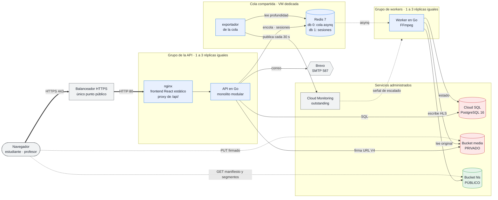
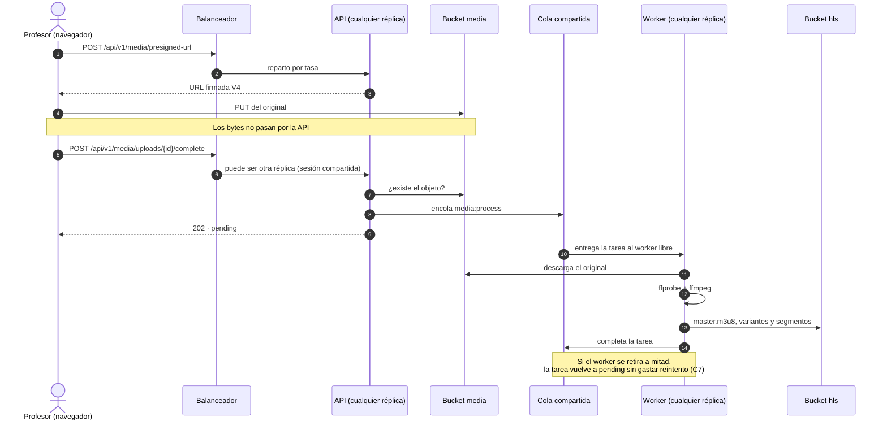

# Arquitectura de la Plataforma MOOC — Entrega 3: aplicación elástica IaaS

Describe **la solución efectivamente desplegada** en `plataforma-mooc-entrega2`
(GCP, región `us-east1`), no un diseño previsto. Cada dato sale del código de
infraestructura en [`infra/terraform/`](../../infra/terraform/) o de una
evidencia de [`evidencias/`](./evidencias/), y va enlazado.

| Sección | Qué cubre | Issue |
| :--- | :--- | :--- |
| [1](#1-servicios-del-proveedor) | Qué servicio de GCP satisface cada capacidad | I1 (#231) |
| [2](#2-modelo-de-componentes) | Modelo de componentes y comunicaciones | I1 (#231) |
| [3](#3-modelo-de-despliegue) | Modelo de despliegue: red, balanceador, grupos, persistencia y accesos | I1 (#231) |
| [4](#4-cambios-frente-a-la-entrega-2) | Cambios frente a la Entrega 2, componente por componente | I1 (#231) |
| [5](#5-decisiones-de-escalamiento) | Decisiones de escalamiento | I2 (#232) |
| [6](#6-operación-y-recuperación) | Operación y recuperación | I2 (#232) |
| [7](#7-capacidad-costo-y-limitaciones) | Capacidad, costo y limitaciones | I2 (#232) |

> **Los diagramas son Mermaid embebido, y el bloque de código es el archivo
> fuente** (§8): se versiona, se revisa en un `diff` y GitHub lo renderiza. Es la
> misma convención de la Entrega 2.

---

## 1. Servicios del proveedor

| Capacidad del enunciado | Servicio de GCP | Recurso desplegado |
| :--- | :--- | :--- |
| Punto de entrada HTTPS | Application Load Balancer externo **global** | `mooc-lb-ip`, `mooc-lb-cert`, `mooc-api-backend` ([`load_balancer.tf`](../../infra/terraform/load_balancer.tf)) |
| Grupo de la API, 1–3 instancias | Compute Engine, grupo administrado zonal + autoescalador | `mooc-api-group`, `mooc-api-autoscaler` ([`api_group.tf`](../../infra/terraform/api_group.tf), [`api_autoscaler.tf`](../../infra/terraform/api_autoscaler.tf)) |
| Grupo de workers, 1–3 instancias | Compute Engine, grupo administrado zonal + autoescalador | `mooc-worker-group`, `mooc-worker-autoscaler` ([`worker_group.tf`](../../infra/terraform/worker_group.tf), [`worker_autoscaler.tf`](../../infra/terraform/worker_autoscaler.tf)) |
| Cola compartida fuera de los grupos | *VM dedicada, no servicio administrado* | `mooc-queue-server`, Redis 7 con AOF ([`queue.tf`](../../infra/terraform/queue.tf)) |
| Base de datos relacional administrada | Cloud SQL para PostgreSQL 16 | `mooc-db-1` ([`database.tf`](../../infra/terraform/database.tf)) |
| Almacenamiento de objetos | Cloud Storage | `plataforma-mooc-entrega2-media` (privado) y `…-hls` (público) ([`storage.tf`](../../infra/terraform/storage.tf)) |
| Red privada, salida y firewall | VPC, Cloud NAT, Cloud Firewall | `mooc-vpc`, `mooc-subnet`, `mooc-nat` ([`network.tf`](../../infra/terraform/network.tf)) |
| Imágenes versionadas | Artifact Registry | repositorio `mooc`: `api`, `worker`, `web`, etiqueta = SHA del commit |
| Secretos | Secret Manager | `db-password`, `smtp-password` |
| Señal de escalado de los workers | Cloud Monitoring, métrica personalizada | `custom.googleapis.com/mooc/queue/outstanding` |
| Administración | Identity-Aware Proxy (túnel TCP) | SSH solo desde `35.235.240.0/20` |
| Correo saliente | *Proveedor externo* | Brevo, SMTP 587 con STARTTLS |

La cola es una VM y no Memorystore: el enunciado admite «una instancia dedicada o
un servicio compatible», y la VM es el camino de menos coste y menos cambios
desde la Entrega 2 (B1, [`evidencias/B1/`](./evidencias/B1/README.md)).

---

## 2. Modelo de componentes

### 2.1 Vista general

Lo que cambia frente a la Entrega 2 se ve en dos sitios. **Las réplicas de API y
de workers son intercambiables**: ninguna guarda estado propio, porque todo lo
que comparten —sesiones, cola, datos y archivos— vive fuera de ellas (E1, E3). Y
**la cola ya no vive con los workers**: está en una máquina que ningún
autoescalador puede retirar.

Las dos flechas punteadas que salen del navegador siguen siendo el punto del
diseño de la Entrega 2: **los bytes de los archivos no atraviesan la API**.

### 2.2 Responsabilidades

| Componente | Responsabilidad | Código | Imagen |
| :--- | :--- | :--- | :--- |
| **Frontend** | Recorridos mínimos de estudiante y profesor; versión del build visible en el pie y en `/version.json`. Sesión solo por cookie `HttpOnly`: el cliente nunca guarda el token (D1) | [`frontend/`](../../frontend/) (React + Vite + TypeScript) | `web` = nginx con el build |
| **API** | Monolito modular: un proceso, separación por paquetes (tabla siguiente). Autoriza y firma; no transcodifica | [`cmd/api`](../../cmd/api/), `internal/*` | `api` |
| **Workers** | Consumen `media:process` de la cola compartida: audio y vídeo pasan a HLS con FFmpeg; documentos e imágenes se validan en el bucket sin generar derivados (nota 16). Actualizan el estado del recurso y drenan ordenadamente al retirarse (C7) | [`cmd/worker`](../../cmd/worker/), `internal/worker`, `internal/transcode` | `worker` |
| **Cola** | Redis 7 como servicio del sistema, con AOF. Base 0: tareas de asynq. Base 1: sesiones. También limitador de tasa y claves de idempotencia | [`queue_startup.sh`](../../infra/terraform/queue_startup.sh) | — (paquete de Debian) |
| **Exportador de la cola** | Lee `pending` y `active` y publica `outstanding` = `pending` + `active` en Cloud Monitoring cada 30 s: es la señal del autoescalador de workers (nota 42) | [`cmd/queue-exporter`](../../cmd/queue-exporter/) | `worker` (mismo binario empaquetado) |
| **Base de datos** | Estado académico: usuarios, cursos, estructura, inscripciones, intentos, progreso, recursos y auditoría | migraciones en [`scripts/migrate.sh`](../../scripts/migrate.sh) | — (Cloud SQL) |
| **Almacenamiento de objetos** | Originales, documentos y miniaturas (privado); derivados HLS (público) | [`internal/storage`](../../internal/storage/) | — (Cloud Storage) |

Módulos de la API, sin cambios de frontera desde la Entrega 2:

| Paquete | Responsabilidad |
| :--- | :--- |
| `internal/auth` | Registro, verificación de correo, sesiones, contraseñas |
| `internal/admin` | Usuarios y cambios de rol |
| `internal/course` · `internal/structure` | Cursos y su publicación; módulos, unidades y recursos |
| `internal/enrollment` · `internal/quiz` · `internal/progress` | Inscripciones; cuestionarios y calificación; avance e insignias |
| `internal/media` | URLs firmadas de carga y lectura, confirmación y encolado |
| `internal/domain` | Entidades y reglas, sin dependencias de infraestructura |
| `internal/postgres` · `internal/storage` · `internal/cache` · `internal/mailer` | Adaptadores: repositorios, Cloud Storage, Redis, SMTP |

`internal/http` registra **57 rutas**, verificadas contra el despliegue en
[`VERIFICACION_ENDPOINTS.md`](./VERIFICACION_ENDPOINTS.md). Cada respuesta lleva
`X-Instance-ID`, un resumen del ID de la instancia que atendió (A2): es lo que
permite demostrar el reparto entre réplicas sin publicar la topología.

### 2.3 Comunicaciones

| # | Origen → destino | Mecanismo | Naturaleza |
| ---: | :--- | :--- | :--- |
| 1 | Navegador → balanceador | HTTPS 443, certificado administrado por Google; el 80 redirige con 301 | Síncrona |
| 2 | Balanceador → nginx de una réplica | HTTP 80 dentro de la VPC, reparto por tasa (`RATE`) | Síncrona |
| 3 | nginx → API | HTTP en la red de Compose de la misma VM; `/api/` al contenedor `api`, el resto es el frontend estático | Síncrona |
| 4 | API → Cloud SQL | PostgreSQL 5432 por IP privada, `ENCRYPTED_ONLY` | Síncrona |
| 5 | API → cola | TCP 6379 por la VPC: encolar, sesiones, limitador, idempotencia | Síncrona |
| 6 | Cola → worker | asynq, tarea `media:process` | **Asíncrona** |
| 7 | Worker → Cloud SQL | PostgreSQL 5432 por IP privada | Síncrona |
| 8 | API · worker → Cloud Storage | HTTPS con la cuenta de servicio de la instancia, por Private Google Access | Síncrona |
| 9 | Navegador → Cloud Storage | HTTPS: URL firmada V4 para subir, lectura pública para HLS | Síncrona, **sin la API** |
| 10 | Exportador → Cloud Monitoring | `CreateTimeSeries` sobre `generic_node`, cada 30 s | **Asíncrona** respecto a la aplicación |
| 11 | Cloud Monitoring → autoescalador de workers | lectura de `outstanding` con filtro | **Asíncrona** |
| 12 | Balanceador → cada réplica | comprobación de salud `GET /api/v1/ready` | Síncrona, periódica |
| 13 | API → Brevo | SMTP 587 con STARTTLS, por Cloud NAT | Síncrona |

### 2.4 El flujo asíncrono con réplicas

Las dos llamadas del profesor pueden caer en réplicas distintas y el flujo no
lo nota: la sesión vive en la cola compartida y el recurso en la base (E1).

---

## 3. Modelo de despliegue

### 3.1 Topología

Para que el dibujo se lea, faltan dos cosas que valen para todas las máquinas:
la salida a internet va por Cloud NAT (§3.2) y todas, incluida la cola, se
administran por IAP. La cola y el generador también escriben en Monitoring.

Todas las instancias de aplicación están en **una sola zona**, `us-east1-b`: el
enunciado no exige alta disponibilidad multizonal, y la zona única evita tráfico
entre zonas. El generador va en **otra zona** a propósito, para que sus recursos
no compitan con los de la aplicación (G1).

### 3.2 Red

| Elemento | Valor | Para qué |
| :--- | :--- | :--- |
| VPC | `mooc-vpc`, modo personalizado | Un solo espacio privado para todos los componentes |
| Subred | `mooc-subnet`, `10.0.1.0/24`, Private Google Access activado | Las instancias sin IP pública llegan a Artifact Registry, Secret Manager, Storage y Monitoring |
| Rango para servicios administrados | `mooc-private-ip-alloc`, `/20`, peering de Service Networking | La IP privada de Cloud SQL |
| Salida a internet | `mooc-router` + `mooc-nat`, IP automáticas, `min_ports_per_vm = 2048` | Paquetes del sistema, GitHub, Brevo y el tráfico del generador hacia el balanceador; ninguna instancia tiene IP externa. Los 2 048 puertos por VM vienen de G3: con los 64 por omisión el generador agotaba el NAT (nota 57) |
| IP interna fija de la cola | `mooc-queue-ip` | La cola no cambia de dirección al reiniciarse; las plantillas la llevan en su metadata |

### 3.3 Balanceador y verificaciones de salud

| Parámetro | Valor |
| :--- | :--- |
| Tipo | Application Load Balancer externo **global**, esquema `EXTERNAL_MANAGED` |
| Dirección | `mooc-lb-ip`, IPv4 global reservada |
| Dominio y certificado | `<IP>.sslip.io`, certificado administrado por Google `mooc-lb-cert` (nota 38) |
| Política TLS | `mooc-api-tls`: TLS 1.2 como mínimo, perfil `MODERN`. Sin ella el balanceador aceptaba TLS 1.1; lo detectó el barrido de F1 |
| Reglas de reenvío | `mooc-api-https` (443 → proxy HTTPS) y `mooc-api-http` (80 → redirección 301 a HTTPS). Se crean solo con `lb_enabled=true` |
| Backend | `mooc-api-backend`, HTTP por el puerto con nombre `http` (80), `timeout_sec = 60` |
| Política de distribución | `balancing_mode = RATE`, `max_rate_per_instance = 100` pet/s: la capacidad declarada que usa el autoescalador de la API (C2) |
| Drenaje de conexiones | 60 s al retirar una réplica |
| Registro | 100 % de las peticiones en Cloud Logging |
| Salud del backend | `mooc-api-ready`: `GET /api/v1/ready` en el 80; cada 10 s, timeout 5 s, sana tras 2 aciertos, no sana tras 3 fallos |

`/api/v1/ready` comprueba la base y que la instancia terminó de arrancar; no la
tumba un fallo de otra réplica (nota 19). El frontend sale por el mismo backend:
nginx sirve el build y reenvía `/api/` a la API de la misma máquina, así que **la
interfaz y la API comparten origen** y no hace falta CORS (D1, nota 46).

### 3.4 Grupos de instancias

Las políticas de escalado y sus razones están en el §5. Aquí, lo que cada grupo
**es**:

| | `mooc-api-group` | `mooc-worker-group` |
| :--- | :--- | :--- |
| Plantilla | `mooc-api-*` | `mooc-worker-*` |
| Máquina | `e2-highcpu-2` · 2 vCPU · 2 GiB | `e2-highcpu-2` · 2 vCPU · 2 GiB |
| Disco | 30 GiB `pd-balanced`, Debian 12 | 30 GiB `pd-balanced`, Debian 12 |
| Zona | `us-east1-b` | `us-east1-b` |
| Mínimo · máximo | 1 · 3 | 1 · 3 |
| Señal de escalado | peticiones por instancia en el balanceador, objetivo 0,8 × 100 | `outstanding` de la cola, 2 por instancia |
| Etiquetas de red | `mooc-api-node`, `allow-iap-ssh` | `mooc-worker-node`, `allow-iap-ssh` |
| Cuenta de servicio | `sa-web-server` | `sa-worker-server` |
| Contenedores | `proxy` (imagen `web`: nginx + frontend) y `api` | `worker` |
| Unidad de arranque | `mooc-web.service` | `mooc-worker.service` |
| Autohealing | `/api/v1/ready`, retraso inicial 300 s | `/readyz` en el 9090, retraso inicial 420 s |
| Actualización | `PROACTIVE`, `REPLACE`, `max_surge = 1`, `max_unavailable = 0` | igual |
| Arranque medido | **62–66 s** del guion de arranque a `LISTO` (B3) | **102 s** de la creación a consumir de la cola (C5) |

Una instancia nueva arranca **sin intervención**: la plantilla lleva
[`mooc-bootstrap.sh`](../../infra/bootstrap/mooc-bootstrap.sh) como guion de
arranque, que lee el rol, la etiqueta de imagen, la IP de la base y la de la cola
de la metadata; saca la contraseña de Secret Manager; fija el repositorio en el
mismo commit que la imagen; aplica las migraciones con un *advisory lock* para
que solo una réplica las ejecute ([`mooc-migrate.sh`](../../infra/bootstrap/mooc-migrate.sh),
A3), y levanta los contenedores (B3). Todas las réplicas de un grupo corren la
misma imagen porque la etiqueta va en la plantilla, y es el SHA completo del
commit.

### 3.5 Cola compartida

| | |
| :--- | :--- |
| Máquina | `mooc-queue-server`, `e2-small`, 10 GiB `pd-balanced`, `us-east1-b`, **fuera de los dos grupos** |
| Servicio | Redis 7 como servicio del sistema; `appendonly yes`, `maxmemory 1400mb`, `maxmemory-policy noeviction` |
| Quién la alcanza | solo las cuentas `sa-web-server` y `sa-worker-server`, por la regla `mooc-allow-queue` (6379) |
| Exportador | contenedor `mooc-queue-exporter` (unidad de systemd), publica la señal de los workers |
| Si se reinicia | conserva disco y AOF: las tareas encoladas siguen ahí |

Es el **punto único de fallo** que queda en la arquitectura y está declarado: si
cae, la API no puede encolar trabajos, las peticiones con clave de idempotencia
se rechazan con 503 en vez de arriesgar un doble efecto, las sesiones caen a su
respaldo en PostgreSQL, y los workers se declaran no sanos a la vez (notas 41 y
52). El enunciado no exige redundancia de la cola; el §7 lo
retoma.

### 3.6 Persistencia

| | Cloud SQL | Bucket `…-media` | Bucket `…-hls` |
| :--- | :--- | :--- | :--- |
| Qué guarda | Todo el estado académico | `originals/`, `documents/`, `thumbnails/` | `hls/<recurso>/…` |
| Configuración | PostgreSQL 16, `db-custom-1-3840` (1 vCPU, 3,75 GiB), zonal, SSD 10 GiB con autoaumento a 20 | Acceso uniforme, `public_access_prevention = enforced` | Lectura pública por diseño |
| Acceso de red | Solo IP privada, `ENCRYPTED_ONLY`, sin redes autorizadas | HTTPS; escribe el navegador con la URL firmada que emite la API; lee el worker | HTTPS; escribe solo el worker |
| Copias | Diarias a las 03:00 UTC, 3 retenidas, PITR de 3 días | — | — |
| Compartida por | Las réplicas de los dos grupos | Las réplicas de los dos grupos | Los workers y los navegadores |

Ninguna instancia de los grupos guarda estado en su disco: `worker_scratch` es
espacio de trabajo que se limpia por trabajo, también si se interrumpe (nota 50).
Por eso el autoescalador puede retirar cualquier réplica.

### 3.7 Reglas de acceso

Firewall de `mooc-vpc`, completo. **No queda ninguna regla con origen
`0.0.0.0/0`**, y ninguna instancia tiene IP externa: desde internet solo se
alcanza el balanceador (F1).

| Regla | Origen | Destino | Puerto | Para qué |
| :--- | :--- | :--- | :--- | :--- |
| `mooc-allow-lb-health` | `130.211.0.0/22`, `35.191.0.0/16` | etiqueta `mooc-api-node` | 80/tcp | Balanceador y su comprobación de salud hacia la API |
| `mooc-allow-worker-health` | `130.211.0.0/22`, `35.191.0.0/16` | etiqueta `mooc-worker-node` | 9090/tcp | Comprobación de salud del autohealing de workers |
| `mooc-allow-queue` | cuentas `sa-web-server`, `sa-worker-server` | cuenta `sa-queue-server` | 6379/tcp | Cola compartida |
| `mooc-allow-ssh-iap` | `35.235.240.0/20` | etiqueta `allow-iap-ssh` | 22/tcp | Administración por IAP |
| `mooc-allow-internal-icmp` | `10.0.1.0/24` | toda la subred | ICMP | Diagnóstico; no abre puertos de servicio |

Cada componente tiene su cuenta de servicio (`sa-web-server`, `sa-worker-server`,
`sa-queue-server` y, durante las pruebas, `sa-load-generator`) y ninguna usa
llaves: toman credenciales del servidor de metadatos. Los permisos de cada una,
recortados al mínimo, están en F2 ([`evidencias/F2/`](./evidencias/F2/)); la
superficie de red verificada desde fuera, en F1
([`evidencias/F1/`](./evidencias/F1/README.md)).

---

## 4. Cambios frente a la Entrega 2

| Componente | Entrega 2, desplegado | Entrega 3, desplegado | Dónde se ve |
| :--- | :--- | :--- | :--- |
| **API** | Una VM fija, `mooc-web-server` (`e2-highcpu-2`) | Grupo administrado `mooc-api-group`, 1–3 réplicas, autoescalado por peticiones por instancia | C1, C2, G5 |
| **Acceso a la API** | nginx en la VM con certificado de Let's Encrypt y la regla `mooc-allow-web-ingress` abierta a internet | Balanceador externo global con certificado administrado, redirección 80 → 443 y comprobación de salud `/api/v1/ready`. La regla abierta a internet se retiró | C3, C4, F1 |
| **Inicialización** | Despliegue a mano sobre una VM ya configurada | Guion de arranque en la plantilla, sin acceso manual; migraciones una vez por versión con *advisory lock*; tiempo de arranque registrado | A3, B3 |
| **Workers** | Una VM fija, `mooc-worker-server` | Grupo administrado `mooc-worker-group`, 1–3 réplicas, autoescalado por trabajos pendientes; retiro con drenaje | C5, C6, C7 |
| **Cola** | Redis en un contenedor del Worker Server: retirar el worker se llevaba la cola | Redis en `mooc-queue-server`, fuera de los dos grupos, con AOF y acceso por cuenta de servicio | B1 |
| **Frontend** | No existía | React servido por nginx en las réplicas de la API, mismo origen, versión visible; recorridos de estudiante y profesor en la nube | D1–D5 |
| **Persistencia** | Cloud SQL y buckets, usados por dos VMs | Los mismos servicios, compartidos por todas las réplicas; sesiones e idempotencia en la cola compartida, sin cachés locales | E1, E2, E3 |
| **Red** | Dos VMs con IP pública | Ninguna IP pública salvo el balanceador; salida por Cloud NAT; regla interna abierta sustituida por reglas con propósito | B2, F1 |
| **Validación** | Caracterización de capacidad, con el escenario 2 medido contra Docker Compose | Hechos: línea base de la Entrega 2 medida de nuevo contra la nube (A7), generador externo en VM propia (G1), escenario 1 sobre la arquitectura elástica (G3) y ciclo de escalado de workers (G6). En curso: escenario 2 (G4), ciclo de la API (G5) e informe consolidado (G7) | A7, G1, G3–G7 |
| **Calidad y deuda técnica** | Sin línea base formal | SonarQube en la CI (H1), verificación de umbrales (H2) y primer documento de deuda técnica en [`deuda-tecnica.md`](./deuda-tecnica.md) (H3), hechos | H1–H3 |

**Estado al 2026-11-01:** las ocho primeras filas están desplegadas y
verificadas en sus evidencias, y la de calidad también está cerrada. Validación
tiene partes **en curso**: cuando cierren, sus resultados quedan en el informe de
capacidad (G7) y esta tabla se actualiza.

---

## 5. Decisiones de escalamiento

*Lo escribe I2 (#232): plantillas, arranque automático, políticas de ambos
grupos con sus parámetros efectivos, verificaciones de salud, consumo de la cola
y retiro seguro de workers.*

## 6. Operación y recuperación

*Lo escribe I2 (#232): despliegue, verificación, reconstrucción y retiro de
recursos, con el manejo de configuración y secretos.*

## 7. Capacidad, costo y limitaciones

*Lo escribe I2 (#232): configuración efectiva, estimación y consumo observado
(F3), puntos únicos de falla restantes y relación con las pruebas (G7).*

---

## 8. Archivos fuente de los diagramas

| Diagrama | Sección | Fuente |
| :--- | :--- | :--- |
| Vista general de componentes | §2.1 | bloque `mermaid` de este archivo |
| Flujo asíncrono con réplicas | §2.4 | bloque `mermaid` de este archivo |
| Topología de despliegue | §3.1 | bloque `mermaid` de este archivo |

Se editan aquí mismo y GitHub los renderiza. Para exportarlos a imagen:
`npx -y @mermaid-js/mermaid-cli -i docs/entrega3/arquitectura.md -o arquitectura.svg`,
que genera un SVG por bloque. Los saltos de línea dentro de los nodos van con
` `, nunca con `\n`, que Mermaid imprime literal.

Todos los diagramas corresponden a lo que declara `infra/terraform/` en `main`
a la fecha de este documento, aplicado y verificado en las evidencias que se
citan; ninguno dibuja algo previsto y no desplegado.

---

Este archivo no contiene credenciales, llaves ni secretos.
