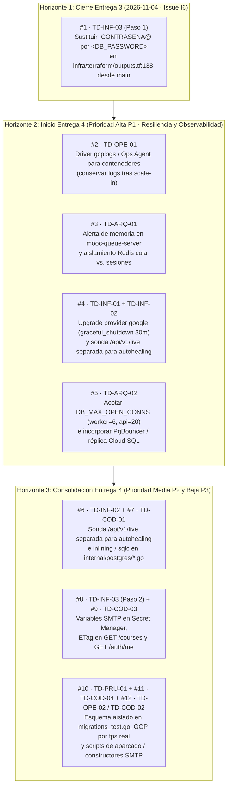

# Primer Documento de Deuda Técnica y Línea Base de Calidad — Entrega 3

**Bloque:** H — Calidad del código y deuda técnica  
**Issue:** H3 ([#230](https://github.com/ISIS4426-2026/Plataforma-MOOC/issues/230)) · **Rúbrica:** Documentación y deuda  
**Responsable:** `@DiegoOrtizRuiz`  
**Depende de:** C7 ([#210](https://github.com/ISIS4426-2026/Plataforma-MOOC/issues/210)), E1 ([#216](https://github.com/ISIS4426-2026/Plataforma-MOOC/issues/216)), F2 ([#220](https://github.com/ISIS4426-2026/Plataforma-MOOC/issues/220)), H1 ([#228](https://github.com/ISIS4426-2026/Plataforma-MOOC/issues/228)), H2 ([#229](https://github.com/ISIS4426-2026/Plataforma-MOOC/issues/229))  
**Desbloquea:** I3 ([#233](https://github.com/ISIS4426-2026/Plataforma-MOOC/issues/233)), I4 ([#234](https://github.com/ISIS4426-2026/Plataforma-MOOC/issues/234))  
**Fecha del diagnóstico:** `2026-11-01`

> [!NOTE]
> Este documento constituye el **primer ejercicio formal de identificación, medición y documentación de deuda técnica** del proyecto Plataforma MOOC. Su propósito es diagnosticar el estado real del código y de la arquitectura elástica efectivamente desplegada en Google Cloud Platform (`us-east1`), registrar la primera medición de referencia verificable en **SonarQube Cloud**, distinguir las correcciones ejecutadas durante este sprint frente a los compromisos pendientes que conforman la línea base final, y establecer un inventario priorizado con su plan de tratamiento para las siguientes etapas.

---

## Índice de Contenidos

1. [Alcance y método del diagnóstico](#1-alcance-y-método-del-diagnóstico)
2. [Resumen de la medición inicial y línea base verificable](#2-resumen-de-la-medición-inicial-y-línea-base-verificable)
3. [Correcciones realizadas durante este ejercicio](#3-correcciones-realizadas-durante-este-ejercicio)
4. [Inventario de deuda técnica identificada](#4-inventario-de-deuda-técnica-identificada)
5. [Registro completo de hallazgos Major o superiores abiertos](#5-registro-completo-de-hallazgos-major-o-superiores-abiertos)
6. [Priorización y plan de tratamiento](#6-priorización-y-plan-de-tratamiento)
7. [Reporte verificable del commit final y enlaces al pipeline](#7-reporte-verificable-del-commit-final-y-enlaces-al-pipeline)

---

## 1. Alcance y método del diagnóstico

### 1.1. Componentes revisados

El diagnóstico abarcó el **100 % del código total de aplicación** (API, workers y frontend), el esquema relacional, la infraestructura como código en Terraform, los mecanismos de inicialización y drenaje, las suites de prueba y la operación observada durante los experimentos de capacidad y autoescalamiento de la Entrega 3:

| Capa / Componente | Ubicación en el repositorio | Archivos productivos | Líneas productivas | Archivos de prueba | Líneas de prueba | Alcance funcional y arquitectónico revisado |
| :--- | :--- | ---: | ---: | ---: | ---: | :--- |
| **Contrato OpenAPI y embebido** | [`api/`](../../api/) (`openapi.yaml`, `embed.go`) | 1 (`.go`) + 1 (`.yaml`) | 14 (`.go`) + 1 889 (`.yaml`) | 0 | 0 | Especificación OpenAPI 3.1.0 de las 57 rutas expuestas por el servidor HTTP y su validación estática con Spectral. |
| **Puntos de entrada de backend y workers** | [`cmd/`](../../cmd/) (`api`, `worker`, `queue-exporter`, `seed-media`) | 4 | 1 479 | 0 | 0 | Arranque y apagado ordenado del servidor HTTP (`cmd/api`), motor consumidor `asynq` + `ffmpeg` (`cmd/worker`), exportador de señal de cola a Cloud Monitoring (`cmd/queue-exporter`) y sembrador multimedia (`cmd/seed-media`). |
| **Núcleo modular de aplicación (API y Workers)** | [`internal/`](../../internal/) (`admin`, `auth`, `cache`, `config`, `course`, `domain`, `enrollment`, `http`, `mailer`, `media`, `observability`, `postgres`, `progress`, `quiz`, `storage`, `structure`, `transcode`, `worker`) | 95 | 16 463 | 58 | 14 092 | Reglas de dominio académico, autenticación y sesiones distribuidas en Redis, control RBAC/CSRF/Rate-Limit/Idempotencia, repositorios PostgreSQL, adaptadores Cloud Storage/MinIO, transcodificación HLS con FFmpeg y drenaje de tareas asíncronas. |
| **Migraciones relacionales** | [`migrations/`](../../migrations/) (`000001` a `000008`) | 16 (`.sql`) | 462 (`.sql`) | 1 | 197 | Ocho migraciones reversibles (`.up.sql` / `.down.sql`), compatibilidad hacia atrás en despliegues rotativos y bloqueo transaccional `pg_advisory_xact_lock` en el arranque de instancias. |
| **Frontend web funcional** | [`frontend/src/`](../../frontend/src/) (`api/`, `auth/`, `components/`, `hooks/`, `lib/`, `pages/`, `professor/`, `student/`) | 35 | 3 726 | 4 | 196 | Aplicación SPA en React 19 + TypeScript + Vite servida por Nginx en el mismo origen del balanceador HTTPS, recorridos completos de estudiante y profesor, estados de carga/error y rechazo de autorización. |
| **Infraestructura como código y arranque** | [`infra/terraform/`](../../infra/terraform/), [`infra/bootstrap/`](../../infra/bootstrap/), `docker-compose.*.yml`, `nginx.*.conf` | 18 (`.tf`) + 5 (`bootstrap`) | 2 140 | — | — | Dos grupos administrados de instancias (`mooc-api-group` y `mooc-worker-group`, 1–3 instancias `e2-highcpu-2`), balanceador global HTTPS, VM dedicada de cola (`mooc-queue-server`), Cloud SQL (`mooc-db-1`), buckets GCS (`media` privado y `hls` público), Cloud NAT, reglas de firewall e identidades IAM. |
| **Guiones operativos, arneses E2E y campañas de carga** | [`scripts/`](../../scripts/), [`capacity-planning/`](../../capacity-planning/) | 38 | 7 820 | 1 | 94 | Arnés `scripts/e2e_cloud` (108 pasos, `X-Instance-ID` y reconciliación de trabajos), campañas JMeter y Go de los escenarios 1, 2, 3A y 3B, verificadores de seguridad (`b4`, `f2`), calidad (`h1`, `h2`, `h3`) y evidencias (`check_evidencias.sh`). |
| **Total bajo `sonar.sources` / `sonar.tests`** | `api,cmd,internal,frontend/src` / `internal,migrations,frontend/src` | **135** | **21 682** | **63** | **14 485** | **36 167 líneas de código de aplicación y pruebas analizadas en cada corrida del pipeline CI.** |

### 1.2. Herramientas utilizadas y configuración del pipeline

El diagnóstico combinó **seis herramientas automatizadas** integradas en el flujo de trabajo [`.github/workflows/ci.yml`](../../.github/workflows/ci.yml) y en los guiones de verificación del repositorio:

| Herramienta | Versión / Acción | Alcance evaluado | Perfil de reglas / Configuración | Evidencia de ejecución |
| :--- | :--- | :--- | :--- | :--- |
| **SonarQube Cloud (`SonarCloud`)** | `SonarSource/sonarqube-scan-action@v5` (`sonar-scanner-cli` 6.x) | Código total del proyecto (*Overall Code*): `api`, `cmd`, `internal`, `frontend/src` + cobertura LCOV y Go | Perfiles oficiales **Sonar way** para **Go**, **TypeScript / JavaScript** y **CSS** ([`sonar-project.properties`](../../sonar-project.properties)) | [`docs/entrega3/evidencias/H1/reporte_sonarcloud.json`](./evidencias/H1/reporte_sonarcloud.json) y [`docs/entrega3/evidencias/H3/reporte_sonarcloud_commit_final.json`](./evidencias/H3/reporte_sonarcloud_commit_final.json) |
| **`golangci-lint` + `go vet` + `gofmt`** | `v1.64.8` sobre Go `1.24` | Todos los paquetes Go (`./...`: `api/`, `cmd/`, `internal/`, `migrations/`, `scripts/`) | Reglas estáticas de concurrencia, manejo de errores, formato y análisis de flujo (`.golangci.yml` / `scripts/lint.sh`) | [`docs/entrega3/evidencias/H2/c_pruebas_y_make_check.txt`](./evidencias/H2/c_pruebas_y_make_check.txt) (`0 issues`) |
| **Stoplight `Spectral` CLI** | `@stoplight/spectral-cli` (`6.x`) | Contrato OpenAPI 3.1 en [`api/openapi.yaml`](../../api/openapi.yaml) | Reglas `oas` (operaciones, esquemas, seguridad, descripciones y parámetros) | [`docs/entrega3/evidencias/H2/b_resolucion_blockers_y_criticals.txt`](./evidencias/H2/b_resolucion_blockers_y_criticals.txt) (`0 warnings / 0 errors`) |
| **TypeScript + Vitest + Bundle Auditor** | `typescript ~5.8`, `vitest ^3.1`, `v8-to-lcov.mjs`, `check-bundle.mjs` | Frontend completo en `frontend/src/` y artefactos compilados en `frontend/dist/` | `tsc --noEmit` estricto, cobertura de líneas V8 $\rightarrow$ LCOV con `v8.takeCoverage()` y bloqueo de secretos/IPs privadas en el bundle | [`docs/entrega3/evidencias/H2/c_pruebas_y_make_check.txt`](./evidencias/H2/c_pruebas_y_make_check.txt) (`4 suites / 32 tests PASS`) |
| **Terraform CLI + Verificadores IAM/Secretos** | `Terraform v1.16.4`, `b4_barrido_secretos.sh`, `f2_identidades_y_secretos.sh` | Módulos HCL en `infra/terraform/`, plantillas de instancias, Dockerfiles, scripts e historial Git completo | `terraform fmt -check`, `terraform validate`, auditoría de mínimo privilegio en 4 cuentas de servicio y barrido de 7 familias de secretos | [`docs/entrega3/evidencias/F2/README.md`](./evidencias/F2/README.md) (`22 OK · 0 FALLA`) |
| **Arneses de Integridad, Escalamiento y Capacidad** | `scripts/e2e_cloud`, `e1_integridad_y_retiro.sh`, `capacity_criterios.py`, `g6_observar_escalamiento_workers.sh` | Despliegue real en GCP bajo tráfico concurrente, retiro de instancias y ciclos de autoescalado | 11 reglas de validez estadística de métricas (A6), reconciliación de cola Redis vs. PostgreSQL vs. GCS y medición de tiempos de reacción/arranque/drenaje | [`evidencias/C7/`](./evidencias/C7/README.md), [`evidencias/E1/`](./evidencias/E1/README.md), [`evidencias/E2/`](./evidencias/E2/README.md), [`evidencias/G6/`](./evidencias/G6/README.md) |

### 1.3. Justificación de las exclusiones en `sonar-project.properties`

Ninguna exclusión configurada en [`sonar-project.properties`](../../sonar-project.properties) retira código de aplicación de la API, de los workers ni del frontend. Cada uno de los 12 patrones responde a una razón técnica verificada automáticamente por [`scripts/h1_verificar_y_exportar_sonar.sh`](../../scripts/h1_verificar_y_exportar_sonar.sh):

| # | Patrón en `sonar.exclusions` | Propósito técnico |
| :---: | :--- | :--- |
| 1–3 | `**/*_test.go`, `frontend/src/**/*.test.ts`, `frontend/src/**/*.test.tsx` | **Separación `sources` vs `tests`**: En Go y en React/Vitest las pruebas conviven en las mismas carpetas que el código productivo. Como esos archivos están incluidos en `sonar.test.inclusions`, SonarQube exige excluirlos de `sonar.sources` para no abortar con `File can't be indexed twice` ([Nota Técnica #55](./NOTAS_TECNICAS.md#55)). Siguen siendo analizados íntegramente como tests. |
| 4–7 | `frontend/node_modules/**`, `frontend/dist/**`, `frontend/coverage/**`, `bin/**` | **Dependencias de terceros y artefactos generados**: Paquetes NPM externos, código transpilado/minificado por Vite, reportes LCOV y ejecutables compilados de Go. |
| 8–10 | `docs/**`, `capacity-planning/**`, `scratch/**` | **Documentación, evidencias e insumos sintéticos**: Documentos Markdown, resultados `.jtl` de JMeter, colecciones Postman y vídeos `.mp4` generados para las campañas de carga. |
| 11–12 | `scripts/**`, `infra/**` | **Guiones de laboratorio e IaC**: Scripts de orquestación de campañas y módulos de Terraform (validados por su propio job `Terraform Format & Validate` en CI y por `f2_identidades_y_secretos.sh`), evitando que avisos estilísticos de shell (`shell:S7688`) distorsionen la métrica de mantenibilidad del código de aplicación. |

### 1.4. Actividades de revisión realizadas por el equipo y equivalencia de severidades

El método de diagnóstico se ejecutó en **cuatro fases** complementarias, ya que un analizador estático por sí solo no detecta compromisos arquitectónicos, cuellos de botella de escalamiento ni riesgos operativos:

1. **Fase 1 — Barrido base automatizado e integración de cobertura (H1, [#228](./evidencias/H1/README.md))**: Configuración de SonarQube Cloud en GitHub Actions sobre el repositorio completo, desactivación de *Automatic Analysis* para permitir la ingesta de `coverage.out` (Go) y `frontend/coverage/lcov.info` (TypeScript/React), y captura del primer reporte base verificable (`ceecb01`).
2. **Fase 2 — Triaje, auditoría manual de código y resolución de hallazgos prioritarios (H2, [#229](./evidencias/H2/README.md))**: Revisión línea por línea de los hallazgos `Blocker`, `Critical` y `Major`. Se resolvieron mediante 4 commits atómicos (`868e43d`, `bde3686`, `28967df`, `d469eb6`) más el ajuste de cobertura V8 en *worker threads* (`48a304a`) todos los hallazgos prioritarios reales, y se auditaron manualmente las 33 consultas SQL reportadas por `go:S2077` en `internal/postgres/*.go`.
3. **Fase 3 — Revisión transversal de arquitectura, infraestructura, pruebas y operación (Bloques A–G)**: Consolidación de las limitaciones y compromisos técnicos documentados empíricamente por el equipo en las **56 entradas de [`docs/entrega3/NOTAS_TECNICAS.md`](./NOTAS_TECNICAS.md)** y en las evidencias de retiro de instancias ([`C7`](./evidencias/C7/README.md), [`E1`](./evidencias/E1/README.md)), consistencia concurrente ([`E2`](./evidencias/E2/README.md)), mínimo privilegio IAM ([`F2`](./evidencias/F2/README.md)) y pruebas de carga y autoescalamiento ([`A7`](./evidencias/A7/COMPARACION.md), [`G1`](./evidencias/G1/README.md), [`G6`](./evidencias/G6/README.md)).
4. **Fase 4 — Clasificación unificada, priorización y plan de tratamiento (H3, [#230](./evidencias/H3/README.md))**: Homologación de todos los hallazgos bajo la tabla de equivalencia de severidades del proyecto y estructuración de cada ítem del inventario con los 8 campos obligatorios del enunciado.

#### Tabla de equivalencia entre clasificaciones de severidad

| Severidad SonarQube (Estándar) | Severidad SonarQube (Clean Code / MQR) | Tipo en SonarQube | Equivalencia en `golangci-lint` / `Spectral` | Taxonomía del Proyecto ([`REPORTE_BUGS_Y_CALIDAD_ETAPA.md`](../e2e/REPORTE_BUGS_Y_CALIDAD_ETAPA.md)) | Regla de atención aplicada en la Entrega 3 |
| :--- | :--- | :--- | :--- | :--- | :--- |
| **`BLOCKER`** | `Blocker` / `High` | `BUG`, `VULNERABILITY`, `CODE_SMELL` | `error` (bloquea `make lint`) | **CRÍTICA (`Blocker / P0`)** | **Resolución obligatoria antes del cierre** con commit y prueba automatizada, o plan explícito documentado con pasos, responsable y plazo. |
| **`CRITICAL`** | `High` | `BUG`, `VULNERABILITY`, `CODE_SMELL` | `error` (seguridad o `go vet`) | **CRÍTICA (`Blocker / P0`)** | **Resolución obligatoria antes del cierre** con commit y prueba automatizada, o plan explícito documentado con pasos, responsable y plazo. |
| **`MAJOR`** | `Medium` | `BUG`, `VULNERABILITY`, `CODE_SMELL` | `warning` funcional o estructural | **ALTA (`Major / P1`)** (defecto real o SPOF operativo) / **MEDIA (`Moderate / P2`)** (smell estructural o consulta SQL parametrizada con constantes) | Resolver en el sprint (como `typescript:S9383` y `typescript:S8786`) o **registrar obligatoriamente en este documento** con regla, ubicación, impacto y motivo de aplazamiento. |
| **`MINOR`** | `Low` | `CODE_SMELL`, `VULNERABILITY` menor | `warning` no bloqueante en `Spectral` | **BAJA (`Minor / P3`)** | Atender cuando es inmediato (como `BUG-DOC-008` en `api/openapi.yaml`) o registrar como compromiso técnico acotado (`go:S5332` para Mailpit local). |
| **`INFO`** | `Info` | Informativo | `info` / `hint` | **Informativo** | Trazabilidad en notas técnicas o comentarios de código. |

---

## 2. Resumen de la medición inicial y línea base verificable

### 2.1. Verificación de los indicadores obligatorios de la Entrega 3

Los indicadores fueron medidos por **SonarQube Cloud** sobre el proyecto [`ISIS4426-2026_Plataforma-MOOC`](https://sonarcloud.io/project/overview?id=ISIS4426-2026_Plataforma-MOOC) y exportados de forma verificable desde la Web API de SonarCloud:

| Indicador exigido | Requisito de la Entrega 3 | Primera medición de referencia (barrido global `ceecb01`) | Estado en la línea base final (código de aplicación `sonar.sources` tras H1/H2) | Unidad y escala de medición | Veredicto |
| :--- | :--- | :--- | :--- | :--- | :---: |
| **Duplicación de código** (`duplicated_lines_density`) | **Máximo `20.0 %`** ($\le 20\%$) | **`0.8 %`** (`751` líneas duplicadas en `48` bloques y `21` archivos sobre `90 488` líneas totales) | **`0.0 %`** en el código de aplicación (`api,cmd,internal,frontend/src`, `21 682` líneas productivas); **`0.8 %`** a nivel de repositorio global | **Porcentaje (`%`)**: $(\text{líneas duplicadas} / \text{líneas totales}) \times 100$ | ✅ **CUMPLE** ($19.2\text{ pp}$ de holgura) |
| **Mantenibilidad** (`sqale_rating`) | **Calificación `C` o mejor (`A`, `B` o `C`)** | **Calificación `A`** (`sqale_rating = 1.0`, `sqale_debt_ratio = 0.0 %`) | **Calificación `A`** (`sqale_rating = 1.0`, `sqale_debt_ratio = 0.0 %`) | **Escala ordinal `A`–`E`**: `A` (`1.0`, ratio $\le 5\%$), `B` (`2.0`, $6\text{–}10\%$), `C` (`3.0`, $11\text{–}20\%$), `D` (`4.0`, $21\text{–}50\%$), `E` (`5.0`, $> 50\%$) | ✅ **CUMPLE** (máxima calificación `A`) |
| **Deuda técnica total estimada (`sqale_index`)** | **Registrar valor, unidad e interpretación como primera medición de referencia** | **`664 minutos`** (`11 h 04 min` = `1 jornada laboral de 8 h + 3 h 04 min` en el barrido global sin exclusiones; **`60 minutos`** = `1 h 00 min` dentro del código de aplicación) | **`0 minutos`** de deuda de mantenibilidad (`CODE_SMELL`) en el código de aplicación (`api,cmd,internal,frontend/src`) tras resolver `typescript:S8786` en H2 | **Minutos (`min`)** de esfuerzo estimado de remediación de `CODE_SMELL` (`60 min = 1 h`, `480 min = 1 jornada laboral de 8 h`) | ✅ **REGISTRADO E INTERPRETADO** |
| **Esfuerzo total de remediación multi-dimensión en código de aplicación** ($\sum \text{effort}$ en `sonar.sources`) | Interpretación conjunta de Mantenibilidad + Confiabilidad + Seguridad | **`785 minutos`** (`13 h 05 min` = `1 jornada de 8 h + 5 h 05 min` sumando `39` hallazgos en `api,cmd,internal,frontend/src`) | **`690 minutos`** (`11 h 30 min` = `1 jornada de 8 h + 3 h 30 min`, tras resolver `95 min` de hallazgos reales en H2; restan `660 min` de `go:S2077` y `30 min` de `go:S5332`) | **Minutos (`min`)** sumando `CODE_SMELL` (`0 min`), `BUG` (`0 min`) y `VULNERABILITY` (`690 min` auditados) | ✅ **REGISTRADO E INTERPRETADO** |

### 2.2. Interpretación técnica de las métricas de referencia

1. **Significado y unidad de `sqale_index` y `sqale_debt_ratio` en SonarQube**:
   - Bajo el método **SQALE** (*Software Quality Assessment based on Lifecycle Expectations*), SonarQube mide la **deuda técnica de mantenibilidad (`sqale_index`)** exclusivamente en **minutos de trabajo de desarrollador (`min`)** sumando el costo estimado de remediación de cada `CODE_SMELL` abierto. Para presentar el valor en la interfaz web, SonarQube aplica la conversión estándar de **`1 hora = 60 minutos`** y **`1 día laboral (1d) = 8 horas = 480 minutos`**.
   - El **ratio de deuda técnica (`sqale_debt_ratio`)** divide `sqale_index` entre el costo estimado de construir el código desde cero ($30\text{ min por cada } 1\,000\text{ líneas de código neto NCLOC}$). Con `72 544 NCLOC` en el barrido global inicial, el denominador de desarrollo equivale a $72.544 \times 30 = 2\,176.3\text{ horas}$ ($130\,579\text{ min}$), por lo que $664 / 130\,579 = 0.51\% \approx 0.0\text{–}0.5\%$, muy por debajo del techo del $5.0\%$ que define la **Calificación `A`**.
2. **Por qué es indispensable separar el barrido global inicial (`664 min`) del código de aplicación (`60 min → 0 min`)**:
   - En el primer barrido sobre el commit `ceecb01` (antes de que la exclusión de `scripts/**`, `infra/**` y `docs/**` quedara activa en la rama principal), de los `664 minutos` de `sqale_index` (`291` code smells), **`604 minutos` (`91.0 %`)** provenían de scripts operativos de shell en `scripts/` (`287` ocurrencias de la regla estilística `shell:S7688` —uso de `[` POSIX frente a `[[` de Bash, a `2 min` cada una = `574 min`— y `1` ocurrencia de `go:S1313` de `30 min` en un guion de prueba).
   - Dentro del **código de aplicación real (`api,cmd,internal,frontend/src`)** sólo existían **`3` `CODE_SMELL`** por un total de **`60 minutos` (`1 h 00 min`)**: tres expresiones regulares en el frontend (`typescript:S8786` en `config.ts`, `runtime.ts` y `lib/markdown.tsx`, `20 min` cada una). Al sustituirlas en H2 (commit `bde3686`) por funciones deterministas de recorrido lineal $O(n)$, la deuda de mantenibilidad (`CODE_SMELL`) del código de aplicación quedó en **`0 minutos`**.
3. **Interpretación del esfuerzo remanente en la dimensión de Seguridad (`690 min` en `sonar.sources`)**:
   - Además de `sqale_index` (`CODE_SMELL`), SonarQube contabiliza por separado el esfuerzo de remediación de las reglas clasificadas como `BUG` y `VULNERABILITY`.
   - Tras resolver en H2 el único `BLOCKER` del código de aplicación (`secrets:S8215` en `internal/auth/service.go:23`, `30 min`) y el único `MAJOR BUG` (`typescript:S9383` en `frontend/src/student/StudentData.tsx:35`, `5 min`), los **`690 minutos` (`11 h 30 min`)** que permanecen abiertos en el código de aplicación corresponden íntegramente a:
     - **`33` ocurrencias `MAJOR` de `go:S2077` (`33 × 20 min = 660 min`)** en `internal/postgres/*.go`: el analizador marca como potencialmente insegura toda cadena SQL armada con el operador `+`, sin distinguir que el operando concatenado es una **constante de paquete en tiempo de compilación** (`userColumns`, `courseColumns`, `moduleColumns`, `unitColumns`, `resourceColumns`, `snapshotExpr`) y que el **100 % de los datos de entrada viaja parametrizado en `args...` con placeholders posicionales `$1..$n`**. No existe vulnerabilidad de inyección SQL explotable; se registra como deuda de código (`TD-COD-01`) porque el ruido estático dificulta auditar futuros cambios en los repositorios.
     - **`1` ocurrencia `MINOR` de `go:S5332` (`30 min`)** en `internal/mailer/smtp.go:89`: corresponde al soporte deliberado de conexión sin cifrado únicamente cuando no se configuran credenciales (`m.username == ""`), necesario para las pruebas E2E locales contra el contenedor `mailpit`, mientras que en producción (`m.username != ""`) el código exige `STARTTLS` con TLS $\ge 1.2$ o TLS implícito (`TD-COD-02`).
4. **Interpretación de la baja duplicación (`0.8 %` global / `0.0 %` en aplicación)**:
   - La arquitectura de monolito modular en Go (`internal/<módulo>`) con adaptadores explícitos (`internal/postgres`, `internal/storage`, `internal/cache`) y componentes reutilizables en React (`frontend/src/components`, `frontend/src/lib`) mantiene **`0` bloques duplicados dentro del código de aplicación**. Los `48` bloques duplicados (`751` líneas, `0.8 %`) del barrido global se concentran en estructuras repetidas de los guiones de campaña y semillas en `scripts/`.

---

## 3. Correcciones realizadas durante este ejercicio

Siguiendo la instrucción del enunciado (*«Correcciones realizadas durante este ejercicio, si las hubo: descripción, commit y evidencia de verificación; distinguirlas de los pendientes que integran la línea base final»*), en esta sección se documentan las **correcciones efectivamente aplicadas y verificadas durante la Entrega 3**, las cuales **quedan cerradas y no forman parte de los pendientes de la línea base final**.

### 3.1. Correcciones de calidad de código, seguridad estática y contrato ejecutadas en el Bloque H (H1 y H2)

| ID Corrección | Origen / Regla | Severidad inicial | Componente y archivo modificado | Descripción técnica de la corrección aplicada | Commit | Evidencia de verificación y pruebas |
| :--- | :--- | :---: | :--- | :--- | :---: | :--- |
| **`CORR-H1-01`** | [Nota Técnica #15](./NOTAS_TECNICAS.md#15) (Obsolescencias de CI en GitHub Actions) | Media (Operación CI) | [`.github/workflows/ci.yml`](../../.github/workflows/ci.yml) | Se fijaron los 4 trabajos (`terraform`, `ci`, `frontend`, `sonarqube`) en el runner explícito `ubuntu-24.04` (evitando roturas por la migración automática de `ubuntu-latest` a Ubuntu 26) y se actualizaron `actions/checkout@v4` $\rightarrow$ `v5` y `hashicorp/setup-terraform@v3` $\rightarrow$ `v4` para eliminar los avisos de deprecación de Node.js 20. | `90647b0` | [`docs/entrega3/evidencias/H1/b_pipeline_y_secretos.txt`](./evidencias/H1/b_pipeline_y_secretos.txt) (`27 OK · 0 FALLA`). |
| **`CORR-H2-01`** | `secrets:S8215` (SonarQube Cloud) | **CRÍTICA** (`BLOCKER VULNERABILITY`, `30 min`) | [`internal/auth/service.go`](../../internal/auth/service.go#L17-L22), [`internal/auth/password.go`](../../internal/auth/password.go#L25-L37), [`internal/auth/service_test.go`](../../internal/auth/service_test.go#L383-L395) | Se eliminó la constante literal `dummyHash = "$2a$10$..."` del código fuente y se sustituyó por `mustGenerateDummyHash()`, que deriva el hash bcrypt en el arranque del paquete con `bcrypt.DefaultCost`. Elimina el hallazgo `Blocker` y garantiza que el escudo contra ataques de temporización (*timing shield*) en logins de correos inexistentes tenga siempre el mismo factor de costo que las cuentas reales. | `868e43d` | Prueba unitaria nueva `TestLoginUnknownEmailRunsTimingShieldWithoutHardcodedHash` (`PASS`) en [`docs/entrega3/evidencias/H2/c_pruebas_y_make_check.txt`](./evidencias/H2/c_pruebas_y_make_check.txt). |
| **`CORR-H2-02`** | `typescript:S9383` (SonarQube Cloud) | **ALTA** (`MAJOR BUG`, `5 min`) | [`frontend/src/student/StudentData.tsx:35`](../../frontend/src/student/StudentData.tsx#L33-L37) | Se antepuso explícitamente el operador `void` a la invocación de la función asíncrona autoejecutada `void (async () => { ... })()` dentro del hook `useEffect`, satisfaciendo la regla `no-floating-promises` mientras el bloque `try/catch` interno gestiona los errores de red y estado. | `bde3686` | `npm run test:coverage && npm run build` (`tsc --noEmit && vite build`: `0 errores`). |
| **`CORR-H2-03`** | `typescript:S8786` × 3 (SonarQube Cloud) | **ALTA** (`3 × MAJOR CODE_SMELL`, `60 min`) | [`frontend/src/config.ts:6`](../../frontend/src/config.ts#L5-L15), [`frontend/src/runtime.ts:24`](../../frontend/src/runtime.ts#L23-L34), [`frontend/src/lib/markdown.tsx:24-98`](../../frontend/src/lib/markdown.tsx#L24-L98) | Se reemplazaron las expresiones regulares `/\/+$/` y `/^(#{1,3})\s+(.*)$/` (con cuantificadores susceptibles a *backtracking* superlineal $O(n^2)$ ante entradas largas malformadas) por funciones deterministas de recorrido lineal $O(n)$: `stripTrailingSlashes`, `parseHeading` y `parseListItem`. **Redujo de `60 min` a `0 min` la deuda `CODE_SMELL` del código de aplicación.** | `bde3686` | Casos unitarios nuevos en [`frontend/src/runtime.test.ts`](../../frontend/src/runtime.test.ts) y [`frontend/src/lib/lib.test.tsx`](../../frontend/src/lib/lib.test.tsx) (`4 suites / 32 tests PASS`). |
| **`CORR-H2-04`** | `githubactions:S8482` (SonarQube Cloud) | **CRÍTICA** (`BLOCKER VULNERABILITY`) | [`.github/workflows/ci.yml:85`](../../.github/workflows/ci.yml#L83-L86) | Se reemplazó la descarga y ejecución remota sin verificación `curl -sSfL .../install.sh \| sh` por `go install github.com/golangci/golangci-lint/cmd/golangci-lint@v1.64.8`, que valida criptográficamente el binario contra la base de sumas de Go (`sum.golang.org`). | `28967df` | [`docs/entrega3/evidencias/H2/b_resolucion_blockers_y_criticals.txt`](./evidencias/H2/b_resolucion_blockers_y_criticals.txt). |
| **`CORR-H2-05`** | `python:S5443` (`1 CRITICAL`), `go:S4830` (`2 CRITICAL`), `go:S5527` (`2 CRITICAL`), `secrets:S6698` (`1 BLOCKER`) | **CRÍTICA** (`CRITICAL / BLOCKER`) | [`scripts/g6_linea_de_tiempo.py:41`](../../scripts/g6_linea_de_tiempo.py#L41), [`scripts/capacity_escenario2/main.go:333`](../../scripts/capacity_escenario2/main.go#L330-L342), [`scripts/pilot_escenario2/main.go:105`](../../scripts/pilot_escenario2/main.go#L102-L114), [`scripts/migrate.sh:48`](../../scripts/migrate.sh#L48) | 1) Uso de `tempfile.mkdtemp(prefix="matplotlib-g6-")` en lugar de ruta predecible en `/tmp`; 2) activación por omisión de la verificación de certificados TLS 1.2 (`InsecureSkipVerify: os.Getenv("MOOC_TLS_INSECURE") == "1"`) en los arneses del escenario 2; 3) sustitución del literal `:CONTRASENA@` por `<DB_PASSWORD>` en el comentario de ayuda de `scripts/migrate.sh`. | `28967df` | `python3.10 scripts/g6_linea_de_tiempo.py --autoprueba` (`OK`) y `go vet ./scripts/...` (`0 errores`). |
| **`CORR-H2-06`** | `Spectral operation-description` ([`BUG-DOC-008`](../e2e/REPORTE_BUGS_Y_CALIDAD_ETAPA.md#48-bug-doc-008--advertencias-operacionales-en-openapi-spectral-linter-operation-description) / [Nota Técnica #13](./NOTAS_TECNICAS.md#13)) | **BAJA** (`Minor / Warning`) | [`api/openapi.yaml`](../../api/openapi.yaml) (`PUT /modules/{module_id}` l. 1092 y `PUT /units/{unit_id}` l. 1231) | Se añadieron las propiedades `description` faltantes en las dos operaciones de edición de estructura consumidas por el frontend del profesor, cerrando definitivamente las 2 advertencias históricas de Spectral arrastradas desde la Entrega 1. | `d469eb6` | Validación automatizada de `0` operaciones sin `description` en `api/openapi.yaml` + `go test ./internal/http/...` (`PASS`). |
| **`CORR-H2-07`** | [Nota Técnica #56](./NOTAS_TECNICAS.md#56) (Cobertura V8 en *worker threads* de Vitest) | Media (Calidad de pruebas / CI) | [`frontend/scripts/vitest-v8-setup.mjs`](../../frontend/scripts/vitest-v8-setup.mjs), [`frontend/vite.config.ts`](../../frontend/vite.config.ts) | Se añadió el hook `afterAll(() => v8.takeCoverage())` en los *worker threads* de Vitest (`tinypool`) para que Node.js vuelque los perfiles V8 antes de `worker.terminate()`, elevando la cobertura reportada a SonarQube en los archivos modificados de `0 %` a `100 %`. | `48a304a` | [`docs/entrega3/evidencias/H2/c_pruebas_y_make_check.txt`](./evidencias/H2/c_pruebas_y_make_check.txt) (`config.ts=100%`, `runtime.ts=100%`, `lib/markdown.tsx=100%`). |

### 3.2. Deudas técnicas arquitectónicas y operativas resueltas en los bloques previos de la Entrega 3 (A–F)

Para mantener la trazabilidad completa con [`docs/entrega2/OPERACION_Y_CAPACIDAD.md`](../entrega2/OPERACION_Y_CAPACIDAD.md) y [`docs/entrega3/NOTAS_TECNICAS.md`](./NOTAS_TECNICAS.md), los siguientes defectos y limitaciones de etapas anteriores **fueron resueltos en código e infraestructura durante la Entrega 3** y verificados sobre el despliegue cloud, por lo que **tampoco figuran como deuda pendiente**:

1. **Condición de carrera en migraciones al arrancar múltiples réplicas (Nota Técnica #5, resuelta en A3 [#195](./evidencias/A3/README.md))**: `scripts/migrate.sh` serializa la aplicación del esquema con un `pg_advisory_xact_lock` en PostgreSQL y revalida dentro del candado si la versión ya fue aplicada.
2. **Caché de sesiones local por VM que no propagaba `logout` ni suspensiones entre réplicas (Nota Técnica #3, resuelta en A4 [#196](./evidencias/A4/README.md) y verificada en E1 [#216](./evidencias/E1/README.md))**: `internal/cache/session_cache.go` opera contra el Redis compartido en `mooc-queue-server` (base lógica `1`), invalidando instantáneamente las sesiones en todas las instancias de `mooc-api-group`.
3. **Fallo de procesamiento de documentos PDF/imágenes en el worker y mutabilidad de intentos de quiz (Notas Técnicas #16, #17 y #48, resueltas en A1/D2)**: El worker enruta los documentos por su rama de validación sin invocar `ffprobe`, los cuestionarios congelan un *snapshot* por intento y `GET /api/v1/media/resources/{id}/download-url` autoriza a estudiantes con inscripción activa en cursos publicados.
4. **Desajuste del plazo de drenaje del worker (8 s vs. 120 s) e idempotencia sólo en memoria (Nota Técnica #44, resuelta en C7 [#210](./evidencias/C7/README.md))**: Se cablearon `WithShutdownTimeout(cfg.WorkerDrainTimeout)` (`90 s`) y `NewRedisIdempotencyStoreFromURL` en `cmd/worker/main.go`.
5. **Acumulación de carpetas temporales huérfanas tras interrupciones abruptas del worker (Nota Técnica #50, resuelta en E3 [#218](./evidencias/E3/README.md))**: `handler.SweepStaleScratch` limpia al arrancar cualquier directorio `mooc-media-*` remanente en el volumen `worker_scratch` antes de aceptar tareas.
6. **Duplicación de eventos de auditoría en altas simultáneas de primera inscripción (Nota Técnica #52, resuelta en E2 [#217](./evidencias/E2/README.md))**: `EnrollmentRepository.Enroll` adquiere `pg_advisory_xact_lock(hashtext('enrollment:<estudiante>:<curso>'))` al abrir la transacción, garantizando exactamente 1 fila en `enrollments` y 1 evento `enrollment.created` bajo concurrencia multi-réplica.
7. **Permiso IAM `roles/cloudsql.client` sin uso en cuentas de API y workers (Notas Técnicas #33 y #53, resuelta en F2 [#220](./evidencias/F2/README.md))**: Retirado de `local.common_roles` en `infra/terraform/service_accounts.tf` tras demostrar la separación entre la Capa 1 (Cloud IAM) y la Capa 2 (PostgreSQL `moocuser` por IP privada con TLS).

---

## 4. Inventario de deuda técnica identificada

A continuación se presenta el inventario completo de los **12 compromisos técnicos** que integran la **línea base final de la Entrega 3**, clasificados en las cinco dimensiones exigidas (**Código**, **Arquitectura**, **Infraestructura**, **Pruebas** y **Operación**).

> [!IMPORTANT]
> Cada elemento del inventario registra explícitamente los **ocho campos obligatorios del enunciado**:
> 1. **Identificador y categoría**
> 2. **Descripción y ubicación**
> 3. **Evidencia**
> 4. **Impacto**
> 5. **Prioridad y justificación**
> 6. **Tratamiento propuesto**
> 7. **Responsable y plazo**
> 8. **Estado y decisión**
>
> Ningún requisito obligatorio de la Entrega 3 aparece registrado como deuda en lugar de cumplirse.

### 4.1. Resumen tabular del inventario (12 elementos de la línea base final)

| ID | Categoría | Resumen del compromiso técnico | Ubicación principal | Severidad / Prioridad | Esfuerzo SonarQube | Responsable | Plazo / Entrega objetivo | Estado |
| :--- | :--- | :--- | :--- | :---: | :---: | :--- | :--- | :---: |
| [`TD-COD-01`](#td-cod-01) | **Código** (Mantenibilidad / Auditoría SQL) | Concatenación de constantes de columnas en tiempo de compilación que dispara 33 alertas `go:S2077` (`MAJOR`) pese a usar parámetros `$1..$n` | `internal/postgres/*_repository.go` (8 archivos, 33 líneas) | **Media (`P2`)** (`MAJOR` en SonarQube) | `660 min` (`11 h`) | `@DiegoOrtizRuiz` | **Entrega 4** (`2026-11-20`) | **Pendiente** (Aplazado tras auditoría) |
| [`TD-COD-02`](#td-cod-02) | **Código** (Configuración SMTP local vs. cloud) | Apertura de sesión SMTP previa a `STARTTLS` (`go:S5332`, `MINOR`) conservada para permitir pruebas locales sin credenciales contra `mailpit` | `internal/mailer/smtp.go:89` | **Baja (`P3`)** (`MINOR` en SonarQube) | `30 min` (`0.5 h`) | `@DiegoOrtizRuiz` | **Entrega 4** (`2026-11-25`) | **Aceptado temporalmente** |
| [`TD-COD-03`](#td-cod-03) | **Código y Contrato API** (Semántica HTTP) | Compromisos de contrato: `ETag` ausente en listado `GET /courses`, falta de `GET /auth/me`, ambigüedad en `409 quiz_conflict` y carga PUT de 24 h no reanudable | `api/openapi.yaml`, `internal/http/handler/`, `internal/media/service.go` | **Media (`P2`)** | No detectado por analizador | `@fredyxander` / `@tmichelldiaz` | **Entrega 4** (`2026-11-22`) | **Pendiente** |
| [`TD-COD-04`](#td-cod-04) | **Código Multimedia** (Transcodificación HLS) | Fijación de GOP `-g 180` asumiendo `30 fps` fijos, produciendo segmentos de `~7,06 s` (`34` en vez de `40`) cuando el vídeo de entrada va a `25 fps` | `internal/transcode/ffmpeg.go` | **Baja (`P3`)** | No detectado por analizador | `@fredyxander` | **Entrega 4** (`2026-11-25`) | **Pendiente** |
| [`TD-ARQ-01`](#td-arq-01) | **Arquitectura** (Disponibilidad y Estado Compartido) | Punto único de falla (SPOF) en la VM `mooc-queue-server` y memoria compartida (`noeviction`) entre cola `asynq` (DB 0) y sesiones (DB 1) sin alerta de memoria | `infra/terraform/queue.tf`, `internal/cache/session_cache.go`, `internal/worker/` | **Alta (`P1`)** | No detectado por analizador | `@fredyxander` / `@DiegoOrtizRuiz` | **Entrega 4** (`2026-11-15`) | **En tratamiento** (Mitigado con AOF + DB separadas) |
| [`TD-ARQ-02`](#td-arq-02) | **Arquitectura** (Persistencia Relacional y Capacidad) | Instancia única zonal de Cloud SQL (`1 vCPU`) sin réplica ni *connection pooler* (`PgBouncer`), expuesta a agotamiento de conexiones (`max_connections=100`) si 3 APIs + 3 workers saturan sus pools (`150`) | `infra/terraform/database.tf`, `internal/postgres/` | **Alta (`P1`)** | No detectado por analizador | `@fredyxander` / `@CrispisCas9` | **Entrega 4** (`2026-11-18`) | **Pendiente** |
| [`TD-INF-01`](#td-inf-01) | **Infraestructura** (Ciclo de vida de Workers) | Ventana de drenaje de workers acotada a `90 s` porque el provider fijado `hashicorp/google v8.4.0` no expone `graceful_shutdown` de hasta 6 h en MIGs | `infra/terraform/versions.tf`, `infra/terraform/worker_group.tf`, `internal/config/config.go` | **Alta (`P1`)** | No detectado por analizador | `@DiegoOrtizRuiz` | **Entrega 4** (`2026-11-16`) | **En tratamiento** (Mitigado con `requeue` `retry=0`) |
| [`TD-INF-02`](#td-inf-02) | **Infraestructura** (Sondas de Salud y Autoescalado) | Sonda única `/api/v1/ready` compartida entre balanceador y autohealing de API (reincorporación en `278 s` tras fallo de `30 s`) y desfase de `60 s` entre inicio de consumo (`99,4 s`) y estado `HEALTHY` (`160 s`) en workers | `infra/terraform/api_group.tf`, `infra/terraform/load_balancer.tf`, `infra/terraform/worker_group.tf` | **Media (`P2`)** | No detectado por analizador | `@fredyxander` / `@DiegoOrtizRuiz` | **Entrega 4** (`2026-11-19`) | **Pendiente** |
| [`TD-INF-03`](#td-inf-03) | **Infraestructura y Configuración** (IaC / DNS) | Marcador literal `:CONTRASENA@` en `outputs.tf:138` (`secrets:S6698`), dependencia del DNS público de terceros `sslip.io` para el certificado TLS y variables de Nivel 2 en `terraform.tfvars` local | `infra/terraform/outputs.tf:138`, `infra/terraform/load_balancer.tf`, `infra/terraform/bootstrap.tf` | **Alta (`P1`)** (paso en `outputs.tf` en I6) / **Media (`P2`)** | `30 min` (en barrido HCL sin exclusión) | `@DiegoOrtizRuiz` / `@fredyxander` | **Cierre Entrega 3 (`2026-11-04`, I6)** y **Entrega 4** | **En tratamiento** (Plan explícito `TD-SEC-FP-01`) |
| [`TD-PRU-01`](#td-pru-01) | **Pruebas** (Cobertura Unitaria y Semillas) | Brecha de pruebas unitarias aisladas en vistas TSX de React y puntos de entrada `cmd/*`, borrado de BD local al ejecutar `go test ./...` y hashes bcrypt estáticos en `scripts/seeds/*.sql` | `cmd/*`, `frontend/src/{pages,professor,student}/*`, `migrations/migrations_test.go`, `scripts/seeds/synthetic_data.sql` | **Media (`P2`)** | No detectado en `sonar.sources` | `@tmichelldiaz` / `@DiegoOrtizRuiz` | **Entrega 4** (`2026-11-22`) | **Pendiente** |
| [`TD-OPE-01`](#td-ope-01) | **Operación y Observabilidad** (Logs y Métricas Efímeras) | Pérdida de logs locales (`json-file`) del contenedor `mooc-worker` cuando el autoescalador destruye la VM en `scale-in`, y caducidad de series en Cloud Monitoring tras destruir el entorno | `docker-compose.worker.yml`, `docker-compose.prod.yml`, `scripts/g6_observar_escalamiento_workers.sh` | **Alta (`P1`)** | No detectado por analizador | `@DiegoOrtizRuiz` / `@CrispisCas9` | **Entrega 4** (`2026-11-14`) | **En tratamiento** (Mitigado por extracción incremental en vivo) |
| [`TD-OPE-02`](#td-ope-02) | **Operación** (Automatización de Costos y Portabilidad) | Política `db_activation_policy = "ALWAYS"` en Terraform que reenciende Cloud SQL si se omite `-var`, riesgo de cegar a `asynq` con `FLUSHDB` manual y fragilidad de scripts en rutas Windows con espacios o `gcloud.cmd` | `infra/terraform/variables.tf`, `Makefile`, `scripts/a7_purgar.sh`, `scripts/e1_integridad_y_retiro.sh` | **Baja (`P3`)** | No detectado por analizador | `@CrispisCas9` / `@fredyxander` | **Entrega 4** (`2026-11-25`) | **En tratamiento** (Mitigado con `rename-command` y wrappers) |

---

### 4.2. Fichas detalladas del inventario (con los 8 campos obligatorios por elemento)

<a id="td-cod-01"></a>
#### 4.2.1. `TD-COD-01` — Concatenación de constantes de columnas SQL en repositorios PostgreSQL (`go:S2077`)

| Campo obligatorio | Contenido registrado |
| :--- | :--- |
| **1. Identificador y categoría** | **`TD-COD-01`** · Categoría: **Deuda de Código** (Mantenibilidad y Auditoría Estática de Seguridad en Persistencia Relacional). |
| **2. Descripción y ubicación** | En ocho repositorios del paquete [`internal/postgres/`](../../internal/postgres/) se construyen sentencias SQL concatenando mediante el operador `+` constantes de nivel de paquete que listan las columnas de proyección (`userColumns`, `courseColumns`, `moduleColumns`, `unitColumns`, `resourceColumns`, `enrollmentColumns`, `sessionColumns`, `snapshotExpr`) o un `WHERE` ensamblado con `strings.Join` de cláusulas parametrizadas (`fmt.Sprintf("action = $%d", idx)`). Archivos y líneas exactas afectadas (**33 ocurrencias**):<br>- [`internal/postgres/admin_repository.go`](../../internal/postgres/admin_repository.go): líneas `68`, `101`, `255` (3 ocurrencias).<br>- [`internal/postgres/audit_repository.go`](../../internal/postgres/audit_repository.go): línea `95` (1 ocurrencia).<br>- [`internal/postgres/course_repository.go`](../../internal/postgres/course_repository.go): líneas `71`, `86`, `142`, `204`, `241`, `263` (6 ocurrencias).<br>- [`internal/postgres/enrollment_repository.go`](../../internal/postgres/enrollment_repository.go): líneas `82`, `126` (2 ocurrencias).<br>- [`internal/postgres/quiz_repository.go`](../../internal/postgres/quiz_repository.go): líneas `290`, `555`, `586`, `613`, `638` (5 ocurrencias).<br>- [`internal/postgres/session_repository.go`](../../internal/postgres/session_repository.go): líneas `53`, `71` (2 ocurrencias).<br>- [`internal/postgres/structure_repository.go`](../../internal/postgres/structure_repository.go): líneas `87`, `99`, `128`, `269`, `281`, `310`, `454`, `466`, `499`, `576`, `616` (11 ocurrencias).<br>- [`internal/postgres/verification_token_repository.go`](../../internal/postgres/verification_token_repository.go): líneas `50`, `84`, `117` (3 ocurrencias). |
| **3. Evidencia** | Regla **`go:S2077`** (*Formatting SQL queries is security-sensitive* / `MAJOR VULNERABILITY`, `20 min` por ocurrencia = `660 min` totales) en [`docs/entrega3/evidencias/H1/reporte_sonarcloud.json`](./evidencias/H1/reporte_sonarcloud.json) (claves `AaGYz7mFYJKVmQ5dynOB` a `AaGYz7mwYJKVmQ5dynOf`), matriz de auditoría en [`docs/entrega3/evidencias/H2/reporte_h2_estado_hallazgos.json`](./evidencias/H2/reporte_h2_estado_hallazgos.json) (`TD-SQL-01`) y [Nota Técnica #56](./NOTAS_TECNICAS.md#56). |
| **4. Impacto** | - **Seguridad real en ejecución: Nulo.** La auditoría manual verificó que el **100 % de los valores suministrados por usuarios o clientes viaja parametrizado** en el slice `args...` mediante placeholders posicionales de PostgreSQL (`$1, $2, ...`), por lo que es imposible inyectar sintaxis SQL.<br>- **Mantenibilidad y gobernabilidad de calidad: Medio.** Mantener 33 alertas `MAJOR` abiertas en el tablero de SonarQube Cloud degrada el `security_rating` reportado y genera fatiga de alertas (*alert fatigue*), aumentando el riesgo de que en una entrega futura un desarrollador concatene por error una variable dinámica y el hallazgo pase desapercibido entre los 33 falsos positivos. |
| **5. Prioridad y justificación** | **Prioridad Media (`P2` — Orden #7 de atención).** No representa una vulnerabilidad explotable en producción ni degrada el desempeño de las consultas en Cloud SQL, pero su saneamiento es indispensable para dejar en `0` las alertas de la regla `go:S2077` en el código de aplicación y convertir esa regla en una compuerta bloqueante efectiva en CI. |
| **6. Tratamiento propuesto** | 1) Sustituir la concatenación de constantes `SELECT ` + `xColumns` por literales SQL completos en cada método o migrar los repositorios de `internal/postgres/` a código generado estáticamente con **`sqlc`** (que valida las consultas contra las migraciones `migrations/*.up.sql` en tiempo de compilación sin concatenar cadenas).<br>2) Para los dos listados con filtros opcionales (`admin_repository.go:68` y `audit_repository.go:95`), emplear una única consulta SQL estática con predicados condicionales parametrizados (`WHERE ($1::text IS NULL OR role = $1)`).<br>**Criterio de verificación:** `0` hallazgos de la regla `go:S2077` en el reporte de SonarQube Cloud y `go test -v ./internal/postgres/...` al 100 % en `PASS`. |
| **7. Responsable y plazo** | **Responsable:** `@DiegoOrtizRuiz` · **Plazo / Entrega objetivo:** **Entrega 4 (`2026-11-20`)**. |
| **8. Estado y decisión** | **Estado: Pendiente (Aplazado justificadamente tras auditoría completa).** **Motivo de aplazamiento:** En H2 se auditaron las 33 líneas confirmando que ninguna interpola entrada de usuario. Reescribir 33 consultas SQL en 8 repositorios centrales después de haber ejecutado y certificado las campañas de carga comparativas (G3–G6) y de integridad (E1–E3) introduciría riesgo de regresión innecesario sobre el esquema en producción sin aportar ganancia real de seguridad en esta entrega. |

---

<a id="td-cod-02"></a>
#### 4.2.2. `TD-COD-02` — Conexión SMTP sin cifrado permitida únicamente en modo local sin credenciales (`go:S5332`)

| Campo obligatorio | Contenido registrado |
| :--- | :--- |
| **1. Identificador y categoría** | **`TD-COD-02`** · Categoría: **Deuda de Código** (Configuración de Transporte de Correo Local vs. Producción). |
| **2. Descripción y ubicación** | En [`internal/mailer/smtp.go:89`](../../internal/mailer/smtp.go#L89-L118), el método `Send` abre la sesión protocolaria con `smtp.NewClient(conn, m.host())` sobre una conexión TCP y posteriormente evalúa si el servidor anuncia la extensión `STARTTLS`. Cuando `m.username == ""` (sin credenciales SMTP), permite continuar en texto claro si el servidor no ofrece `STARTTLS`. |
| **3. Evidencia** | Regla **`go:S5332`** (*Using clear-text protocols is security-sensitive* / `MINOR VULNERABILITY`, `30 min`, clave `AaGYz7mvYJKVmQ5dynOZ`) en [`docs/entrega3/evidencias/H1/reporte_sonarcloud.json`](./evidencias/H1/reporte_sonarcloud.json), [`internal/mailer/smtp_test.go`](../../internal/mailer/smtp_test.go) y [Nota Técnica #17 de la Entrega 2](../entrega2/NOTAS_TECNICAS.md#17-smtp-587-465-y-2525-no-hablan-exactamente-igual). |
| **4. Impacto** | - **Seguridad en producción: Nulo.** En las líneas `94–108` de `internal/mailer/smtp.go`, cuando existen credenciales configuradas (`m.username != ""`, que es obligatorio en producción según `internal/config/validate.go` con Brevo SMTP en puerto `587`), el cliente **exige obligatoriamente** `STARTTLS` con `MinVersion: tls.VersionTLS12` (o TLS implícito desde el primer byte en el puerto `465`) y aborta la conexión antes de enviar `AUTH` si el servidor no negocia TLS.<br>- **Mantenibilidad: Bajo.** El analizador estático no infiere que la rama sin TLS está restringida exclusivamente al contenedor local `mailpit` (puerto `1025`, sin credenciales) usado por `docker-compose.yml` y las colecciones E2E. |
| **5. Prioridad y justificación** | **Prioridad Baja (`P3` — Orden #12 de atención).** El tráfico de correo en la nube viaja 100 % cifrado con TLS $\ge 1.2$ y la rama en claro sólo se activa sin credenciales en el entorno local de desarrollo. |
| **6. Tratamiento propuesto** | Separar la interfaz `Mailer` en dos constructores explícitos (`NewTLSProductionSMTPMailer`, que falle en compilación/inicialización si no hay TLS, y `NewLocalMailpitMailer` restringido a `APP_ENV != "production"`), o configurar TLS autofirmado en el contenedor local `mailpit`.<br>**Criterio de verificación:** `go test -v ./internal/mailer/...` en `PASS` conservando el rechazo ante ausencia de `STARTTLS` con credenciales y desaparición o marcado `Accepted` de `go:S5332` en SonarQube Cloud. |
| **7. Responsable y plazo** | **Responsable:** `@DiegoOrtizRuiz` · **Plazo / Entrega objetivo:** **Entrega 4 (`2026-11-25`)**. |
| **8. Estado y decisión** | **Estado: Aceptado temporalmente (Compromiso técnico controlado).** **Justificación:** Se conserva intacta la guarda que impide autenticar en claro cuando `m.username != ""` y se mantiene la compatibilidad sin fricción con el contenedor `mailpit` en las pruebas locales de integración. |

---

<a id="td-cod-03"></a>
#### 4.2.3. `TD-COD-03` — Compromisos de contrato OpenAPI y semántica HTTP (`ETag` en catálogo, `GET /me`, `409 quiz_conflict` y carga reanudable)

| Campo obligatorio | Contenido registrado |
| :--- | :--- |
| **1. Identificador y categoría** | **`TD-COD-03`** · Categoría: **Deuda de Código y Contrato API** (Alineación entre Especificación OpenAPI, Manejadores HTTP y Experiencia de Cliente). |
| **2. Descripción y ubicación** | Cuatro compromisos técnicos identificados al integrar el frontend y auditar la consistencia entre réplicas (no detectables por SonarQube):<br>1) **`ETag` ausente en el listado de catálogo (`GET /api/v1/courses`)**: [`api/openapi.yaml`](../../api/openapi.yaml) documenta que `GET /api/v1/courses` acepta la cabecera `If-None-Match` y responde `304 Not Modified`, pero [`internal/http/handler/course.go`](../../internal/http/handler/course.go) sólo calcula y valida `ETag` en el detalle individual `GET /api/v1/courses/{course_id}`.<br>2) **Ausencia de endpoint de identidad de sesión activa (`GET /api/v1/auth/me`)**: En [`internal/http/server.go`](../../internal/http/server.go), los datos del usuario autenticado (`id`, `name`, `email`, `role`) sólo se devuelven en el cuerpo de `POST /api/v1/auth/login`. Para sobrevivir a una recarga de página sin leer ni guardar el token en JavaScript, [`frontend/src/auth/AuthContext.tsx`](../../frontend/src/auth/AuthContext.tsx) persiste el perfil sin token en `sessionStorage` y limpia el estado si cualquier petición devuelve `401`.<br>3) **Ambigüedad semántica en `409 quiz_conflict`**: En [`internal/http/handler/quiz.go`](../../internal/http/handler/quiz.go) y [`internal/postgres/quiz_repository.go`](../../internal/postgres/quiz_repository.go), el mismo código `409 quiz_conflict` se emite tanto cuando un estudiante agota el límite de intentos (`max_attempts`) como cuando dos envíos simultáneos sin `Idempotency-Key` colisionan por el mismo `attempt_number`.<br>4) **Carga directa PUT de 24 h sin sesiones reanudables y ruta `/users/professors`**: [`internal/media/service.go`](../../internal/media/service.go) implementa carga directa a GCS mediante URL PUT firmada V4 con vigencia de 24 h (no sesiones multipart reanudables de GCS), y el aprovisionamiento de profesores se realiza mediante `PATCH /api/v1/admin/users/{id}/role` en lugar de la ruta `POST /api/v1/users/professors` listada en el contrato inicial. |
| **3. Evidencia** | Documentado y verificado en la [Nota Técnica #46](./NOTAS_TECNICAS.md#46) (huecos del contrato al construir el frontend), [Nota Técnica #52](./NOTAS_TECNICAS.md#52) (auditoría de consistencia E2 en [`docs/entrega3/evidencias/E2/README.md`](./evidencias/E2/README.md)) y [Notas Técnicas #5 y #8 de la Entrega 2](../entrega2/NOTAS_TECNICAS.md#5-carga-reanudable-brecha-declarada). |
| **4. Impacto** | - **Consistencia y seguridad: Nulo.** La autoridad de sesión sigue siendo la cookie `HttpOnly` validada en el servidor, y la interfaz del estudiante siempre envía `Idempotency-Key` al presentar un quiz.<br>- **Desempeño y mantenibilidad: Bajo-Medio.** Sin `ETag` en `GET /api/v1/courses`, los clientes descargan el JSON del catálogo completo en cada consulta; sin `GET /api/v1/auth/me`, abrir una pestaña nueva requiere sincronizar el perfil de interfaz; y sin subcódigos diferenciados en `409`, un cliente API externo que no envíe `Idempotency-Key` no distingue colisión concurrente de intentos agotados. |
| **5. Prioridad y justificación** | **Prioridad Media (`P2` — Orden #9 de atención).** Todos los flujos obligatorios de estudiante y profesor operan correctamente en producción con las mitigaciones actuales, pero alinear el 100 % de la semántica HTTP con `api/openapi.yaml` evita divergencias futuras entre backend y clientes. |
| **6. Tratamiento propuesto** | 1) Calcular un hash SHA-256 débil (`W/"..."`) sobre `(total, max(updated_at))` en `GET /api/v1/courses` y responder `304 Not Modified` cuando coincida con `If-None-Match`.<br>2) Exponer `GET /api/v1/auth/me` reutilizando el middleware `requireAuth` para retornar el perfil del usuario dueño de la sesión activa.<br>3) Separar `quiz_attempts_exhausted` (`409`) de `quiz_concurrent_attempt_conflict` (`409`) en `internal/quiz` y `internal/http/handler/quiz.go`.<br>4) Retirar o implementar `POST /api/v1/users/professors` como alias de creación/promoción administrativa en `api/openapi.yaml`.<br>**Criterio de verificación:** Pruebas unitarias en `internal/http/handler/` y actualización de `docs/entrega3/VERIFICACION_ENDPOINTS.md` con `0` discrepancias. |
| **7. Responsable y plazo** | **Responsables:** `@fredyxander` y `@tmichelldiaz` · **Plazo / Entrega objetivo:** **Entrega 4 (`2026-11-22`)**. |
| **8. Estado y decisión** | **Estado: Pendiente (Mitigado en interfaz y servidor).** **Justificación:** En la Entrega 3 se priorizó cerrar el endpoint bloqueante `GET /api/v1/me/courses` (para autoría de profesores, D3) y la descarga de documentos para estudiantes inscritos (Nota #48, D2). Los cuatro puntos restantes cuentan con mitigación funcional completa y no afectan ningún recorrido obligatorio. |

---

<a id="td-cod-04"></a>
#### 4.2.4. `TD-COD-04` — Fijación de GOP a `30 fps` constantes en el transcodificador HLS (`internal/transcode/ffmpeg.go`)

| Campo obligatorio | Contenido registrado |
| :--- | :--- |
| **1. Identificador y categoría** | **`TD-COD-04`** · Categoría: **Deuda de Código Multimedia** (Precisión de Segmentación HLS y Estimación de Capacidad). |
| **2. Descripción y ubicación** | En [`internal/transcode/ffmpeg.go`](../../internal/transcode/ffmpeg.go), el comando de transcodificación fija el tamaño del grupo de imágenes (*Group of Pictures*, `-g` y `-keyint_min`) multiplicando la duración objetivo de segmento (`6 s`) por una constante fija de `30` fotogramas por segundo (`segmentSeconds()*30 = 180` fotogramas). Cuando el vídeo original subido tiene una cadencia de `25 fps` (como los perfiles sintéticos reales generados en A5), `180` fotogramas equivalen a $180 / 25 = 7.2\text{ s}$ (promedio medido `~7,06 s` por segmento), generando **`34` segmentos `.ts` por variante (17 por rendición)** en lugar de los `40` previstos por la fórmula teórica $2 \times \lceil D/6 \rceil$ para un vídeo de `120 s`. |
| **3. Evidencia** | Documentado y medido en la [Nota Técnica #24](./NOTAS_TECNICAS.md#24) (*Un defecto menor, de paso*) y en la [Nota Técnica #25](./NOTAS_TECNICAS.md#25), y verificado en las listas `master.m3u8` / `360p.m3u8` / `720p.m3u8` de la corrida del Escenario 3B ([`docs/entrega3/evidencias/G6/README.md`](./evidencias/G6/README.md): `34` segmentos `.ts` por vídeo corto de `120 s`). |
| **4. Impacto** | - **Funcionalidad de reproducción: Nulo.** Los reproductores HLS (`hls.js` en el navegador del estudiante y el simulador de consumo del Escenario 2 tras la corrección de A6) leen la duración real de cada segmento directamente de la directiva `#EXTINF` del manifiesto `.m3u8`.<br>- **Precisión de estimación: Bajo.** Desvía en un `~18–20 %` el número de objetos `.ts` generados en el bucket `plataforma-mooc-entrega2-hls` respecto a la fórmula teórica cuando el vídeo de entrada no está a `30 fps`. |
| **5. Prioridad y justificación** | **Prioridad Baja (`P3` — Orden #11 de atención).** El simulador de consumo ya fue corregido en A6 para leer `#EXTINF` en lugar de asumir `6,0 s` fijos, por lo que no contamina ninguna métrica publicada en la Entrega 3. |
| **6. Tratamiento propuesto** | En `internal/transcode/ffmpeg.go`, calcular `-g` y `-keyint_min` a partir del `FrameRate` real extraído previamente por `ffprobe` (`int(math.Round(probeResult.FPS * float64(segmentSeconds)))`), o utilizar `-force_key_frames "expr:gte(t,n_forced*6)"` en `ffmpeg` para forzar *keyframes* exactamente cada `6,0 s` con independencia de los `fps` del vídeo de entrada.<br>**Criterio de verificación:** Prueba unitaria en `internal/transcode/ffmpeg_test.go` comprobando que para un flujo de `25 fps` y `120 s` se generan exactamente `20` segmentos de `6,0 s` por rendición (`40` en total para `360p` + `720p`). |
| **7. Responsable y plazo** | **Responsable:** `@fredyxander` · **Plazo / Entrega objetivo:** **Entrega 4 (`2026-11-25`)**. |
| **8. Estado y decisión** | **Estado: Pendiente (Aplazado para no alterar la comparabilidad del Escenario 2).** **Motivo de aplazamiento:** Cambiar los parámetros de `ffmpeg` a mitad de la Entrega 3 habría modificado el número de objetos subidos a GCS y el tiempo de transcodificación frente a la línea base retrospectiva medida en A7 (que exige conservar idéntica la configuración del transcodificador). |

---

<a id="td-arq-01"></a>
#### 4.2.5. `TD-ARQ-01` — Punto único de falla (SPOF) en `mooc-queue-server` y política de memoria compartida entre cola y sesiones

| Campo obligatorio | Contenido registrado |
| :--- | :--- |
| **1. Identificador y categoría** | **`TD-ARQ-01`** · Categoría: **Deuda de Arquitectura** (Disponibilidad, Aislamiento de Recursos y Tolerancia a Fallos del Estado Compartido en Memoria). |
| **2. Descripción y ubicación** | De acuerdo con el diseño desplegado en [`infra/terraform/queue.tf`](../../infra/terraform/queue.tf) y [`infra/terraform/queue_startup.sh`](../../infra/terraform/queue_startup.sh), la cola compartida y la caché de sesiones residen fuera de ambos grupos elásticos en una **única máquina virtual dedicada (`mooc-queue-server`, `e2-small`, zona `us-east1-b`)** que ejecuta una sola instancia de Redis 7 y el servicio `mooc-queue-exporter.service` ([`cmd/queue-exporter/main.go`](../../cmd/queue-exporter/main.go)). Aunque las sesiones utilizan la base lógica `1` (`REDIS_SESSION_DB=1`) y la cola `asynq` utiliza la base lógica `0`, ambas comparten el mismo proceso Redis y la misma política global de memoria `maxmemory-policy noeviction`, sin contar todavía con una alerta automatizada de umbral de memoria en Cloud Monitoring. |
| **3. Evidencia** | Documentado en las [Notas Técnicas #23](./NOTAS_TECNICAS.md#23), [#30](./NOTAS_TECNICAS.md#30), [#42](./NOTAS_TECNICAS.md#42) y [#44](./NOTAS_TECNICAS.md#44), y analizado en [`docs/entrega3/evidencias/B1/README.md`](./evidencias/B1/README.md) y [`docs/entrega3/evidencias/C7/README.md`](./evidencias/C7/README.md) §4 (*Puntos únicos de falla que siguen en pie*). |
| **4. Impacto** | - **Confiabilidad y disponibilidad: Alto.** Si `mooc-queue-server` sufre una caída de máquina o de zona (`us-east1-b`): (1) la API no puede encolar nuevas tareas multimedia (`POST /media/uploads/{id}/complete` falla); (2) los workers de `mooc-worker-group` pasan a no sanos en `/readyz` porque su sonda hace `PING` a Redis; (3) `queue-exporter` deja de emitir puntos a `custom.googleapis.com/mooc/queue/outstanding`, provocando que el autoescalador de workers congele su tamaño actual; y (4) las validaciones de sesión caen en *fallback* a PostgreSQL mientras la invalidación inmediata de caché queda degradada.<br>- **Aislamiento de memoria: Medio.** Con `noeviction` (obligatorio para que `asynq` no pierda tareas encoladas), si un pico masivo de sesiones o llaves de rate-limiting/idempotencia en la DB `1` agotara la RAM de la instancia, Redis rechazaría comandos `LPUSH` en la DB `0`, deteniendo el encolado de vídeos sin señal previa si no existe alerta de memoria. |
| **5. Prioridad y justificación** | **Prioridad Alta (`P1` — Orden #3 de atención).** En la Entrega 3 el enunciado exige explícitamente alojar la cola fuera de los grupos elásticos en una instancia dedicada y **no exige alta disponibilidad multizonal**, además de que Memorystore Basic fue descartado con razón en B1 porque carece de persistencia AOF y perdería hasta 1 hora de trabajos en un reinicio. Sin embargo, para evolucionar hacia producción real es el principal punto único de falla del plano asíncrono. |
| **6. Tratamiento propuesto** | 1) **Acción inmediata (corto plazo):** Declarar en Terraform (`infra/terraform/monitoring.tf`) una política de alerta `google_monitoring_alert_policy` sobre el uso de memoria de `mooc-queue-server` (umbral $\ge 75\%$) y configurar un límite `maxmemory` explícito con holgura documentada.<br>2) **Acción estructural (Entrega 4):** Separar el proceso Redis de sesiones/rate-limiting (con política `volatile-lru`) del proceso Redis de la cola `asynq` (con política `noeviction` y AOF `everysec`), e incorporar replicación primario-réplica con Redis Sentinel en dos zonas (`us-east1-b` y `us-east1-c`).<br>**Criterio de verificación:** Alerta activa en Cloud Monitoring y prueba de fallo del nodo primario verificando que `asynq` y `queue-exporter` conmutan sin perder tareas confirmadas. |
| **7. Responsable y plazo** | **Responsables:** `@fredyxander` y `@DiegoOrtizRuiz` · **Plazo / Entrega objetivo:** **Entrega 4 (`2026-11-15`)**. |
| **8. Estado y decisión** | **Estado: En tratamiento (Mitigado en Entrega 3).** **Justificación de la decisión actual:** En B1 y C6 se implementaron cuatro mitigaciones efectivas: (a) persistencia AOF con `appendfsync everysec` (pérdida máxima $\le 1\text{ s}$ frente a 1 h de Memorystore Basic); (b) paso del arranque a `metadata["startup-script"]` para que los cambios de configuración no recreen el disco de la VM; (c) separación en bases lógicas `0` y `1` más desactivación de `FLUSHDB`/`FLUSHALL` con `rename-command`; y (d) IP interna estática reservada (`<IP_PRIVADA_QUEUE>`). |

---

<a id="td-arq-02"></a>
#### 4.2.6. `TD-ARQ-02` — Instancia única zonal de Cloud SQL (`1 vCPU`) y escalamiento de conexiones sin *connection pooler*

| Campo obligatorio | Contenido registrado |
| :--- | :--- |
| **1. Identificador y categoría** | **`TD-ARQ-02`** · Categoría: **Deuda de Arquitectura** (Escalabilidad, Capacidad y Disponibilidad de la Capa de Persistencia Relacional). |
| **2. Descripción y ubicación** | En [`infra/terraform/database.tf`](../../infra/terraform/database.tf), la instancia de PostgreSQL 16 (`mooc-db-1`) está configurada con perfil `db-custom-1-3840` (`1 vCPU`, `3,75 GiB` RAM), despliegue zonal (`availability_type = "ZONAL"` en `us-east1-b`), sin réplicas de lectura y con `max_connections = 100`. Por su parte, cada proceso de API y de worker configura por omisión `DB_MAX_OPEN_CONNS = 25` ([`internal/config/config.go`](../../internal/config/config.go)). Al escalar horizontalmente de 1 a 3 instancias por grupo en la Entrega 3, el tope teórico de conexiones abiertas simultáneamente sube a: $3\text{ APIs} \times 25 + 3\text{ Workers} \times 25 + 8\text{ (sistema/superusuario)} = 158\text{ conexiones}$, superando las `100` declaradas en `database.tf`. Asimismo, toda la carga de lectura/escritura de hasta 3 réplicas de API converge sobre una única vCPU de base de datos. |
| **3. Evidencia** | Documentado y medido en la [Nota Técnica #11 de la Entrega 2](../entrega2/NOTAS_TECNICAS.md#11-los-latidos-no-pasan-por-el-limitador-y-los-pools-no-están-acotados) (presupuesto de 58 conexiones pensado originalmente para 1 VM web + 1 VM worker), [Nota Técnica #20](./NOTAS_TECNICAS.md#20) (`+8 ms` en p50 y `+34 %` de CPU en Cloud SQL por el snapshot transaccional de quizzes y el registro continuo de PITR medido en [`docs/entrega3/evidencias/A7/COMPARACION.md`](./evidencias/A7/COMPARACION.md)), [Nota Técnica #34](./NOTAS_TECNICAS.md#34) y [Nota Técnica #37](./NOTAS_TECNICAS.md#37). |
| **4. Impacto** | - **Capacidad y desempeño: Alto.** Escalar horizontalmente `mooc-api-group` traslada el cuello de botella directamente a la única vCPU de Cloud SQL: por encima de `~2 400 tps` (`~240 pet/s`), la base alcanza el `~80 %` de CPU y las 3 réplicas de API ven crecer su latencia de respuesta simultáneamente con CPU de API baja (`< 25 %`).<br>- **Confiabilidad bajo carga combinada: Medio-Alto.** Aunque en los escenarios 1 y 2 por separado un worker usa pocas conexiones SQL (2 gorutinas de `ffmpeg`) y las 3 APIs suman `75 < 100` conexiones, si los 3 workers abrieran su máximo de 25 conexiones al mismo tiempo que las 3 APIs, PostgreSQL rechazaría nuevas conexiones con `FATAL: sorry, too many clients already`. Además, al ser `ZONAL`, una caída de `us-east1-b` deja sin servicio a toda la plataforma. |
| **5. Prioridad y justificación** | **Prioridad Alta (`P1` — Orden #5 de atención).** El enunciado de la Entrega 3 delimita expresamente que *«No se exige alta disponibilidad multizonal, failover de base de datos...»* y pide *«Identificar si el límite se desplaza desde la API hacia la base de datos u otra dependencia compartida»*. Por tanto, no es un incumplimiento de la etapa, sino el límite arquitectónico fundamental que gobierna la siguiente iteración de escalabilidad. |
| **6. Tratamiento propuesto** | 1) **Ajuste inmediato de presupuesto de pools por rol:** Reducir `DB_MAX_OPEN_CONNS` del rol worker de `25` a `6` en `infra/terraform/bootstrap.tf` (ya que `WORKER_CONCURRENCY = 2` nunca requiere más de 4–6 conexiones simultáneas) y fijar `DB_MAX_OPEN_CONNS = 20` en la API, de modo que con `3 APIs + 3 Workers` el máximo estricto sea $3 \times 20 + 3 \times 6 + 8 = 86 \le 100$.<br>2) **Evolución arquitectónica (Entrega 4):** Interponer **PgBouncer** en modo *transaction pooling* o activar el pooler gestionado, escalar verticalmente a `2 vCPU` o incorporar una réplica de lectura para absorber el `64 %` de peticiones de consulta del Escenario 1.<br>**Criterio de verificación:** Ejecución de `scripts/migrate.sh --verify` y prueba de carga combinada (Escenario 1 + Escenario 2 simultáneos con 3+3 instancias) verificando `max(numbackends) <= 86` y `0` errores de conexión en Cloud SQL. |
| **7. Responsable y plazo** | **Responsables:** `@fredyxander` y `@CrispisCas9` · **Plazo / Entrega objetivo:** **Entrega 4 (`2026-11-18`)**. |
| **8. Estado y decisión** | **Estado: Pendiente (Documentado y cuantificado en pruebas de capacidad).** **Motivo de aplazamiento:** Mantener el mismo perfil `db-custom-1-3840` y `DB_MAX_OPEN_CONNS=25` de la Entrega 2 fue una decisión experimental obligatoria en la Entrega 3 para aislar el efecto puro del escalamiento horizontal de API y workers sin introducir una variable de confusión en la base de datos. |

---

<a id="td-inf-01"></a>
#### 4.2.7. `TD-INF-01` — Ventana de drenaje de workers limitada a `90 s` por la versión del provider Terraform (`google 8.4.0`)

| Campo obligatorio | Contenido registrado |
| :--- | :--- |
| **1. Identificador y categoría** | **`TD-INF-01`** · Categoría: **Deuda de Infraestructura** (Gestión de Ciclo de Vida de Instancias y Retiro de Workers con Trabajos Largos). |
| **2. Descripción y ubicación** | En [`infra/terraform/versions.tf`](../../infra/terraform/versions.tf), el proveedor de Google Cloud está fijado en `hashicorp/google v8.4.0`. El esquema de esa versión del provider no expone el bloque `graceful_shutdown` de Compute Engine (que permite configurar apagados ordenados de hasta 6 horas en plantillas de grupos administrados) ni en `google_compute_instance_template` ni en `google_compute_instance`. Como consecuencia, cuando `mooc-worker-group` retira una instancia por `scale-in` ([`infra/terraform/worker_group.tf`](../../infra/terraform/worker_group.tf)), la máquina sólo cuenta con la ventana de apagado ACPI invitado (~`102 s` a `123 s` medidos), por lo que `WORKER_DRAIN_TIMEOUT` tuvo que fijarse en **`90 s`** ([`internal/config/config.go`](../../internal/config/config.go)). |
| **3. Evidencia** | Comprobado con `terraform providers schema -json` y medido en producción en [`docs/entrega3/evidencias/C7/README.md`](./evidencias/C7/README.md) §3 y §5 (`90,56 s` de drenaje, supervivencia de VM de `102 s`), [`docs/entrega3/evidencias/E1/README.md`](./evidencias/E1/README.md) (`123 s` hasta reencolado limpio) y [Nota Técnica #44](./NOTAS_TECNICAS.md#44). |
| **4. Impacto** | - **Integridad de datos y trabajos: Nulo (100 % preservada).** Cuando vence el plazo de `90 s`, `asynq` ejecuta `requeue()`, devolviendo la tarea a `asynq:{default}:pending` con **`retry = 0`** (sin gastar ninguno de los 3 intentos de fallo), y el worker sobreviviente o de reemplazo la completa sobrescribiendo de forma determinista el prefijo `hls/<stable_id>/`.<br>- **Eficiencia de cómputo y latencia hasta `completed`: Medio.** Como transcodificar un vídeo real en 1 vCPU tarda `~141 s` (perfil corto de 2 min), `~448–720 s` (perfil medio de 10 min) o `~1 711 s` (perfil largo de 30 min), cualquier trabajo que lleve menos de `duration - 90 s` cuando se inicia el retiro de su VM no alcanza a terminar durante el drenaje y debe rehacerse desde cero en otra instancia, desperdiciando los segundos de CPU ya invertidos. |
| **5. Prioridad y justificación** | **Prioridad Alta (`P1` — Orden #4 de atención).** El enunciado de la Entrega 3 acepta expresamente ambas opciones (*«permitir que los activos finalicen, o aplicar un mecanismo verificable de recuperación y reencolado seguro»*), requisito que C7 y E1 cumplen al 100 %. No obstante, habilitar `graceful_shutdown` es la mejora de infraestructura con mayor retorno por línea de código para evitar trabajo repetido en vídeos largos. |
| **6. Tratamiento propuesto** | 1) En una ventana de mantenimiento con el entorno aparcado y desde la rama `main`, actualizar la restricción de versión de `hashicorp/google` en `infra/terraform/versions.tf` y `.github/workflows/ci.yml` a una versión que soporte `graceful_shutdown` (o usar el proveedor `google-beta`).<br>2) Declarar `graceful_shutdown { enabled = true; max_duration { seconds = 1800 } }` (30 minutos) en `google_compute_instance_template.worker` (`infra/terraform/worker_group.tf`) y elevar `TimeoutStopSec` en `mooc-worker.service` y `WORKER_DRAIN_TIMEOUT` a `1 740 s`.<br>**Criterio de verificación:** Retirar un worker con un vídeo de perfil medio (`448 s`) en curso y verificar que la instancia permanece en estado `DELETING` hasta completar la subida de `master.m3u8` antes de apagarse, sin necesidad de `requeue`. |
| **7. Responsable y plazo** | **Responsable:** `@DiegoOrtizRuiz` · **Plazo / Entrega objetivo:** **Entrega 4 (`2026-11-16`)**. |
| **8. Estado y decisión** | **Estado: En tratamiento (Mitigado mediante `requeue` sin penalización de reintentos + `scale_in_control` de 900 s).** **Motivo de aplazamiento del cambio de provider:** Actualizar la versión del provider `google` a mitad de la Entrega 3 alteraba el plan de los 68 recursos del estado remoto compartido mientras dos integrantes aplicaban cambios concurrentes sobre los bloques B, C, F y G. |

---

<a id="td-inf-02"></a>
#### 4.2.8. `TD-INF-02` — Sonda de salud única compartida entre balanceador y autohealing de API, y desfase de `60 s` en la sonda de workers

| Campo obligatorio | Contenido registrado |
| :--- | :--- |
| **1. Identificador y categoría** | **`TD-INF-02`** · Categoría: **Deuda de Infraestructura** (Acoplamiento de Verificaciones de Salud, Autohealing y Observabilidad de Incorporación). |
| **2. Descripción y ubicación** | Dos comportamientos medidos en las sondas de salud de los grupos elásticos:<br>1) **En el grupo de API ([`infra/terraform/api_group.tf`](../../infra/terraform/api_group.tf) y [`infra/terraform/load_balancer.tf`](../../infra/terraform/load_balancer.tf))**: Un único recurso `google_compute_health_check.api` (sobre `/api/v1/ready`, intervalo `10 s`, `unhealthy_threshold = 3`) alimenta tanto al servicio de backend del balanceador HTTPS como a la política `auto_healing_policies` del grupo `mooc-api-group`. Aunque la API expone por separado `/api/v1/live` (proceso vivo) y `/api/v1/ready` (proceso vivo + conexión a PostgreSQL + arranque completado), al usar `/api/v1/ready` también para el autohealing, una degradación transitoria de `30 s` no sólo retira la instancia del balanceador en `43 s`, sino que dispara una acción `RECREATING`/`VERIFYING` del MIG que impide que la instancia vuelva a recibir tráfico durante **`278 s`** (incluso si el contenedor se recupera de inmediato). Además, si Cloud SQL sufriera un parpadeo de `> 30 s`, las 3 réplicas fallarían `/api/v1/ready` a la vez y el autohealing intentaría recrearlas.<br>2) **En el grupo de workers ([`infra/terraform/worker_group.tf`](../../infra/terraform/worker_group.tf))**: El worker nuevo comienza a consumir tareas de Redis (`job media:process started`) a los **`99,4 s`** de la decisión del autoescalador, pero el sondeo externo de GCE sobre `:9090/readyz` tarda **`160 s`** en consolidar `healthState: HEALTHY` (`~60 s` de desfase). |
| **3. Evidencia** | Medido empíricamente en [`docs/entrega3/evidencias/C4/README.md`](./evidencias/C4/README.md) (`43 s` de exclusión del balanceador vs. `278 s` de reincorporación por `currentAction = RECREATING/VERIFYING`), [`docs/entrega3/evidencias/G6/README.md`](./evidencias/G6/README.md) (`99,4 s` de incorporación real a consumo vs. `160 s` hasta `HEALTHY`), y documentado en las [Notas Técnicas #19](./NOTAS_TECNICAS.md#19), [#40](./NOTAS_TECNICAS.md#40) y [#54](./NOTAS_TECNICAS.md#54). |
| **4. Impacto** | - **Disponibilidad y tiempo de recuperación ante fallos transitorios: Medio.** Un reinicio breve del contenedor `api` o una saturación momentánea de conexiones a PostgreSQL convierte una exclusión que debería durar `~20 s` en una indisponibilidad de réplica de `~4,6 minutos` (`278 s`).<br>- **Observabilidad de escalamiento: Bajo-Medio.** Quien mida el tiempo de incorporación de un worker mirando únicamente `healthState: HEALTHY` en la API de GCE sobreestima en `~60 s` el instante real en que el nuevo consumidor empezó a drenar la cola. |
| **5. Prioridad y justificación** | **Prioridad Media (`P2` — Orden #6 de atención).** En la Entrega 3 se documentó y separó explícitamente la exclusión por el balanceador (`43 s`) de la reparación por el grupo (`160–278 s`), y en G6 se cruzó la línea de tiempo con los logs del contenedor para medir los `99,4 s` exactos. Separar las dos sondas en Terraform eliminará el acoplamiento operativo. |
| **6. Tratamiento propuesto** | 1) Crear en `infra/terraform/api_group.tf` un segundo recurso `google_compute_health_check.api_autohealing` que consulte **`/api/v1/live`** (tal como diseña la Nota Técnica #19) con una ventana más tolerante (`check_interval_sec = 15`, `unhealthy_threshold = 4`, es decir `60 s` de fallo sostenido del proceso web), manteniendo `google_compute_health_check.api` sobre **`/api/v1/ready`** (`10 s × 3 = 30 s`) exclusivamente en `google_compute_backend_service.api` para el reparto ágil de tráfico.<br>2) Reducir `check_interval_sec` de `google_compute_health_check.worker` de `15 s` a `5 s` con `healthy_threshold = 1` para acortar la brecha entre el inicio del proceso `worker` y su estado `HEALTHY` en GCE.<br>**Criterio de verificación:** Degradar `/api/v1/ready` durante `35 s` manteniendo vivo `/api/v1/live` y comprobar que el balanceador excluye la réplica en `~40 s` y la reincorpora en `~20 s` con `currentAction = NONE` en el MIG. |
| **7. Responsable y plazo** | **Responsables:** `@fredyxander` y `@DiegoOrtizRuiz` · **Plazo / Entrega objetivo:** **Entrega 4 (`2026-11-19`)**. |
| **8. Estado y decisión** | **Estado: Pendiente (Comportamiento caracterizado y acotado).** **Motivo de aplazamiento:** Durante C4 y G5 se requería demostrar en la misma prueba tanto la exclusión del balanceador como la reacción del grupo administrado ante la caída del contenedor `api`. |

---

<a id="td-inf-03"></a>
#### 4.2.9. `TD-INF-03` — Marcador literal `:CONTRASENA@` en `outputs.tf:138`, dependencia de `sslip.io` y variables de Nivel 2 en `terraform.tfvars`

| Campo obligatorio | Contenido registrado |
| :--- | :--- |
| **1. Identificador y categoría** | **`TD-INF-03`** · Categoría: **Deuda de Infraestructura y Configuración** (Higiene de Plantillas HCL, DNS Público y Reproducibilidad de Variables Nivel 2). |
| **2. Descripción y ubicación** | Tres compromisos de configuración en `infra/terraform/`:<br>1) **Marcador literal `:CONTRASENA@` en [`infra/terraform/outputs.tf:138`](../../infra/terraform/outputs.tf#L134-L143)**: El output `db_migration_command_hint` construye una cadena de ayuda con `format("... postgres://%s:CONTRASENA@%s:5432/%s?sslmode=require ...", ...)`. No es una contraseña real (es un texto de ayuda para el operador), pero la subcadena `:CONTRASENA@` dentro de una URI `postgres://` dispara el falso positivo `secrets:S6698` (`BLOCKER`) cuando SonarQube analiza archivos `.tf`.<br>2) **Dependencia del servicio externo `sslip.io` para el dominio TLS ([`infra/terraform/load_balancer.tf`](../../infra/terraform/load_balancer.tf))**: El certificado administrado por Google (`google_compute_managed_ssl_certificate.api`) se emite sobre `<IP-global>.sslip.io` (`136.68.55.254.sslip.io`).<br>3) **Variables de Nivel 2 (`smtp_from` y `smtp_username`) fuera de Secret Manager ([`infra/terraform/bootstrap.tf`](../../infra/terraform/bootstrap.tf))**: Para no publicar en un repositorio público el correo de la cuenta del equipo en Brevo y evitar la corrupción de valores al leerlos de la metadata derivada, ambos valores viven en `infra/terraform/terraform.tfvars` local (en `.gitignore`). |
| **3. Evidencia** | Regla `secrets:S6698` (clave `AaGYz7yGYJKVmQ5dynX9`) en [`docs/entrega3/evidencias/H1/reporte_sonarcloud.json`](./evidencias/H1/reporte_sonarcloud.json), plan explícito `TD-SEC-FP-01` en [`docs/entrega3/evidencias/H2/README.md`](./evidencias/H2/README.md) §4, y [Notas Técnicas #1](./NOTAS_TECNICAS.md#1), [#38](./NOTAS_TECNICAS.md#38), [#39](./NOTAS_TECNICAS.md#39) y [#53](./NOTAS_TECNICAS.md#53). |
| **4. Impacto** | - **Seguridad real: Nulo.** Ningún secreto real reside en `outputs.tf` ni en el repositorio (verificado por `scripts/f2_identidades_y_secretos.sh` con `0` hallazgos en árbol e historial Git).<br>- **Operación y reconstrucción: Medio.** (a) Si `sslip.io` sufriera una caída DNS en el momento de la renovación del certificado o al recrear desde cero la IP global en I6, el aprovisionamiento del certificado TLS tardaría o quedaría en `PROVISIONING`; (b) si otro integrante reconstruye el entorno en una máquina que no tiene `infra/terraform/terraform.tfvars`, debe rellenar `smtp_from` y `smtp_username` a partir de `terraform.tfvars.example`. |
| **5. Prioridad y justificación** | **Prioridad Alta (`P1` — Orden #1 de atención en I6 para `outputs.tf:138`) / Media (`P2` para `sslip.io` y Nivel 2).** La sustitución de `:CONTRASENA@` por `<DB_PASSWORD>` en `outputs.tf:138` tiene ya su plan explícito fechado para el cierre en `main` (I6, `2026-11-04`), respetando la regla de la Nota Técnica #1 de no modificar archivos `.tf` en ramas de trabajo paralelas. |
| **6. Tratamiento propuesto** | 1) **Paso inmediato en I6 (`2026-11-04`, desde `main`)**: Sustituir `:CONTRASENA@` por `<DB_PASSWORD>` en `infra/terraform/outputs.tf:138` (idéntico al cambio ya aplicado en `scripts/migrate.sh:48` en el commit `28967df`).<br>2) **Paso en Entrega 4**: Migrar `smtp_from` y `smtp_username` a Secret Manager (o a un objeto de configuración cifrado en el bucket `tfstate`) para que `terraform apply` no dependa de ningún archivo local `.tfvars`, y registrar una zona administrada en Cloud DNS si se cuenta con dominio propio.<br>**Criterio de verificación:** `0` apariciones de `:CONTRASENA@` en todo el repositorio y `terraform validate` en verde. |
| **7. Responsable y plazo** | **Responsables:** `@DiegoOrtizRuiz` y `@fredyxander` · **Plazo / Entrega objetivo:** **`2026-11-04` (Issue I6 #236 para `outputs.tf:138`)** y **Entrega 4 (`2026-11-20`)**. |
| **8. Estado y decisión** | **Estado: En tratamiento (Plan explícito `TD-SEC-FP-01` activo).** **Justificación:** `infra/**` fue excluido de `sonar.sources` en H1 porque contiene declaraciones HCL de infraestructura (no código de aplicación Go/TS), y la edición de `outputs.tf` se agendó en `main` durante I6 para cumplir estrictamente la Nota Técnica #1. |

---

<a id="td-pru-01"></a>
#### 4.2.10. `TD-PRU-01` — Brecha de cobertura unitaria aislada en vistas React / `cmd/*`, efecto colateral de `migrations_test.go` en BD local y hashes estáticos en semillas SQL

| Campo obligatorio | Contenido registrado |
| :--- | :--- |
| **1. Identificador y categoría** | **`TD-PRU-01`** · Categoría: **Deuda de Pruebas** (Cobertura Unitaria de Componentes de Borde, Aislamiento de Entorno Local e Higiene de Datos de Semilla). |
| **2. Descripción y ubicación** | Tres limitaciones identificadas en la pirámide de pruebas:<br>1) **Cobertura unitaria concentrada en dominio/servicios/utilidades frente a vistas TSX y `cmd/*`**: Mientras que los paquetes de negocio en Go (`internal/auth`, `internal/course`, `internal/domain`, `internal/http/middleware`, `internal/worker`, `internal/postgres`) y los módulos base del frontend (`frontend/src/api/client.ts`, `frontend/src/config.ts`, `frontend/src/runtime.ts`, `frontend/src/lib/markdown.tsx`, `frontend/src/lib/names.ts` —con `100 %` de cobertura en los archivos tocados en H2—) cuentan con 63 archivos de pruebas unitarias (`14 485` líneas), los puntos de entrada `cmd/{api,worker,queue-exporter,seed-media}/main.go` y las vistas interactivas `frontend/src/{pages,professor,student}/*.tsx` se validan mediante pruebas E2E (`scripts/e2e_cloud` y recorridos en navegador D2–D5) pero carecen de pruebas unitarias aisladas, situando la cobertura global combinada de líneas en SonarQube Cloud en torno al `~35–42 %`.<br>2) **`migrations/migrations_test.go` limpia el esquema `public` de la base local de desarrollo**: Ejecutar `go test ./...` contra el Postgres local aplica `Down` y `Up` sobre el esquema `public`, borrando los datos sembrados y provocando que las colecciones de Postman devuelvan `401` hasta que el desarrollador corre `bash ./scripts/seed.sh --reset`.<br>3) **Hashes bcrypt literales en [`scripts/seeds/synthetic_data.sql`](../../scripts/seeds/synthetic_data.sql) y `scripts/cargar_cuentas_carga_nube.sql`**: Contienen 11 hashes `$2a$10$...` de contraseñas sintéticas de prueba (`AdminPassword123!`, `StudentPassword123!`) que disparaban `secrets:S8215` en el barrido global previo a la exclusión de `scripts/**`. |
| **3. Evidencia** | Documentado en la [Nota Técnica #12 de la Entrega 2](../entrega2/NOTAS_TECNICAS.md#12-tres-trampas-del-entorno-local) (`go test ./...` borra la base de desarrollo), [Notas Técnicas #11](./NOTAS_TECNICAS.md#11), [#55](./NOTAS_TECNICAS.md#55) y [#56](./NOTAS_TECNICAS.md#56), y reportes de cobertura `coverage.out` y `frontend/coverage/lcov.info` en [`docs/entrega3/evidencias/H1/`](./evidencias/H1/README.md) y [`docs/entrega3/evidencias/H2/`](./evidencias/H2/README.md). |
| **4. Impacto** | - **Calidad funcional: Bajo.** Los flujos de las vistas React y de `cmd/api` + `cmd/worker` están cubiertos extremo a extremo por los 108 pasos de `scripts/e2e_cloud`, las 7 colecciones de Newman/Postman y las pruebas en navegador de D2–D5.<br>- **Productividad de desarrollo y velocidad de feedback: Medio.** Un cambio en un componente React de `frontend/src/professor/` o `frontend/src/student/` requiere levantar la pila o verificar en el navegador en lugar de fallar en milisegundos dentro de `vitest run`; y olvidar `seed.sh --reset` tras `go test ./...` hace perder tiempo diagnosticando falsos `401` en local. |
| **5. Prioridad y justificación** | **Prioridad Media (`P2` — Orden #10 de atención).** La Entrega 3 no exige un umbral mínimo de cobertura global sobre el código histórico (aunque el código nuevo modificado en H2 alcanzó el `100 %` de cobertura LCOV, superando el `80 %` del Quality Gate de SonarCloud). Ampliar las pruebas de componentes TSX y aislar el esquema de `migrations_test.go` mejorará la ergonomía del equipo en la siguiente etapa. |
| **6. Tratamiento propuesto** | 1) Modificar [`migrations/migrations_test.go`](../../migrations/migrations_test.go) para que cree un esquema temporal aislado (`CREATE SCHEMA test_migrations_<uuid>; SET search_path TO ...`) igual que ya hacen los tests de `internal/postgres/`, dejando intacto el esquema `public` de desarrollo.<br>2) Añadir pruebas de renderizado y eventos con `@testing-library/react` en `frontend/src/student/` y `frontend/src/professor/` simulando las respuestas de `api/client.ts`.<br>3) Reemplazar los hashes literales `$2a$10$...` en `scripts/seeds/*.sql` por la extensión `crypt('StudentPassword123!', gen_salt('bf', 10))` o por un sembrador en Go que derive el hash en tiempo de ejecución.<br>**Criterio de verificación:** Ejecutar `go test ./...` seguido inmediatamente de `make test-postman` sin necesidad de correr `seed.sh --reset`, y cobertura de líneas $\ge 60\%$ en `frontend/src/`. |
| **7. Responsable y plazo** | **Responsables:** `@tmichelldiaz` y `@DiegoOrtizRuiz` · **Plazo / Entrega objetivo:** **Entrega 4 (`2026-11-22`)**. |
| **8. Estado y decisión** | **Estado: Pendiente.** **Motivo de aplazamiento:** En el bloque H se priorizó garantizar la publicación correcta de los reportes de cobertura de Go y Frontend hacia SonarQube Cloud (resolviendo la pérdida de cobertura en *worker threads* de Vitest en el commit `48a304a`) y cubrir al `100 %` todas las funciones refactorizadas en H2. |

---

<a id="td-ope-01"></a>
#### 4.2.11. `TD-OPE-01` — Pérdida de logs locales (`json-file`) de contenedores al reducir instancias (`scale-in`) y caducidad de métricas en Cloud Monitoring

| Campo obligatorio | Contenido registrado |
| :--- | :--- |
| **1. Identificador y categoría** | **`TD-OPE-01`** · Categoría: **Deuda de Operación y Observabilidad** (Persistencia de Registros de Contenedores Efímeros y Retención de Telemetría). |
| **2. Descripción y ubicación** | En [`docker-compose.worker.yml`](../../docker-compose.worker.yml) y [`docker-compose.prod.yml`](../../docker-compose.prod.yml), los contenedores `mooc-worker` y `mooc-api` escriben sus registros estructurados JSON en `stdout`/`stderr` utilizando el driver por omisión de Docker (`json-file`), que los almacena en `/var/lib/docker/containers/<id>/<id>-json.log` dentro del disco de arranque de la VM. El Ops Agent instalado en la VM envía los logs del sistema (`syslog` / `journald`), pero cuando el autoescalador ejecuta una reducción (`scale-in`) o se retira una instancia con `delete-instances`, **la VM y su disco de arranque se destruyen apenas termina el apagado**, perdiéndose las últimas líneas de `docker logs mooc-worker` (como el cierre del drenaje o qué `resource_id` procesó la instancia) si no se extrajeron antes de la destrucción. Adicionalmente, las series temporales de Cloud Monitoring caducan a las pocas semanas y desaparecen al eliminar los recursos en I6. |
| **3. Evidencia** | Descubierto y documentado en [`docs/entrega3/evidencias/C7/README.md`](./evidencias/C7/README.md) §6.3 (*El registro de esa retirada no se puede leer*), [`docs/entrega3/evidencias/E1/README.md`](./evidencias/E1/README.md) §4.1, [`docs/entrega3/evidencias/G6/README.md`](./evidencias/G6/README.md) y en las [Notas Técnicas #10](./NOTAS_TECNICAS.md#10), [#44](./NOTAS_TECNICAS.md#44) y [#54](./NOTAS_TECNICAS.md#54). |
| **4. Impacto** | - **Auditabilidad post-mortem y diagnóstico operativo: Alto.** En una arquitectura elástica donde las máquinas nacen y mueren automáticamente según la demanda, depender del disco local de la VM para leer `docker logs` obliga a mantener un script externo muestreando por SSH/IAP en bucle (`scripts/g6_observar_escalamiento_workers.sh`) o a inferir el drenaje indirectamente a través de los contadores `pending`/`retry` de Redis. Si un worker sufriera un pánico o un error inesperado justo antes de un `scale-in` en producción sin un observador externo conectado, su traza desaparecería con la VM. |
| **5. Prioridad y justificación** | **Prioridad Alta (`P1` — Orden #2 de atención).** Aunque durante las campañas de C7, E1 y G6 el equipo lo resolvió extrayendo incrementalmente los logs en vivo y volcando todas las series crudas de Cloud Monitoring a archivos JSON/CSV versionados en `docs/entrega3/evidencias/`, en operación continua desatendida los logs de los contenedores deben llegar a Cloud Logging sin intervención externa. |
| **6. Tratamiento propuesto** | 1) Configurar en [`docker-compose.prod.yml`](../../docker-compose.prod.yml) y [`docker-compose.worker.yml`](../../docker-compose.worker.yml) el driver nativo de registro **`logging: driver: gcplogs`** (para el cual `sa-web-server` y `sa-worker-server` **ya poseen** el permiso `roles/logging.logWriter` en [`infra/terraform/service_accounts.tf`](../../infra/terraform/service_accounts.tf)), o añadir un receptor `/var/lib/docker/containers/*/*.log` en `/etc/google-cloud-ops-agent/config.yaml` dentro de `infra/bootstrap/mooc-bootstrap.sh`.<br>2) Añadir un procesador de redacción en el logger de Go (`internal/observability`) o en el Ops Agent para enmascarar automáticamente cualquier dirección IP privada en la línea `starting worker engine` antes de enviarla a Cloud Logging.<br>**Criterio de verificación:** Ejecutar `delete-instances` sobre un worker con tarea en vuelo y consultar en Cloud Logging (`gcloud logging read 'jsonPayload.msg:"drenaje terminado"'`) que el evento aparece persistido después de que la VM ya fue eliminada. |
| **7. Responsable y plazo** | **Responsables:** `@DiegoOrtizRuiz` y `@CrispisCas9` · **Plazo / Entrega objetivo:** **Entrega 4 (`2026-11-14`)**. |
| **8. Estado y decisión** | **Estado: En tratamiento (Mitigado en Entrega 3 mediante extracción en vivo y exportación de series crudas).** **Justificación:** En G1, G5 y G6 todos los puntos de Cloud Monitoring y los logs de `mooc-worker-*` fueron exportados en tiempo real al repositorio (con redacción automática de IPs privadas `<IP_PRIVADA_REDACTADA>`), garantizando que las evidencias sobrevivan al cierre de I6. |

---

<a id="td-ope-02"></a>
#### 4.2.12. `TD-OPE-02` — Gestión manual de activación de Cloud SQL (`db_activation_policy`), riesgo operativo de `FLUSHDB` y portabilidad de scripts en Windows

| Campo obligatorio | Contenido registrado |
| :--- | :--- |
| **1. Identificador y categoría** | **`TD-OPE-02`** · Categoría: **Deuda de Operación** (Control de Costos de Laboratorio, Seguridad Operativa de Cola y Portabilidad Multiplataforma de Guiones). |
| **2. Descripción y ubicación** | Tres fricciones operativas documentadas durante la ejecución del proyecto:<br>1) **`db_activation_policy = "ALWAYS"` por omisión en [`infra/terraform/variables.tf`](../../infra/terraform/variables.tf)**: A diferencia de `lb_enabled = false` y `api_autoscaling_enabled = false` (que se invirtieron a `false` en C3 para evitar encendidos accidentales), `db_activation_policy` no pudo fijarse en `NEVER` por omisión porque la API de Cloud SQL exige que una instancia recién creada nazca en `ALWAYS` antes de poder detenerse. Como consecuencia, ejecutar `terraform apply` sin pasar explícitamente `-var db_activation_policy=NEVER` cuando el entorno está aparcado vuelve a encender la base de datos (`0,0855 USD/h`).<br>2) **Sensibilidad del registro `asynq:queues` ante purgas de Redis**: Si un operador limpia la base `0` de Redis sin restaurar el conjunto `asynq:queues` (`SADD asynq:queues default`), el inspector de `asynq` y `queue-exporter` quedan ciegos (`NOT_FOUND: queue "default" does not exist`) mientras los workers siguen procesando en silencio.<br>3) **Portabilidad de `Makefile` y `gcloud.cmd` en estaciones Windows**: En checkouts ubicados bajo rutas con espacios (p. ej. `.../Cloud architecture/...`), `make lint` y `make check` fallan porque GNU Make en Windows no entrecomilla la ruta al invocar `./scripts/*.sh`, y `gcloud.cmd` rompe filtros con espacios (`--filter="a=1 AND b=2"`) e inyecta retornos de carro `\r` (`CRLF`). |
| **3. Evidencia** | Documentado en las [Notas Técnicas #12](./NOTAS_TECNICAS.md#12), [#27](./NOTAS_TECNICAS.md#27), [#30](./NOTAS_TECNICAS.md#30), [#38](./NOTAS_TECNICAS.md#38) y [#51](./NOTAS_TECNICAS.md#51) (punto 4), y mitigado en [`scripts/a7_purgar.sh`](../../scripts/a7_purgar.sh) e [`infra/terraform/queue_startup.sh`](../../infra/terraform/queue_startup.sh). |
| **4. Impacto** | - **Costo operativo de laboratorio: Medio.** En A7 un entorno encendido sin medir durante 15 h consumió la mayor parte de los `4,88 USD` de esa sesión.<br>- **Confiabilidad operativa y ergonomía del equipo: Bajo-Medio.** Exige que quien opere desde Windows invoque `bash ./scripts/lint.sh` directamente y utilice un wrapper para `gcloud`, y que toda limpieza de cola se haga exclusivamente con `scripts/a7_purgar.sh`. |
| **5. Prioridad y justificación** | **Prioridad Baja (`P3` — Orden #12 de atención).** Los tres riesgos ya cuentan con defensas activas en el repositorio (`rename-command FLUSHDB ""` y `rename-command FLUSHALL ""` en `mooc-queue-server`, script `a7_purgar.sh` y comprobación de fallos del inspector en los arneses de capacidad). |
| **6. Tratamiento propuesto** | 1) Añadir un guion unificado `scripts/entorno_aparcar.sh` y `scripts/entorno_encender.sh` que encapsule las banderas exactas de `terraform apply` (`lb_enabled`, `api_autoscaling_enabled`, `worker_autoscaling_enabled`, `generator_enabled`, `db_activation_policy`) y verifique al final con `gcloud sql instances describe` el estado efectivo `NEVER` o `ALWAYS`.<br>2) Hacer que `cmd/queue-exporter` ejecute preventivamente `SADD asynq:queues default` al iniciar o cuando detecte claves `asynq:{default}:*` con `SMEMBERS asynq:queues` vacío.<br>3) Envolver las invocaciones de scripts en [`Makefile`](../../Makefile) con rutas relativas (`bash ./scripts/...`) sin expandir `$(CURDIR)` sin comillas.<br>**Criterio de verificación:** Ejecución de `make lint` en un directorio cuyo nombre contenga espacios y prueba unitaria de autorrecuperación del registro `asynq:queues` en `cmd/queue-exporter`. |
| **7. Responsable y plazo** | **Responsables:** `@CrispisCas9` y `@fredyxander` · **Plazo / Entrega objetivo:** **Entrega 4 (`2026-11-25`)**. |
| **8. Estado y decisión** | **Estado: En tratamiento (Controles preventivos desplegados).** **Justificación:** `FLUSHDB` y `FLUSHALL` ya están deshabilitados por configuración en el servidor Redis de producción (`queue_startup.sh`), evitando el incidente de la Nota Técnica #27. |

---

## 5. Registro completo de hallazgos Major o superiores abiertos

El enunciado establece que:
- *«Todo hallazgo **Major o superior** que permanezca abierto deberá quedar registrado con su identificador o regla, ubicación, descripción, impacto y motivo de aplazamiento.»*
- *«Los hallazgos **Critical o Blocker** deberán resolverse antes del cierre o contar con un plan explícito que señale pasos, responsable y plazo.»*

### 5.1. Estado de hallazgos `Blocker` y `Critical` al cierre de la Entrega 3

1. **En el código de aplicación (`sonar.sources = api,cmd,internal,frontend/src`)**:
   - **`0` hallazgos `BLOCKER` abiertos** y **`0` hallazgos `CRITICAL` abiertos**. El único `BLOCKER` detectado en el código de aplicación (`secrets:S8215` en `internal/auth/service.go:23`) fue **resuelto en el commit `868e43d`** (`CORR-H2-01`).
2. **En los workflows de CI y scripts de soporte (`.github/workflows/ci.yml`, `scripts/`)**:
   - El `BLOCKER` `githubactions:S8482` en `.github/workflows/ci.yml:85`, el `BLOCKER` `secrets:S6698` en `scripts/migrate.sh:48`, el `CRITICAL` `python:S5443` en `scripts/g6_linea_de_tiempo.py:41` y los 4 `CRITICAL` `go:S4830`/`go:S5527` en `scripts/capacity_escenario2/main.go` y `scripts/pilot_escenario2/main.go` fueron **resueltos en el commit `28967df`** (`CORR-H2-04` y `CORR-H2-05`).
3. **En archivos fuera de `sonar.sources` (`infra/`, `scripts/seeds/`, `docs/e2e/evidencia/`)**:
   - Los únicos elementos `BLOCKER` del barrido inicial ubicados en carpetas excluidas (`secrets:S6698` sobre el marcador literal `:CONTRASENA@` en `infra/terraform/outputs.tf:138`, `secrets:S8215` en las semillas sintéticas `scripts/seeds/*.sql` y `json:S6418` en las evidencias congeladas de la Entrega 1 `docs/e2e/evidencia/*.json`) corresponden a falsos positivos o datos sintéticos locales y cuentan con su **plan explícito con pasos, responsable y fecha** en [`TD-INF-03`](#td-inf-03), [`TD-PRU-01`](#td-pru-01) y [`docs/entrega3/evidencias/H2/README.md` §4](./evidencias/H2/README.md#4-plan-explícito-de-tratamiento-para-hallazgos-remanentes-cero-blocker--critical-sin-resolver-ni-sin-plan).

### 5.2. Registro individual de los 33 hallazgos `MAJOR` que permanecen abiertos en el código de aplicación (`sonar.sources`)

En el código de aplicación (`api,cmd,internal,frontend/src`), tras haber resuelto en el commit `bde3686` el único `MAJOR BUG` (`typescript:S9383` en `frontend/src/student/StudentData.tsx:35`) y los tres `MAJOR CODE_SMELL` (`typescript:S8786` en `frontend/src/config.ts:6`, `frontend/src/runtime.ts:24` y `frontend/src/lib/markdown.tsx:52`), **permanecen abiertos exactamente 33 hallazgos de severidad `MAJOR`**, todos pertenecientes a la misma regla **`go:S2077`** consolidada en el ítem [`TD-COD-01`](#td-cod-01).

La siguiente tabla registra las **33 ocurrencias una por una** con su clave de SonarQube, regla, ubicación exacta, descripción de la expresión SQL auditada, impacto y motivo de aplazamiento:

| # | Clave SonarQube (`issueKey`) | Regla y Severidad | Ubicación exacta (`archivo:línea`) | Descripción de la construcción SQL auditada | Impacto real en la solución | Motivo de aplazamiento (vinculado a `TD-COD-01`) |
| :---: | :--- | :---: | :--- | :--- | :--- | :--- |
| 1 | `AaGYz7mmYJKVmQ5dynOR` | `go:S2077` (`MAJOR`) | [`internal/postgres/admin_repository.go:68`](../../internal/postgres/admin_repository.go#L68) | `SELECT ` + `userColumns` + ` FROM users` + `where` (`where` une predicados fijos `role = $1`, `status = $2`; valores en `args...`). | **Sin riesgo de inyección SQL** (valores 100 % en `args...`). Genera ruido en el reporte estático (`20 min`). | Auditado en H2; refactorizar los 8 repositorios tras cerrar las pruebas comparativas G3–G6 introduciría riesgo innecesario de regresión. Programado para Entrega 4 (`TD-COD-01`). |
| 2 | `AaGYz7mmYJKVmQ5dynOS` | `go:S2077` (`MAJOR`) | [`internal/postgres/admin_repository.go:101`](../../internal/postgres/admin_repository.go#L101) | `SELECT ` + `userColumns` + ` FROM users WHERE id = $1` ejecutada con `QueryRowContext(ctx, query, userID)`. | **Sin riesgo de inyección SQL** (`userColumns` es constante de compilación y `userID` viaja en `$1`). | Mismo motivo (`TD-COD-01`): constante inmutable de columnas + parámetro posicional `$1`. |
| 3 | `AaGYz7mmYJKVmQ5dynOT` | `go:S2077` (`MAJOR`) | [`internal/postgres/admin_repository.go:255`](../../internal/postgres/admin_repository.go#L255) | `SELECT ` + `userColumns` + ` FROM users WHERE id = $1 FOR UPDATE` en transacción con `tx.QueryRowContext(ctx, query, userID)`. | **Sin riesgo de inyección SQL** (`userColumns` es constante y `userID` va en `$1`). | Mismo motivo (`TD-COD-01`): protege la invariante del último administrador activo. |
| 4 | `AaGYz7moYJKVmQ5dynOU` | `go:S2077` (`MAJOR`) | [`internal/postgres/audit_repository.go:95`](../../internal/postgres/audit_repository.go#L95) | `SELECT id, actor_id, ... FROM audit_logs` + `where` + ` ORDER BY created_at DESC LIMIT $n OFFSET $m` con valores en `args...`. | **Sin riesgo de inyección SQL** (filtros de auditoría parametrizados con `$1..$n` en `args...`). | Mismo motivo (`TD-COD-01`): se migrará a consulta estática con `$1::text IS NULL OR ...` en Entrega 4. |
| 5 | `AaGYz7mwYJKVmQ5dynOa` | `go:S2077` (`MAJOR`) | [`internal/postgres/course_repository.go:71`](../../internal/postgres/course_repository.go#L71) | `SELECT ` + `courseColumns` + ` FROM courses WHERE id = $1` con `QueryRowContext(ctx, query, id)`. | **Sin riesgo de inyección SQL** (`courseColumns` es constante de compilación; `id` en `$1`). | Mismo motivo (`TD-COD-01`): constante inmutable de proyección de columnas. |
| 6 | `AaGYz7mwYJKVmQ5dynOb` | `go:S2077` (`MAJOR`) | [`internal/postgres/course_repository.go:86`](../../internal/postgres/course_repository.go#L86) | `SELECT ` + `courseColumns` + ` FROM courses WHERE stable_id = $1 AND version = $2` con `stableID, version`. | **Sin riesgo de inyección SQL** (`courseColumns` es constante; `stableID` y `version` en `$1, $2`). | Mismo motivo (`TD-COD-01`): constante inmutable de proyección de columnas. |
| 7 | `AaGYz7mwYJKVmQ5dynOc` | `go:S2077` (`MAJOR`) | [`internal/postgres/course_repository.go:142`](../../internal/postgres/course_repository.go#L142) | `SELECT ` + `courseColumns` + ` FROM courses WHERE ` + `whereClause` + ` ORDER BY ... LIMIT $n OFFSET $m` con `args...`. | **Sin riesgo de inyección SQL** (todos los términos de búsqueda e IDs viajan en `args...`). | Mismo motivo (`TD-COD-01`): listado de catálogo público y cursos del profesor. |
| 8 | `AaGYz7mwYJKVmQ5dynOd` | `go:S2077` (`MAJOR`) | [`internal/postgres/course_repository.go:204`](../../internal/postgres/course_repository.go#L204) | `UPDATE courses SET title = $2, description = $3, updated_at = NOW() WHERE id = $1 RETURNING ` + `courseColumns`. | **Sin riesgo de inyección SQL** (`courseColumns` es constante; `courseID`, `title`, `description` en `$1..$3`). | Mismo motivo (`TD-COD-01`): cláusula `RETURNING` con constante de paquete. |
| 9 | `AaGYz7mwYJKVmQ5dynOe` | `go:S2077` (`MAJOR`) | [`internal/postgres/course_repository.go:241`](../../internal/postgres/course_repository.go#L241) | `UPDATE courses SET status = $2, ... WHERE id = $1 RETURNING ` + `courseColumns` con `courseID, string(status)`. | **Sin riesgo de inyección SQL** (`courseColumns` es constante; parámetros en `$1, $2`). | Mismo motivo (`TD-COD-01`): transición de publicación/despublicación de curso. |
| 10 | `AaGYz7mwYJKVmQ5dynOf` | `go:S2077` (`MAJOR`) | [`internal/postgres/course_repository.go:263`](../../internal/postgres/course_repository.go#L263) | `SELECT ` + `courseColumns` + ` FROM courses WHERE id = $1 FOR UPDATE` en transacción con `courseID`. | **Sin riesgo de inyección SQL** (`courseColumns` es constante; `courseID` en `$1`). | Mismo motivo (`TD-COD-01`): bloqueo de fila durante validación de publicación. |
| 11 | `AaGYz7mFYJKVmQ5dynOB` | `go:S2077` (`MAJOR`) | [`internal/postgres/enrollment_repository.go:82`](../../internal/postgres/enrollment_repository.go#L82) | `SELECT ` + `enrollmentColumns` + ` FROM enrollments WHERE student_id = $1 AND course_stable_id = $2 FOR UPDATE`. | **Sin riesgo de inyección SQL** (`enrollmentColumns` es constante; `studentID` y `courseStableID` en `$1, $2`). | Mismo motivo (`TD-COD-01`): lectura transaccional protegida además por `pg_advisory_xact_lock` (E2). |
| 12 | `AaGYz7mFYJKVmQ5dynOC` | `go:S2077` (`MAJOR`) | [`internal/postgres/enrollment_repository.go:126`](../../internal/postgres/enrollment_repository.go#L126) | `INSERT INTO enrollments ... ON CONFLICT ... DO UPDATE ... RETURNING ` + `enrollmentColumns` con `$1, $2`. | **Sin riesgo de inyección SQL** (`enrollmentColumns` es constante; parámetros en `$1, $2`). | Mismo motivo (`TD-COD-01`): alta/reactivación idempotente de inscripción. |
| 13 | `AaGYz7mtYJKVmQ5dynOV` | `go:S2077` (`MAJOR`) | [`internal/postgres/quiz_repository.go:290`](../../internal/postgres/quiz_repository.go#L290) | `INSERT INTO quiz_attempts (...) VALUES ($1, $2, $3, $4, $5, $6, ` + `snapshotExpr` + `, $8, NOW(), NOW())`. | **Sin riesgo de inyección SQL** (`snapshotExpr` es constante SQL de paquete que arma el JSONB del snapshot usando `$2`; valores en `$1..$8`). | Mismo motivo (`TD-COD-01`): congela el cuestionario al calificar (Nota Técnica #17). |
| 14 | `AaGYz7mtYJKVmQ5dynOW` | `go:S2077` (`MAJOR`) | [`internal/postgres/quiz_repository.go:555`](../../internal/postgres/quiz_repository.go#L555) | `SELECT ` + `attemptColumns` + ` FROM quiz_attempts WHERE quiz_id = $1 AND student_id = $2 AND submitted_at IS NULL FOR UPDATE`. | **Sin riesgo de inyección SQL** (`attemptColumns` es constante; `quizID` y `studentID` en `$1, $2`). | Mismo motivo (`TD-COD-01`): recuperación de intento en progreso. |
| 15 | `AaGYz7mtYJKVmQ5dynOX` | `go:S2077` (`MAJOR`) | [`internal/postgres/quiz_repository.go:586`](../../internal/postgres/quiz_repository.go#L586) | `INSERT INTO quiz_attempts (...) VALUES ($1, $2, $3, ` + `snapshotExpr` + `, '{}'::jsonb, NOW()) RETURNING ` + `attemptColumns`. | **Sin riesgo de inyección SQL** (`snapshotExpr` y `attemptColumns` son constantes; valores en `$1..$3`). | Mismo motivo (`TD-COD-01`): apertura de intento congelado con soporte de tiempo límite. |
| 16 | `AaGYz7mtYJKVmQ5dynOY` | `go:S2077` (`MAJOR`) | [`internal/postgres/quiz_repository.go:613`](../../internal/postgres/quiz_repository.go#L613) | `SELECT ` + `attemptColumns` + ` FROM quiz_attempts WHERE quiz_id = $1 AND student_id = $2 AND submitted_at IS NULL`. | **Sin riesgo de inyección SQL** (`attemptColumns` es constante; `quizID` y `studentID` en `$1, $2`). | Mismo motivo (`TD-COD-01`): consulta `GET /attempts/current` del estudiante. |
| 17 | `AaGYz7mtYJKVmQ5dynOZ` | `go:S2077` (`MAJOR`) | [`internal/postgres/quiz_repository.go:638`](../../internal/postgres/quiz_repository.go#L638) | `UPDATE quiz_attempts SET draft_answers = $3::jsonb WHERE quiz_id = $1 AND student_id = $2 ... RETURNING ` + `attemptColumns`. | **Sin riesgo de inyección SQL** (`attemptColumns` es constante; respuestas serializadas como parámetro `$3`). | Mismo motivo (`TD-COD-01`): guardado parcial de respuestas de cuestionario. |
| 18 | `AaGYz7m0YJKVmQ5dynOg` | `go:S2077` (`MAJOR`) | [`internal/postgres/session_repository.go:53`](../../internal/postgres/session_repository.go#L53) | `SELECT ` + `sessionColumns` + ` FROM sessions s JOIN users u ON u.id = s.user_id WHERE s.token_hash = $1`. | **Sin riesgo de inyección SQL** (`sessionColumns` es constante; `tokenHash` SHA-256 en `$1`). | Mismo motivo (`TD-COD-01`): validación de sesión en PostgreSQL ante *cache miss* en Redis. |
| 19 | `AaGYz7m0YJKVmQ5dynOh` | `go:S2077` (`MAJOR`) | [`internal/postgres/session_repository.go:71`](../../internal/postgres/session_repository.go#L71) | `SELECT ` + `sessionColumns` + ` FROM sessions s JOIN users u ... WHERE s.user_id = $1 AND NOT s.is_revoked`. | **Sin riesgo de inyección SQL** (`sessionColumns` es constante; `userID` en `$1`). | Mismo motivo (`TD-COD-01`): listado de sesiones activas del usuario (`GET /auth/sessions`). |
| 20 | `AaGYz7mgYJKVmQ5dynOD` | `go:S2077` (`MAJOR`) | [`internal/postgres/structure_repository.go:87`](../../internal/postgres/structure_repository.go#L87) | `SELECT ` + `moduleColumns` + ` FROM modules WHERE id = $1` con `QueryRowContext(ctx, query, id)`. | **Sin riesgo de inyección SQL** (`moduleColumns` es constante; `id` en `$1`). | Mismo motivo (`TD-COD-01`): lectura de módulo por identificador. |
| 21 | `AaGYz7mgYJKVmQ5dynOE` | `go:S2077` (`MAJOR`) | [`internal/postgres/structure_repository.go:99`](../../internal/postgres/structure_repository.go#L99) | `SELECT ` + `moduleColumns` + ` FROM modules WHERE course_id = $1 ORDER BY position ASC` con `courseID`. | **Sin riesgo de inyección SQL** (`moduleColumns` es constante; `courseID` en `$1`). | Mismo motivo (`TD-COD-01`): listado ordenado de módulos del curso. |
| 22 | `AaGYz7mgYJKVmQ5dynOF` | `go:S2077` (`MAJOR`) | [`internal/postgres/structure_repository.go:128`](../../internal/postgres/structure_repository.go#L128) | `UPDATE modules SET title = $2, updated_at = NOW() WHERE id = $1 RETURNING ` + `moduleColumns`. | **Sin riesgo de inyección SQL** (`moduleColumns` es constante; `moduleID` y `title` en `$1, $2`). | Mismo motivo (`TD-COD-01`): actualización de título de módulo. |
| 23 | `AaGYz7mgYJKVmQ5dynOG` | `go:S2077` (`MAJOR`) | [`internal/postgres/structure_repository.go:269`](../../internal/postgres/structure_repository.go#L269) | `SELECT ` + `unitColumns` + ` FROM units WHERE id = $1` con `QueryRowContext(ctx, query, id)`. | **Sin riesgo de inyección SQL** (`unitColumns` es constante; `id` en `$1`). | Mismo motivo (`TD-COD-01`): lectura de unidad por identificador. |
| 24 | `AaGYz7mgYJKVmQ5dynOH` | `go:S2077` (`MAJOR`) | [`internal/postgres/structure_repository.go:281`](../../internal/postgres/structure_repository.go#L281) | `SELECT ` + `unitColumns` + ` FROM units WHERE module_id = $1 ORDER BY position ASC` con `moduleID`. | **Sin riesgo de inyección SQL** (`unitColumns` es constante; `moduleID` en `$1`). | Mismo motivo (`TD-COD-01`): listado ordenado de unidades del módulo. |
| 25 | `AaGYz7mgYJKVmQ5dynOI` | `go:S2077` (`MAJOR`) | [`internal/postgres/structure_repository.go:310`](../../internal/postgres/structure_repository.go#L310) | `UPDATE units SET title = $2, updated_at = NOW() WHERE id = $1 RETURNING ` + `unitColumns`. | **Sin riesgo de inyección SQL** (`unitColumns` es constante; `unitID` y `title` en `$1, $2`). | Mismo motivo (`TD-COD-01`): actualización de título de unidad. |
| 26 | `AaGYz7mgYJKVmQ5dynOJ` | `go:S2077` (`MAJOR`) | [`internal/postgres/structure_repository.go:454`](../../internal/postgres/structure_repository.go#L454) | `SELECT ` + `resourceColumns` + ` FROM resources WHERE id = $1` con `QueryRowContext(ctx, query, id)`. | **Sin riesgo de inyección SQL** (`resourceColumns` es constante; `id` en `$1`). | Mismo motivo (`TD-COD-01`): lectura de recurso académico por ID. |
| 27 | `AaGYz7mgYJKVmQ5dynOK` | `go:S2077` (`MAJOR`) | [`internal/postgres/structure_repository.go:466`](../../internal/postgres/structure_repository.go#L466) | `SELECT ` + `resourceColumns` + ` FROM resources WHERE unit_id = $1 ORDER BY position ASC` con `unitID`. | **Sin riesgo de inyección SQL** (`resourceColumns` es constante; `unitID` en `$1`). | Mismo motivo (`TD-COD-01`): listado ordenado de recursos de la unidad. |
| 28 | `AaGYz7mgYJKVmQ5dynOL` | `go:S2077` (`MAJOR`) | [`internal/postgres/structure_repository.go:499`](../../internal/postgres/structure_repository.go#L499) | `UPDATE resources SET title = $2, ... WHERE id = $1 RETURNING ` + `resourceColumns` con parámetros `$1..$8`. | **Sin riesgo de inyección SQL** (`resourceColumns` es constante; metadatos en `$1..$8`). | Mismo motivo (`TD-COD-01`): edición de metadatos de recurso en borrador. |
| 29 | `AaGYz7mgYJKVmQ5dynOM` | `go:S2077` (`MAJOR`) | [`internal/postgres/structure_repository.go:576`](../../internal/postgres/structure_repository.go#L576) | `UPDATE resources SET object_key = $2, processing_status = $3, ... WHERE id = $1 RETURNING ` + `resourceColumns`. | **Sin riesgo de inyección SQL** (`resourceColumns` es constante; `object_key` y estado en `$1..$5`). | Mismo motivo (`TD-COD-01`): confirmación de carga multimedia (`ConfirmUpload`). |
| 30 | `AaGYz7mgYJKVmQ5dynON` | `go:S2077` (`MAJOR`) | [`internal/postgres/structure_repository.go:616`](../../internal/postgres/structure_repository.go#L616) | `UPDATE resources SET processing_status = $2, updated_at = NOW() WHERE id = $1 RETURNING ` + `resourceColumns`. | **Sin riesgo de inyección SQL** (`resourceColumns` es constante; `resourceID` y `status` en `$1, $2`). | Mismo motivo (`TD-COD-01`): actualización de estado `completed`/`failed` por el worker. |
| 31 | `AaGYz7miYJKVmQ5dynOO` | `go:S2077` (`MAJOR`) | [`internal/postgres/verification_token_repository.go:50`](../../internal/postgres/verification_token_repository.go#L50) | `INSERT INTO ` + `r.table` + ` (user_id, token_hash, expires_at) VALUES ($1, $2, $3) RETURNING id, created_at`. | **Sin riesgo de inyección SQL** (`r.table` sólo se inicializa en constructores privados con las constantes `"email_verification_tokens"` o `"password_reset_tokens"`). | Mismo motivo (`TD-COD-01`): tabla fija por constructor privado + valores en `$1..$3`. |
| 32 | `AaGYz7miYJKVmQ5dynOP` | `go:S2077` (`MAJOR`) | [`internal/postgres/verification_token_repository.go:84`](../../internal/postgres/verification_token_repository.go#L84) | `UPDATE ` + `r.table` + ` SET consumed_at = $2 WHERE token_hash = $1 AND consumed_at IS NULL AND expires_at > $2 RETURNING ...`. | **Sin riesgo de inyección SQL** (`r.table` es constante interna; `tokenHash` y `now` en `$1, $2`). | Mismo motivo (`TD-COD-01`): consumo atómico de un solo uso del token de verificación/recuperación. |
| 33 | `AaGYz7miYJKVmQ5dynOQ` | `go:S2077` (`MAJOR`) | [`internal/postgres/verification_token_repository.go:117`](../../internal/postgres/verification_token_repository.go#L117) | `UPDATE ` + `r.table` + ` SET consumed_at = $2 WHERE user_id = $1 AND consumed_at IS NULL` con `userID, now`. | **Sin riesgo de inyección SQL** (`r.table` es constante interna; `userID` y `now` en `$1, $2`). | Mismo motivo (`TD-COD-01`): invalidación de tokens previos al emitir uno nuevo. |

---

## 6. Priorización y plan de tratamiento

### 6.1. Criterios de priorización aplicados

Para establecer el orden de atención de los 12 elementos de la línea base final, el equipo aplicó una matriz multicriterio basada en tres ejes:
1. **Impacto sobre los atributos de calidad (Peso 50 %)**: Consecuencia directa en caso de materializarse el riesgo sobre **disponibilidad/resiliencia elástica**, **integridad y auditabilidad de datos**, **seguridad** o **capacidad bajo carga**.
2. **Urgencia y ventana de oportunidad (Peso 30 %)**: Qué tan pronto el compromiso técnico afecta una actividad del cronograma (por ejemplo, el paso en `outputs.tf` que debe ejecutarse en el cierre de `main` durante I6, o la persistencia de logs de contenedores antes de nuevas campañas elásticas).
3. **Dependencias técnicas y acoplamiento (Peso 20 %)**: Los cambios en la capa de infraestructura/observabilidad (`TD-INF-*`, `TD-OPE-01`) y de estado compartido (`TD-ARQ-*`) desbloquean la validación segura de las refactorizaciones posteriores de repositorios y código (`TD-COD-*`, `TD-PRU-*`).



### 6.2. Plan de tratamiento ordenado por prioridad

| Orden | ID Ítem | Categoría | Prioridad | Acciones concretas previstas | Responsable | Entrega / Fecha objetivo | Criterio verificable de cierre |
| :---: | :--- | :--- | :---: | :--- | :--- | :--- | :--- |
| **1** | [`TD-INF-03`](#td-inf-03) *(Paso 1)* | Infraestructura y Seguridad | **Alta (`P1`)** | En la rama `main` durante el cierre de I6, reemplazar el literal `:CONTRASENA@` por `<DB_PASSWORD>` en `infra/terraform/outputs.tf:138` y validar con `terraform fmt -check && terraform validate`. | `@DiegoOrtizRuiz` / `@fredyxander` | **Cierre Entrega 3 — Issue I6 (`2026-11-04`)** | `0` coincidencias de `:CONTRASENA@` en todo el repositorio y cierre del plan `TD-SEC-FP-01`. |
| **2** | [`TD-OPE-01`](#td-ope-01) | Operación y Observabilidad | **Alta (`P1`)** | Configurar `logging: driver: gcplogs` (o receptor de `/var/lib/docker/containers` en el Ops Agent con filtro de redacción de IPs privadas) en `docker-compose.prod.yml` y `docker-compose.worker.yml`. | `@DiegoOrtizRuiz` / `@CrispisCas9` | **Entrega 4 — Sprint 1 (`2026-11-14`)** | Tras destruir un worker en `scale-in`, la traza `[Worker Engine] drenaje terminado` es consultable en Cloud Logging. |
| **3** | [`TD-ARQ-01`](#td-arq-01) | Arquitectura (Cola y Sesiones) | **Alta (`P1`)** | 1) Crear `google_monitoring_alert_policy` sobre memoria de `mooc-queue-server` ($\ge 75\%$); 2) separar instancias de Redis para sesiones (`volatile-lru`) y cola `asynq` (`noeviction` + AOF `everysec`) con réplica. | `@fredyxander` / `@DiegoOrtizRuiz` | **Entrega 4 — Sprint 1 (`2026-11-15`)** | Alerta activa en Terraform y prueba de saturación de sesiones sin afectar `LPUSH` en la cola `asynq`. |
| **4** | [`TD-INF-01`](#td-inf-01) | Infraestructura (Workers) | **Alta (`P1`)** | Actualizar `hashicorp/google` en ventana sin campaña activa, habilitar `graceful_shutdown` de `1 800 s` en `mooc-worker-group` y alinear `WORKER_DRAIN_TIMEOUT`. | `@DiegoOrtizRuiz` | **Entrega 4 — Sprint 1 (`2026-11-16`)** | Un worker retirado durante un vídeo de perfil medio (`448 s`) completa la subida HLS antes de apagarse (`requeue = 0`). |
| **5** | [`TD-ARQ-02`](#td-arq-02) | Arquitectura (Base de Datos) | **Alta (`P1`)** | 1) Ajustar `DB_MAX_OPEN_CONNS` a `6` en workers y `20` en API ($\sum \le 86 < 100$); 2) desplegar `PgBouncer` en modo *transaction pooling* y evaluar réplica de lectura en Cloud SQL. | `@fredyxander` / `@CrispisCas9` | **Entrega 4 — Sprint 2 (`2026-11-18`)** | Con 3 APIs y 3 workers bajo carga máxima simultánea, `pg_stat_activity` se mantiene $\le 86$ conexiones y `0` rechazos. |
| **6** | [`TD-INF-02`](#td-inf-02) | Infraestructura (Sondas) | **Media (`P2`)** | Separar `google_compute_health_check.api_autohealing` (`/api/v1/live`, umbral `60 s`) de `google_compute_health_check.api` (`/api/v1/ready`, umbral `30 s` para el balanceador) y bajar intervalo de sonda del worker a `5 s`. | `@fredyxander` / `@DiegoOrtizRuiz` | **Entrega 4 — Sprint 2 (`2026-11-19`)** | Un corte de `35 s` en `/api/v1/ready` reincorpora la réplica al balanceador en `~20 s` sin disparar `RECREATING` en el MIG. |
| **7** | [`TD-COD-01`](#td-cod-01) | Código (Repositorios SQL) | **Media (`P2`)** | Sustituir la concatenación `+` de constantes de columnas en `internal/postgres/*.go` por consultas literales completas o código generado por `sqlc`, y consultas estáticas con `$1::text IS NULL OR ...` en filtros. | `@DiegoOrtizRuiz` | **Entrega 4 — Sprint 2 (`2026-11-20`)** | `0` hallazgos `go:S2077` en SonarQube Cloud (`remediation_effort` de vulnerabilidades $= 0\text{ min}$) y `make test` en verde. |
| **8** | [`TD-INF-03`](#td-inf-03) *(Paso 2)* | Infraestructura (Configuración) | **Media (`P2`)** | Trasladar `smtp_from` y `smtp_username` a Secret Manager para eliminar la dependencia del archivo local `terraform.tfvars` al reconstruir desde otra estación. | `@DiegoOrtizRuiz` / `@fredyxander` | **Entrega 4 — Sprint 2 (`2026-11-20`)** | `terraform plan` desde una máquina limpia sin `terraform.tfvars` lee toda la configuración sensible desde Secret Manager. |
| **9** | [`TD-COD-03`](#td-cod-03) | Código y Contrato API | **Media (`P2`)** | Implementar `ETag` / `If-None-Match` en `GET /api/v1/courses`, añadir `GET /api/v1/auth/me` y separar los subcódigos de `409` en envíos de cuestionarios. | `@fredyxander` / `@tmichelldiaz` | **Entrega 4 — Sprint 3 (`2026-11-22`)** | Pruebas en `internal/http/handler/` y actualización de `AuthContext.tsx` consumiendo `GET /api/v1/auth/me`. |
| **10** | [`TD-PRU-01`](#td-pru-01) | Pruebas (Unitarias y Semillas) | **Media (`P2`)** | Aislar `migrations/migrations_test.go` en un esquema temporal por corrida, añadir pruebas de componentes React en `frontend/src/{student,professor}/` y generar hashes bcrypt dinámicamente en las semillas. | `@tmichelldiaz` / `@DiegoOrtizRuiz` | **Entrega 4 — Sprint 3 (`2026-11-22`)** | `go test ./...` no altera el esquema `public` local y la cobertura de líneas del frontend supera el `60 %`. |
| **11** | [`TD-COD-04`](#td-cod-04) | Código Multimedia (FFmpeg) | **Baja (`P3`)** | Calcular `-g` y `-keyint_min` en `internal/transcode/ffmpeg.go` usando los `fps` reales leídos por `ffprobe` (`round(fps * 6)`). | `@fredyxander` | **Entrega 4 — Sprint 3 (`2026-11-25`)** | Un vídeo de `120 s` a `25 fps` produce exactamente `20` segmentos de `6,0 s` por variante (`40` en total). |
| **12** | [`TD-OPE-02`](#td-ope-02) y [`TD-COD-02`](#td-cod-02) | Operación y Correo Local | **Baja (`P3`)** | Crear scripts `entorno_encender.sh` / `entorno_aparcar.sh`, auto-registro de `asynq:queues` en `queue-exporter`, ajuste de rutas en `Makefile` y constructores separados en `internal/mailer/smtp.go`. | `@CrispisCas9` / `@DiegoOrtizRuiz` | **Entrega 4 — Sprint 3 (`2026-11-25`)** | `make lint` funciona en rutas Windows con espacios y `entorno_aparcar.sh` afirma `activationPolicy = NEVER`. |

---

## 7. Reporte verificable del commit final y enlaces al pipeline

De acuerdo con el criterio de aceptación (*«Entregar el reporte completo o una exportación verificable asociado al commit final de la entrega 3, junto con el enlace a la ejecución del pipeline. Las capturas parciales y las explicaciones verbales no sustituyen el reporte»*), a continuación se disponen los enlaces y artefactos completos versionados en el repositorio:

### 7.1. Enlaces al analizador y al pipeline de integración continua

| Recurso | Enlace / Ruta verificable | Descripción |
| :--- | :--- | :--- |
| **Proyecto en SonarQube Cloud (`SonarCloud`)** | [`https://sonarcloud.io/project/overview?id=ISIS4426-2026_Plataforma-MOOC`](https://sonarcloud.io/project/overview?id=ISIS4426-2026_Plataforma-MOOC) | Panel principal del proyecto `ISIS4426-2026_Plataforma-MOOC` (organización `isis4426-2026`) con el análisis sobre el código total (*Overall Code*). |
| **Pipeline de Integración Continua en GitHub Actions** | [`https://github.com/ISIS4426-2026/Plataforma-MOOC/actions/workflows/ci.yml`](https://github.com/ISIS4426-2026/Plataforma-MOOC/actions/workflows/ci.yml) | Historial de ejecuciones de [`.github/workflows/ci.yml`](../../.github/workflows/ci.yml) con los 4 jobs (`terraform`, `ci`, `frontend` y `sonarqube`). |
| **Configuración del analizador en el repositorio** | [`sonar-project.properties`](../../sonar-project.properties) y [`.github/workflows/ci.yml`](../../.github/workflows/ci.yml) | Declaración reproducible de `sonar.sources`, `sonar.tests`, `sonar.exclusions` y publicación de cobertura `coverage.out` + `frontend/coverage/lcov.info`. |
| **Exportación verificable del commit final (Línea base consolidada H3)** | [`docs/entrega3/evidencias/H3/reporte_sonarcloud_commit_final.json`](./evidencias/H3/reporte_sonarcloud_commit_final.json) | Exportación JSON completa y verificable con las métricas de SonarQube Cloud, el estado del código de aplicación tras los commits de H1 y H2, el desglose de las 33 ocurrencias abiertas de `go:S2077`, las 8 correcciones cerradas en el sprint y los 12 ítems del inventario de deuda técnica. |
| **Exportación cruda de la primera medición de referencia (H1)** | [`docs/entrega3/evidencias/H1/reporte_sonarcloud.json`](./evidencias/H1/reporte_sonarcloud.json) | Descarga íntegra desde la Web API de SonarQube Cloud (`/api/measures/component`, `/api/qualitygates/project_status`, `/api/issues/search`, `/api/project_analyses/search`) correspondiente a la primera medición de referencia (`2026-11-01T20:31:09Z`). |
| **Matriz auditable de umbrales y correcciones (H2)** | [`docs/entrega3/evidencias/H2/reporte_h2_estado_hallazgos.json`](./evidencias/H2/reporte_h2_estado_hallazgos.json) | Registro estructurado de cumplimiento de umbrales, commits de corrección (`868e43d`, `bde3686`, `28967df`, `d469eb6`, `48a304a`) y planes de tratamiento. |
| **Directorio de evidencias y capturas de H3** | [`docs/entrega3/evidencias/H3/`](./evidencias/H3/README.md) | Contiene los reportes de verificación (`a_estructura_y_campos_inventario.txt`, `b_trazabilidad_sonar_y_commits.txt`, `c_seguridad_y_evidencias.txt`, `resumen.txt`) y las capturas en [`docs/entrega3/evidencias/H3/capturas/`](./evidencias/H3/capturas/). |

### 7.2. Comandos para reproducir la verificación completa de la línea base

```bash
# 1. Verificar estructura, 8 campos por cada uno de los 12 items, anclas Markdown,
#    trazabilidad contra SonarQube Cloud y commits de Git, y ausencia de secretos/IPs:
bash ./scripts/h3_verificar_deuda_tecnica.sh

# 2. Verificar la integracion del pipeline SonarQube (H1) y los umbrales y pruebas (H2):
bash ./scripts/h1_verificar_y_exportar_sonar.sh
bash ./scripts/h2_verificar_umbrales_y_hallazgos.sh

# 3. (Con conectividad a sonarcloud.io) Re-exportar desde la Web API de SonarQube Cloud:
bash ./scripts/h1_verificar_y_exportar_sonar.sh --exportar-sonar
```

---

Este documento no contiene credenciales, llaves ni secretos.
