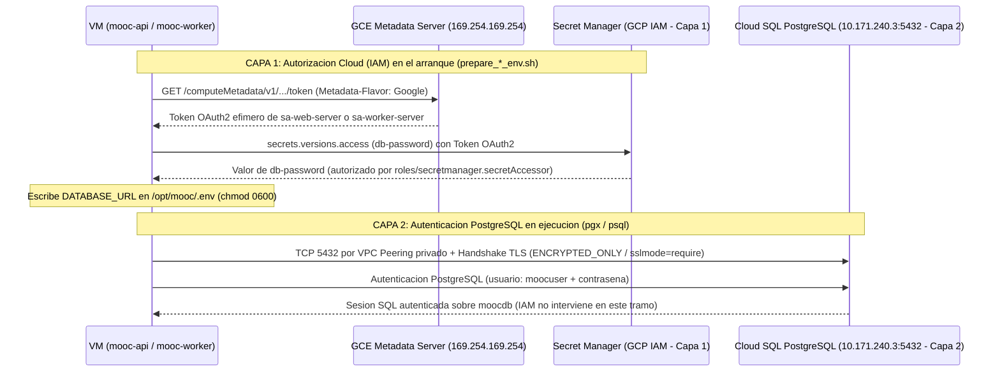

# Evidencia F2 — Identidades de servicio con permisos mínimos y separación de las dos autenticaciones ([#220](https://github.com/ISIS4426-2026/Plataforma-MOOC/issues/220))

| Campo | Detalle |
| :--- | :--- |
| **Bloque** | F — Seguridad, operación y costos |
| **Rúbrica** | Integridad y operación |
| **Responsable** | `@DiegoOrtizRuiz` |
| **Depende de** | B2 (#201), B4 (#203) |
| **Desbloquea** | I2 (#232) |
| **Guion de verificación** | [`scripts/f2_identidades_y_secretos.sh`](../../../../scripts/f2_identidades_y_secretos.sh) y [`scripts/b4_barrido_secretos.sh`](../../../../scripts/b4_barrido_secretos.sh) |

---

## 0. Cumplimiento de criterios de aceptación

| Criterio de aceptación | Estado | Evidencia / Sección |
| :--- | :---: | :--- |
| **Inventario de permisos por identidad con la justificación de cada uno** (y recorte de lo que no se usa) | ✅ | §1 y [`a_inventario_permisos_iam.txt`](./a_inventario_permisos_iam.txt) — Recortado `roles/cloudsql.client` de `sa-web-server` y `sa-worker-server` en [`infra/terraform/service_accounts.tf`](../../../../infra/terraform/service_accounts.tf); inventario completo de las 4 cuentas (`sa-web-server`, `sa-worker-server`, `sa-queue-server`, `sa-load-generator`). |
| **Las dos capas de identidad quedan explicadas sin mezclarse** (autorización de acceso al servicio cloud vs. autenticación de la aplicación ante PostgreSQL) | ✅ | §2 y [`b_dos_capas_identidad_cloudsql.txt`](./b_dos_capas_identidad_cloudsql.txt) |
| **Verificación de ausencia de secretos en el árbol y en el historial** (código, imágenes, plantillas, scripts versionados y evidencias) | ✅ | §3, [`c_barrido_secretos_completo.txt`](./c_barrido_secretos_completo.txt) y [`barrido_secretos.txt`](./barrido_secretos.txt) — **0 hallazgos** |
| **Ejemplos de configuración sin valores sensibles** | ✅ | §4, [`.env.example`](../../../../.env.example), [`infra/terraform/terraform.tfvars.example`](../../../../infra/terraform/terraform.tfvars.example) y [`ejemplos/`](./ejemplos/) |
| **Anotado en `docs/entrega3/NOTAS_TECNICAS.md`** con la columna de a qué issues afecta | ✅ | Nota Técnica 53 en [`docs/entrega3/NOTAS_TECNICAS.md`](../../NOTAS_TECNICAS.md#53) |

Reproducción completa en un solo comando (afirma cada condición y sale con código distinto de `0` si falla cualquiera, según la Nota Técnica 36):

```bash
bash ./scripts/f2_identidades_y_secretos.sh
```

---

## 1. Inventario de permisos por identidad y recorte de permisos sin uso

### 1.1 Qué se recortó en F2: retiro de `roles/cloudsql.client`

El inventario de B4 ([#203](../B4/README.md)) detectó que `roles/cloudsql.client`, heredado de la Entrega 2 en `local.common_roles` de [`infra/terraform/service_accounts.tf`](../../../../infra/terraform/service_accounts.tf), **no se utilizaba en ningún componente**:

1. **Qué concede `roles/cloudsql.client`**: otorga `cloudsql.instances.connect` y `cloudsql.instances.get` sobre la API de administración de Cloud SQL, permisos que solo consumen el **Cloud SQL Auth Proxy** o los **conectores de lenguaje de Cloud SQL** (`cloud.google.com/go/cloudsqlconn`) para solicitar certificados efímeros mTLS vía IAM.
2. **Cómo se conecta realmente la plataforma**: ni la API (`cmd/api`), ni el worker (`cmd/worker`), ni el guion de migraciones (`scripts/migrate.sh`) usan el proxy ni el conector de Go. Todos abren una conexión TCP directa con `pgx`/`psql` hacia la IP privada de Cloud SQL (`10.171.240.3:5432`) a través del *peering* de Private Services Access en `mooc-vpc`, exigiendo TLS (`ssl_mode = "ENCRYPTED_ONLY"` en el servidor y `sslmode=require` en el cliente) y autenticándose como el usuario de PostgreSQL `moocuser` con la contraseña leída de Secret Manager (`db-password`).
3. **Recorte aplicado**: se eliminó `"roles/cloudsql.client"` de `local.common_roles` en [`infra/terraform/service_accounts.tf`](../../../../infra/terraform/service_accounts.tf#L61-L64). Esto retira dos enlaces a nivel de proyecto:
   - `google_project_iam_member.common["web-cloudsql.client"]`
   - `google_project_iam_member.common["worker-cloudsql.client"]`

### 1.2 Qué pasó con `roles/monitoring.metricWriter` en `sa-queue-server`

En B2 ([#201](../B2/README.md)) ese permiso estaba declarado como reservado para C6. Desde C6 ([#209](../C6/README.md), Nota Técnica 42), el servicio `mooc-queue-exporter.service` corre en `mooc-queue-server` y publica cada 15 s las series `custom.googleapis.com/mooc/queue/{pending,active,outstanding,oldest_pending_age_seconds}` directamente en la API de Cloud Monitoring (`CreateTimeSeries` sobre `generic_node`), y `sa-queue-server` recibió además `roles/artifactregistry.reader` sobre el repositorio `mooc` para descargar la imagen `worker` que contiene `/app/queue-exporter`. Por tanto, **ambos permisos están hoy en uso activo y se conservan**.

### 1.3 Matriz completa de identidades y justificación de cada permiso

Ninguna de las cuatro cuentas de servicio tiene archivos de llave JSON (`0` recursos `google_service_account_key` en Terraform y `0` llaves `--managed-by=user` en GCP). Todas van adjuntas a las VMs o plantillas de grupo y obtienen tokens OAuth2 de corta duración desde el servidor de metadatos (`169.254.169.254`).

#### A. `sa-web-server` — Grupo elástico de la API (`mooc-api-group`)

Adjunta en [`infra/terraform/api_group.tf`](../../../../infra/terraform/api_group.tf) (`mooc-api-template-*`).

| Rol / Permiso | Alcance (Recurso) | Archivo Terraform | Quién lo consume y por qué es el mínimo necesario |
| :--- | :--- | :--- | :--- |
| `roles/logging.logWriter` | Proyecto | [`service_accounts.tf`](../../../../infra/terraform/service_accounts.tf) | El Ops Agent de la VM envía los registros de aplicación y sistema a Cloud Logging. Solo permite escribir logs, no leer ni borrar. |
| `roles/monitoring.metricWriter` | Proyecto | [`service_accounts.tf`](../../../../infra/terraform/service_accounts.tf) | El Ops Agent raspa `/api/v1/metrics` en `127.0.0.1:8080` y publica métricas en Cloud Monitoring. Solo escritura de series. |
| `roles/iam.serviceAccountTokenCreator` | **Sobre sí misma** (`sa-web-server`) | [`service_accounts.tf`](../../../../infra/terraform/service_accounts.tf#L129-L133) | [`internal/storage/gcs.go`](../../../../internal/storage/gcs.go) firma URLs V4 de subida y descarga delegando en `signBlob` de IAM Credentials sin clave privada en disco. Concedido sobre la propia cuenta y **no** sobre el proyecto para que la API no pueda suplantar a `sa-worker-server`. |
| `roles/storage.objectViewer` | Bucket `plataforma-mooc-entrega2-media` | [`storage.tf`](../../../../infra/terraform/storage.tf#L59-L63) | Permite a la API verificar existencia/tamaño de objetos en `ConfirmUpload` (`StatObject`) y firmar URLs V4 de lectura (`GetObject`) para documentos e imágenes de estudiantes inscritos (Nota Técnica 48). |
| `roles/storage.objectCreator` + condición CEL `api_deny_derivatives_write` | Bucket `plataforma-mooc-entrega2-media` (solo prefijos `originals/`, `documents/`, `thumbnails/`) | [`storage.tf`](../../../../infra/terraform/storage.tf#L70-L86) | Una URL firmada V4 de carga directa (`PUT`) delega al navegador exactamente los permisos de quien firma. Sin `objectCreator`, el `PUT` del cliente recibiría `403`. La condición CEL prohíbe escribir en `hls/`, garantizando en IAM que ni la API ni un cliente con URL firmada puedan inyectar derivados. |
| `roles/secretmanager.secretAccessor` | Secreto `db-password` (recurso individual) | [`database.tf`](../../../../infra/terraform/database.tf#L302-L312) | [`scripts/prepare_web_env.sh`](../../../../scripts/prepare_web_env.sh) lee la contraseña de PostgreSQL en el arranque para armar `DATABASE_URL` en `/opt/mooc/.env` (modo `0600`). |
| `roles/secretmanager.secretAccessor` | Secreto `smtp-password` (recurso individual) | [`mail.tf`](../../../../infra/terraform/mail.tf#L53-L58) | [`scripts/prepare_web_env.sh`](../../../../scripts/prepare_web_env.sh) lee la clave de Brevo SMTP. Concedido solo sobre este secreto y solo a `sa-web-server` (la única que envía correos). |
| `roles/artifactregistry.reader` | Repositorio `mooc` (`us-east1`) | [`artifact_registry.tf`](../../../../infra/terraform/artifact_registry.tf#L28-L40) | El arranque ([`infra/bootstrap/mooc-bootstrap.sh`](../../../../infra/terraform/../../infra/bootstrap/mooc-bootstrap.sh)) descarga las imágenes `api:<IMAGE_TAG>` y `web:<IMAGE_TAG>`. Solo lectura; no puede publicar ni borrar imágenes. |

**Lo que `sa-web-server` NO puede hacer**: no puede escribir en el bucket de derivados `plataforma-mooc-entrega2-hls`, no puede borrar objetos en ningún bucket (`objectCreator` no incluye `storage.objects.delete`), no puede administrar Cloud SQL ni crear versiones de secretos.

#### B. `sa-worker-server` — Grupo elástico de workers (`mooc-worker-group`)

Adjunta en [`infra/terraform/worker_group.tf`](../../../../infra/terraform/worker_group.tf) (`mooc-worker-template-*`).

| Rol / Permiso | Alcance (Recurso) | Archivo Terraform | Quién lo consume y por qué es el mínimo necesario |
| :--- | :--- | :--- | :--- |
| `roles/logging.logWriter` | Proyecto | [`service_accounts.tf`](../../../../infra/terraform/service_accounts.tf) | Envío de registros del Ops Agent a Cloud Logging. |
| `roles/monitoring.metricWriter` | Proyecto | [`service_accounts.tf`](../../../../infra/terraform/service_accounts.tf) | Envío de métricas de VM y métricas Prometheus del worker (`:9090/metrics`). |
| `roles/storage.objectViewer` | Bucket `plataforma-mooc-entrega2-media` | [`storage.tf`](../../../../infra/terraform/storage.tf#L90-L94) | El procesador multimedia ([`internal/worker/handler/mediaproc.go`](../../../../internal/worker/handler/mediaproc.go)) descarga el video original o valida la cabecera del PDF/imagen subida. **Solo lectura**: un worker no puede modificar ni sobrescribir el archivo original subido por el profesor. |
| `roles/storage.objectUser` | Bucket `plataforma-mooc-entrega2-hls` | [`storage.tf`](../../../../infra/terraform/storage.tf#L157-L161) | El worker escribe las variantes transcodificadas (`360p/`, `720p/` y `master.m3u8`) bajo `hls/<stable_id>/`, y puede sobrescribirlas de forma idempotente si una tarea interrumpida se reejecuta (3.ª defensa de E1). |
| `roles/secretmanager.secretAccessor` | Secreto `db-password` (recurso individual) | [`database.tf`](../../../../infra/terraform/database.tf#L302-L312) | [`scripts/prepare_worker_env.sh`](../../../../scripts/prepare_worker_env.sh) lee la contraseña de PostgreSQL al arrancar para actualizar `resources.processing_status` y aplicar migraciones protegidas por *advisory lock*. |
| `roles/artifactregistry.reader` | Repositorio `mooc` (`us-east1`) | [`artifact_registry.tf`](../../../../infra/terraform/artifact_registry.tf#L28-L40) | Descarga de la imagen `worker:<IMAGE_TAG>` en el arranque. |

**Lo que `sa-worker-server` NO puede hacer**: no tiene `roles/iam.serviceAccountTokenCreator` (no puede emitir URLs firmadas), no tiene acceso al secreto `smtp-password` (no envía correo) y no puede escribir en el bucket privado `plataforma-mooc-entrega2-media`.

#### C. `sa-queue-server` — Servidor de cola compartida y caché Redis (`mooc-queue-server`)

Adjunta en [`infra/terraform/queue.tf`](../../../../infra/terraform/queue.tf).

| Rol / Permiso | Alcance (Recurso) | Archivo Terraform | Quién lo consume y por qué es el mínimo necesario |
| :--- | :--- | :--- | :--- |
| `roles/logging.logWriter` | Proyecto | [`service_accounts.tf`](../../../../infra/terraform/service_accounts.tf#L105-L114) | Envío de registros del sistema y del servicio Redis/exportador. |
| `roles/monitoring.metricWriter` | Proyecto | [`service_accounts.tf`](../../../../infra/terraform/service_accounts.tf#L105-L114) | [`cmd/queue-exporter`](../../../../cmd/queue-exporter/main.go) publica en Cloud Monitoring la señal de demanda de la cola (`outstanding = pending + active`) que gobierna el autoescalador de workers (C6). |
| `roles/artifactregistry.reader` | Repositorio `mooc` (`us-east1`) | [`artifact_registry.tf`](../../../../infra/terraform/artifact_registry.tf#L28-L40) | [`infra/terraform/queue_startup.sh`](../../../../infra/terraform/queue_startup.sh) descarga la imagen `worker:<IMAGE_TAG>` para ejecutar el binario `/app/queue-exporter` (C6). |

**Lo que `sa-queue-server` NO puede hacer**: no lee ningún secreto de Secret Manager (`db-password` ni `smtp-password`), no toca ninguno de los dos buckets de Cloud Storage y no puede firmar URLs.

#### D. `sa-load-generator` — Generador de carga externo bajo demanda (`mooc-load-generator`)

Declarada en [`infra/terraform/generator.tf`](../../../../infra/terraform/generator.tf) con `count = var.generator_enabled ? 1 : 0` (solo existe mientras corre una campaña de carga de G1/G3/G4/G5/G6; apagada el resto del tiempo).

| Rol / Permiso | Alcance (Recurso) | Archivo Terraform | Quién lo consume y por qué es el mínimo necesario |
| :--- | :--- | :--- | :--- |
| `roles/logging.logWriter` | Proyecto | [`generator.tf`](../../../../infra/terraform/generator.tf#L60-L69) | Registro de ejecución de la VM generadora. |
| `roles/monitoring.metricWriter` | Proyecto | [`generator.tf`](../../../../infra/terraform/generator.tf#L60-L69) | Métricas de CPU y memoria del generador para contrastar que no se saturó durante la campaña (`scripts/capacity_contraste_generador.py`, Nota Técnica 49). |

**Lo que `sa-load-generator` NO puede hacer**: no lee secretos, no accede a los buckets, no baja imágenes privadas de Artifact Registry (usa JMeter público fijado por digest `sha256:088ac52b...`), no puede conectarse a la cola (la regla de firewall `mooc-allow-queue` exige `source_service_accounts = [sa-web-server, sa-worker-server]`) y solo interactúa con la plataforma como un cliente externo más a través del balanceador HTTPS público.

#### E. Cuenta de servicio por defecto de Compute Engine (`921648860819-compute@developer.gserviceaccount.com`)

Google la crea automáticamente al habilitar la API de Compute Engine con `roles/editor` sobre el proyecto. **Ninguna VM ni plantilla del proyecto la utiliza**: las plantillas de `mooc-api-group` y `mooc-worker-group`, la VM `mooc-queue-server` y la VM `mooc-load-generator` declaran explícitamente su bloque `service_account` propio.

---

## 2. Separación de las dos capas de identidad (Cloud IAM vs. PostgreSQL)

Un error conceptual frecuente en despliegues sobre IaaS/PaaS es mezclar la autorización ante los servicios gestionados de la nube con la autenticación de la aplicación ante el motor relacional. En la Plataforma MOOC ambas capas son **completamente independientes y ortogonales**:

| Dimensión | Capa 1 — Autorización de acceso al servicio cloud (GCP IAM) | Capa 2 — Autenticación de la aplicación ante PostgreSQL |
| :--- | :--- | :--- |
| **Pregunta que responde** | *«¿Puede esta máquina virtual invocar esta API de Google Cloud sobre este recurso?»* | *«¿Quién es este cliente SQL dentro del motor PostgreSQL y qué objetos de `moocdb` puede leer o modificar?»* |
| **Quién es el sujeto (identidad)** | La **instancia de VM**, identificada por su cuenta de servicio adjunta (`sa-web-server`, `sa-worker-server`, `sa-queue-server`, `sa-load-generator`). Cada componente tiene una identidad distinta. | El **rol de base de datos `moocuser`**, creado dentro del motor PostgreSQL (`google_sql_user.app` en [`database.tf`](../../../../infra/terraform/database.tf#L265-L273)). Tanto la API como el worker se autentican como `moocuser`. |
| **Cómo obtiene y presenta la credencial** | El proceso consulta en local al servidor de metadatos de Compute Engine (`http://metadata.google.internal/computeMetadata/v1/instance/service-accounts/default/token`), que devuelve un **token OAuth2 Bearer efímero** sin que exista ningún archivo de clave privada en el disco ni en la imagen. | En el arranque (`ExecStartPre`), [`scripts/prepare_web_env.sh`](../../../../scripts/prepare_web_env.sh) y [`scripts/prepare_worker_env.sh`](../../../../scripts/prepare_worker_env.sh) usan la Capa 1 para leer el secreto `db-password` de Secret Manager, lo codifican para URI y escriben `DATABASE_URL='postgres://moocuser:<password>@<DB_PRIVATE_IP>:5432/moocdb?sslmode=require'` en `/opt/mooc/.env` (modo `0600`). El driver `pgx` presenta esa contraseña en el handshake de PostgreSQL. |
| **Por qué canal de red viaja** | APIs HTTPS de Google (`*.googleapis.com`, `us-east1-docker.pkg.dev`) alcanzadas desde la subred con `private_ip_google_access = true` y Cloud NAT ([`network.tf`](../../../../infra/terraform/network.tf)). | Conexión TCP directa al puerto `5432` de la IP privada de Cloud SQL (`10.171.240.3`) a través del *peering* VPC de **Private Services Access** (`ipv4_enabled = false`), cifrada obligatoriamente con TLS (`ssl_mode = "ENCRYPTED_ONLY"` en el servidor y `sslmode=require` exigido por [`internal/config/validate.go`](../../../../internal/config/validate.go)). |
| **Qué autoriza exactamente** | Leer un secreto específico en Secret Manager (`db-password`, `smtp-password`), leer o crear objetos en un bucket de GCS (`media`, `hls`), firmar un hash con `signBlob`, descargar una imagen de Artifact Registry o escribir logs/métricas en Cloud Operations. | Ejecutar sentencias DDL (migraciones en `scripts/migrate.sh` serializadas por `pg_advisory_xact_lock`) y DML (`SELECT`, `INSERT`, `UPDATE`, `DELETE`) sobre las tablas del esquema de `moocdb`. **No autoriza ninguna operación sobre la instancia de Cloud SQL en GCP** (ni borrarla, ni redimensionarla, ni exportar respaldos). |
| **Dónde se declara en el código** | [`service_accounts.tf`](../../../../infra/terraform/service_accounts.tf), [`storage.tf`](../../../../infra/terraform/storage.tf), [`database.tf`](../../../../infra/terraform/database.tf#L302-L312), [`mail.tf`](../../../../infra/terraform/mail.tf#L53-L58), [`artifact_registry.tf`](../../../../infra/terraform/artifact_registry.tf) y [`generator.tf`](../../../../infra/terraform/generator.tf). | `google_sql_database_instance.main`, `google_sql_database.mooc` y `google_sql_user.app` en [`infra/terraform/database.tf`](../../../../infra/terraform/database.tf#L91-L273), más la validación de arranque en [`internal/config/validate.go`](../../../../internal/config/validate.go). |
| **Cómo se revoca o rota** | **En IAM**: quitando el recurso `*_iam_member` en Terraform y aplicando. El corte es inmediato en cuanto caduca el token OAuth2 efímero y no requiere reiniciar contenedores ni rotar archivos. | **En PostgreSQL y Secret Manager** (nunca desde IAM): añadiendo una nueva versión en Secret Manager (`gcloud secrets versions add db-password`), aplicando Terraform para actualizar la clave del rol `moocuser` en PostgreSQL y reiniciando los servicios `mooc-web` y `mooc-worker` para que relean el secreto. |

### Por qué el puente entre ambas capas ocurre solo una vez en el arranque



Como se observa en la secuencia:
1. **La Capa 1 (IAM) termina cuando `prepare_*_env.sh` lee `db-password` de Secret Manager**. A partir de ese momento, para hablar con PostgreSQL la VM no vuelve a presentar ningún token de IAM.
2. **La Capa 2 (PostgreSQL) opera íntegramente sobre la VPC privada + TLS + contraseña de `moocuser`**. Por eso retirar `roles/cloudsql.client` en F2 no interrumpe ni degrada el acceso a la base de datos, y a la inversa, tener `roles/cloudsql.client` sin la contraseña de `moocuser` o fuera de `mooc-vpc` jamás permitiría abrir una sesión en `moocdb`.

---

## 3. Verificación de ausencia de secretos en árbol, historial, imágenes, plantillas, scripts y evidencias

La verificación automatizada se ejecuta mediante [`scripts/f2_identidades_y_secretos.sh`](../../../../scripts/f2_identidades_y_secretos.sh), que encadena [`scripts/b4_barrido_secretos.sh`](../../../../scripts/b4_barrido_secretos.sh) y añade los controles específicos de F2. Los resultados completos se encuentran en [`c_barrido_secretos_completo.txt`](./c_barrido_secretos_completo.txt) y [`barrido_secretos.txt`](./barrido_secretos.txt):

| Superficie auditada | Qué se comprueba y afirma en código | Resultado |
| :--- | :--- | :---: |
| **1. Árbol de trabajo (`git grep`)** | 7 familias de patrones: llaves privadas PEM (`BEGIN * PRIVATE KEY`), JSON de cuenta de servicio (`"private_key":`), claves de Google (`AIza...`), Brevo (`xkeysib-...`), AWS (`AKIA...`), tokens de GitHub (`ghp_`, `github_pat_`) y JWT (`eyJ...`), más asignaciones literales de `PASSWORD`/`SECRET_KEY`/`ACCESS_KEY`/`API_KEY`. | **0 hallazgos** ✅ |
| **2. URIs de conexión en el repositorio** | Afirma que toda contraseña presente en una URI `(postgres\|redis\|...)://user:pass@` pertenece exclusivamente a las 4 constantes de desarrollo local declaradas (`moocpassword`, `postgres`, `UnaContrasena*`, `a?b&c=d`) y que [`internal/config/validate.go`](../../../../internal/config/validate.go) rechaza el arranque con `APP_ENV=production` si sobrevive cualquiera de ellas (`go test ./internal/config/` en verde). | **0 contraseñas sin declarar** ✅ |
| **3. Historial completo de Git (`git log -p --all --full-history`)** | Barrido de los 7 patrones sobre la totalidad de commits y objetos en todas las ramas del repositorio, más verificación de que `.env`, `.env.local`, `.env.production`, `terraform.tfstate`, `terraform.tfstate.backup`, `application_default_credentials.json`, `sa-key.json` y `credentials.json` **nunca fueron versionados**. | **0 hallazgos** ✅ |
| **4. Imágenes Docker y contexto de construcción** | [`.dockerignore`](../../../../.dockerignore) excluye `.env`, `.env.*` (salvo `!.env.example`), `*-sa-key.json`, `*service-account*.json`, `application_default_credentials.json`, `infra/`, `*.tfstate`, `.git/` y `docs/`. [`Dockerfile.api`](../../../../Dockerfile.api), [`Dockerfile.worker`](../../../../Dockerfile.worker) y [`Dockerfile.web`](../../../../Dockerfile.web) usan construcción multietapa; la etapa final solo copia los binarios compilados o `dist/` estático, y `Dockerfile.web` ejecuta `npm run check:bundle` (`frontend/scripts/check-bundle.mjs`), que falla el build si el bundle contiene secretos o direcciones internas. | **0 hallazgos** ✅ |
| **5. Plantillas de instancias y scripts versionados** | [`infra/terraform/api_group.tf`](../../../../infra/terraform/api_group.tf), [`worker_group.tf`](../../../../infra/terraform/worker_group.tf), [`bootstrap.tf`](../../../../infra/terraform/bootstrap.tf), [`queue_startup.sh`](../../../../infra/terraform/queue_startup.sh), [`infra/bootstrap/mooc-bootstrap.sh`](../../../../infra/bootstrap/mooc-bootstrap.sh), [`scripts/prepare_web_env.sh`](../../../../scripts/prepare_web_env.sh) y [`scripts/prepare_worker_env.sh`](../../../../scripts/prepare_worker_env.sh) no contienen ninguna contraseña en duro; leen `db-password` y `smtp-password` de Secret Manager en tiempo de ejecución y escriben `.env` con permisos `0600`. | **0 hallazgos** ✅ |
| **6. Evidencias de la Entrega 3 (`docs/entrega3/evidencias/`)** | Barrido de todos los archivos de texto de evidencia en busca de tokens `Bearer` sin redactar, firmas de URLs pre-firmadas de GCS (`X-Goog-Signature=`) o llaves privadas. | **0 hallazgos** ✅ |

---

## 4. Ejemplos de configuración sin valores sensibles y decisión sobre el Nivel 2 de metadata

### 4.1 Decisión sobre la metadata de nivel 2 (`mooc-smtp-from` y `mooc-smtp-username`)

En B4 ([#203](../B4/README.md) §2 y §6, Nota Técnica 33) se clasificó la configuración en tres niveles y se dejó a F2 cerrar la decisión sobre los dos valores de nivel 2 (`smtp_from` y `smtp_username`):

| Nivel | Clasificación | Valores | Dónde viven |
| :---: | :--- | :--- | :--- |
| **Nivel 1** | **Secreto** | `db-password`, `smtp-password` | **Secret Manager** (nunca en Git, ni en metadata de GCE, ni en imágenes Docker). |
| **Nivel 2** | **No secreto, pero no publicable en repositorio público** | `smtp_from`, `smtp_username` | `infra/terraform/terraform.tfvars` local (en `.gitignore`, Nota Técnica 39) → metadata de la plantilla (`mooc-smtp-from`, `mooc-smtp-username`) → `/etc/mooc/web.conf` (`0640`). |
| **Nivel 3** | **Público** | Resto de parámetros (`project_id`, `region`, `zone`, buckets, concurrencia, plazos de drenaje, topes de pool, etc.) | Versionados en el repositorio. |

**Decisión de F2**: se mantiene esta arquitectura de tres niveles porque:
1. `smtp_username` y `smtp_from` **no son credenciales de autenticación**: en Brevo corresponden al correo identificador de la cuenta y al remitente verificado, mientras que lo que protege la cuenta es la clave SMTP (`smtp-password`), que sí vive en Secret Manager (Nivel 1) con permiso `secretAccessor` restringido exclusivamente a `sa-web-server`.
2. Desde la corrección de la Nota Técnica 39, `smtp_from` y `smtp_username` residen en `infra/terraform/terraform.tfvars` (excluido por `.gitignore`), por lo que no se exponen en el repositorio público ni se recuperan nunca leyendo la metadata derivada.
3. En todas las evidencias y ejemplos publicados en el repositorio, ambos campos se representan con marcadores explícitos (`<REMITENTE_VERIFICADO_EN_PROVEEDOR_SMTP>`, `<LOGIN_DEL_PROVEEDOR_SMTP>`).

### 4.2 Catálogo de ejemplos de configuración entregados

| Archivo de ejemplo | Qué documenta | Estado de valores sensibles |
| :--- | :--- | :--- |
| [`.env.example`](../../../../.env.example) | Todas las variables de entorno de desarrollo local y la guía completa de las variables de producción en la nube (actualizado para la arquitectura elástica de la Entrega 3). | Las variables marcadas con `[SECRETO]` van estrictamente vacías (`=`). |
| [`infra/terraform/terraform.tfvars.example`](../../../../infra/terraform/terraform.tfvars.example) | Variables obligatorias de Nivel 1 (`TF_VAR_db_password`), Nivel 2 (`smtp_from`, `smtp_username`), `image_tag` (SHA de 40 hex) y banderas operativas de encendido/aparcado de la Entrega 3 (`lb_enabled`, `api_autoscaling_enabled`, `worker_autoscaling_enabled`, `generator_enabled`, `db_activation_policy`). | Sin valores reales; usa marcadores `<...>` y comenta todas las variables opcionales. |
| [`ejemplos/web.conf.example`](./ejemplos/web.conf.example) | Estructura exacta de `/etc/mooc/web.conf` (modo `0640`) generada en cada réplica de `mooc-api-group` por `infra/bootstrap/mooc-bootstrap.sh`. | Sin contraseñas; direcciones privadas y Nivel 2 con marcadores `<...>`. |
| [`ejemplos/worker.conf.example`](./ejemplos/worker.conf.example) | Estructura exacta de `/etc/mooc/worker.conf` (modo `0640`) generada en cada instancia de `mooc-worker-group` por `infra/bootstrap/mooc-bootstrap.sh`. | Sin secretos ni variables SMTP; IP privada con marcador `<...>`. |
| [`ejemplos/runtime.web.env.example`](./ejemplos/runtime.web.env.example) | Estructura exacta de `/opt/mooc/.env` (modo `0600`) producida en el arranque por `scripts/prepare_web_env.sh` antes de levantar `docker-compose.prod.yml`. | `db-password` y `smtp-password` representados con `<SECRETO_DESDE_SECRET_MANAGER_*>`. |
| [`ejemplos/runtime.worker.env.example`](./ejemplos/runtime.worker.env.example) | Estructura exacta de `/opt/mooc/.env` (modo `0600`) producida en el arranque por `scripts/prepare_worker_env.sh` antes de levantar `docker-compose.worker.yml`. | `db-password` representado con `<SECRETO_URL_ENCODED_DB_PASSWORD>`; sin variables SMTP. |

---

## 5. Artefactos en este directorio

- [`a_inventario_permisos_iam.txt`](./a_inventario_permisos_iam.txt): verificación automatizada del recorte de `roles/cloudsql.client`, ausencia de `google_service_account_key` y matriz de permisos por identidad.
- [`b_dos_capas_identidad_cloudsql.txt`](./b_dos_capas_identidad_cloudsql.txt): verificación automatizada de la separación entre la Capa 1 (Cloud IAM / Metadata Server) y la Capa 2 (PostgreSQL `moocuser` sobre IP privada + `sslmode=require`).
- [`c_barrido_secretos_completo.txt`](./c_barrido_secretos_completo.txt) y [`barrido_secretos.txt`](./barrido_secretos.txt): salida íntegra del barrido de secretos sobre árbol, URIs, historial de Git, Dockerfiles, `.dockerignore`, scripts, evidencias de la Entrega 3 y ejemplos de configuración.
- [`resumen.txt`](./resumen.txt): consolidado de los veredictos de `scripts/f2_identidades_y_secretos.sh`.
- [`ejemplos/`](./ejemplos/): plantillas de configuración operativa sin valores sensibles (`web.conf.example`, `worker.conf.example`, `runtime.web.env.example`, `runtime.worker.env.example`).
- [`capturas/`](./capturas/): captura renderizada del resultado de la verificación (`2026-11-01_verificacion-identidades-y-ausencia-secretos.png`).

---

Este archivo no contiene credenciales, llaves ni secretos.

