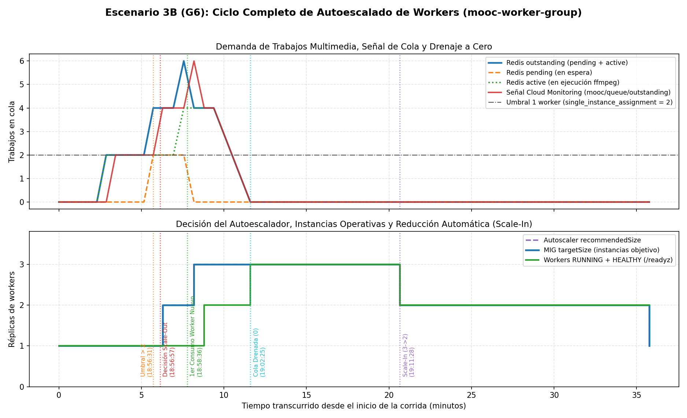
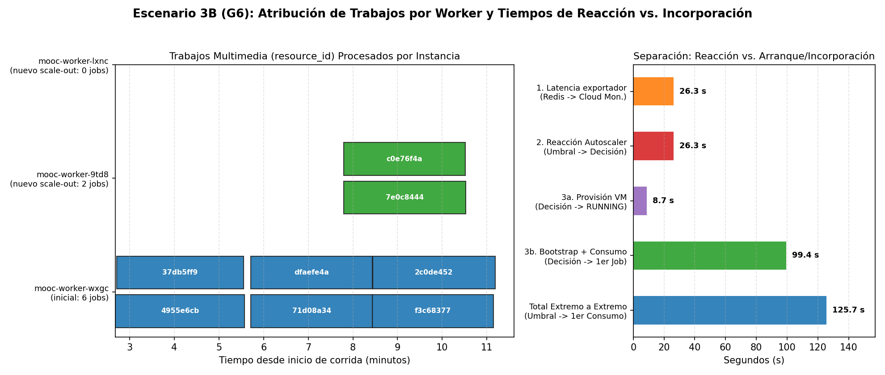
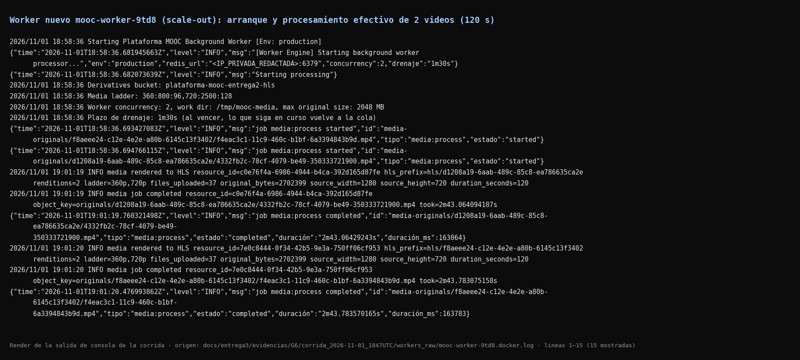
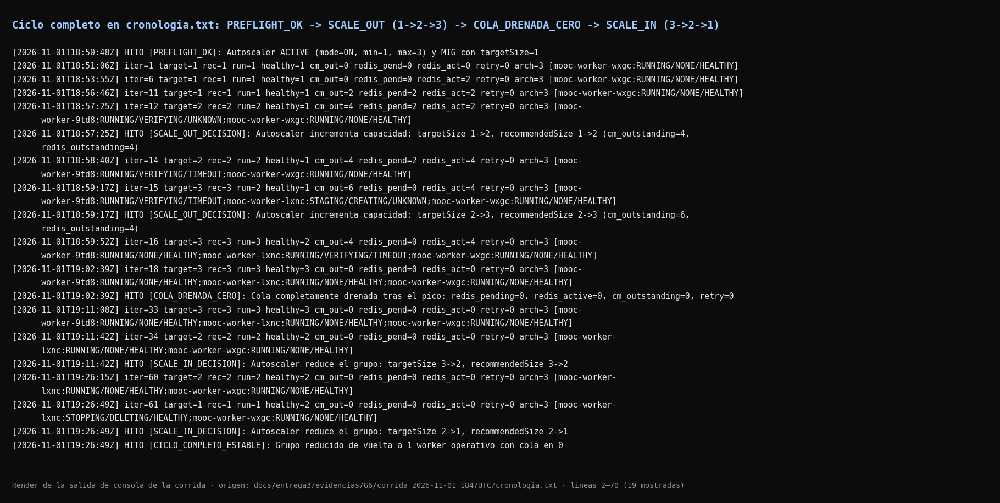
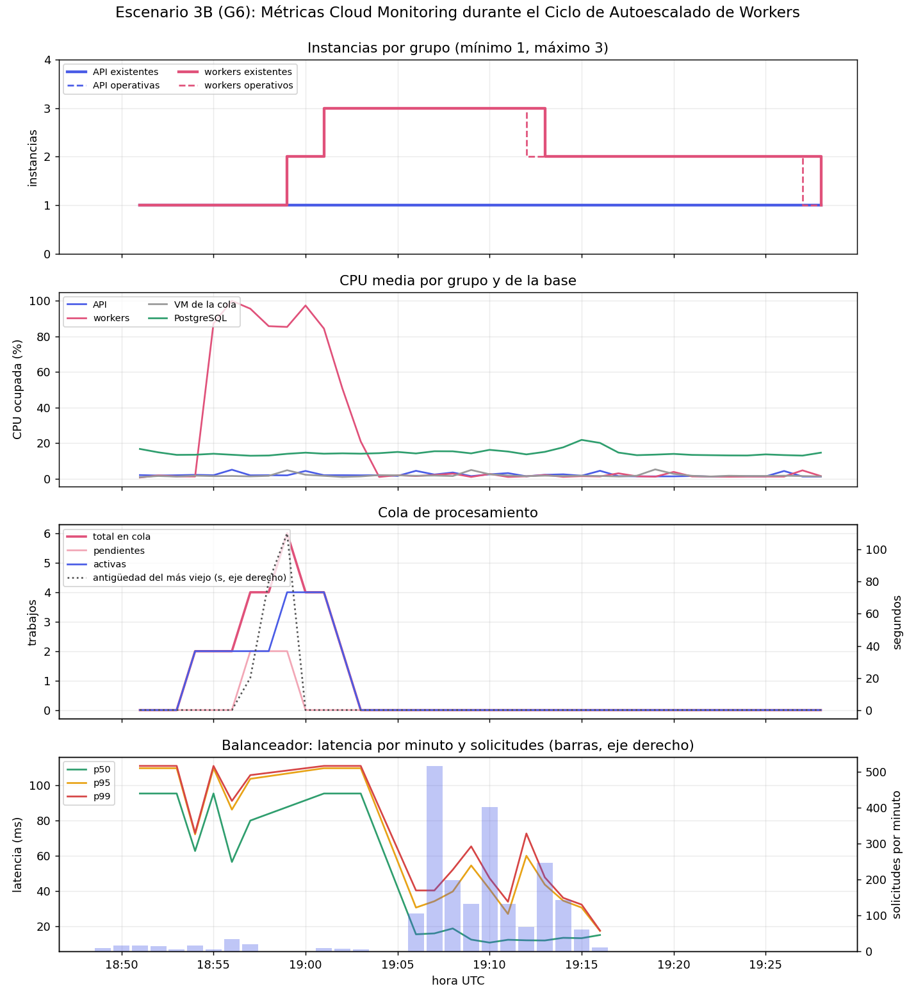
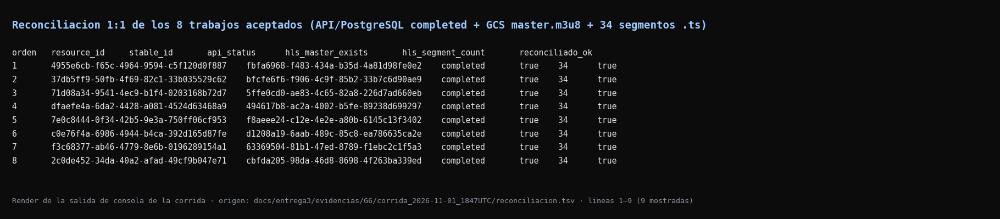
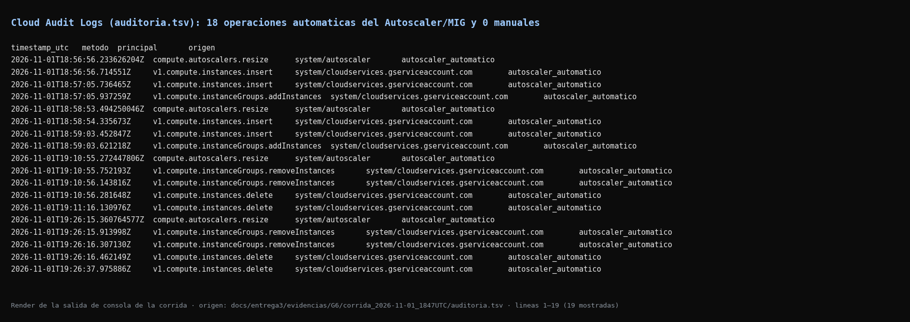

# Evidencia G6 — Escenario 3B: ciclo de escalamiento automático de workers ([#226](https://github.com/ISIS4426-2026/Plataforma-MOOC/issues/226))

| | |
| :--- | :--- |
| **Bloque** | G — Pruebas de carga comparativas |
| **Rúbrica** | Pruebas comparativas |
| **Responsable** | `@DiegoOrtizRuiz` |
| **Depende de** | C6 (#209), C7 (#210), E1 (#216), G1 (#222) — todos cerrados |
| **Desbloquea** | G7 (#227) |
| **Guía de reproducción** | [`RUNBOOK.md`](./RUNBOOK.md) |
| **Datos crudos de la corrida** | [`corrida_2026-11-01_1847UTC/`](./corrida_2026-11-01_1847UTC/) |

---

## 0. Resumen Ejecutivo y Estado de Criterios de Aceptación

La corrida en vivo del **Escenario 3B** se ejecutó el **1 de noviembre de 2026 (`18:50:46Z – 19:26:49Z`)** contra la arquitectura elástica en GCP (`plataforma-mooc-entrega2`, zona `us-east1-b`), completando el ciclo íntegro **`1 → 2 → 3 → 2 → 1`** en `mooc-worker-group` exclusivamente por decisión de `mooc-worker-autoscaler`.

| Criterio de aceptación | Estado | Evidencia verificable |
| :--- | :---: | :--- |
| **Al menos una creación automática y una reducción posterior en el grupo de workers** | Cumplido | Dos ampliaciones automáticas (`1 → 2` a las `18:56:56Z` y `2 → 3` a las `18:58:53Z`) y dos reducciones automáticas (`3 → 2` a las `19:10:55Z` y `2 → 1` a las `19:26:15Z`), verificadas en [`hitos.tsv`](./corrida_2026-11-01_1847UTC/hitos.tsv), [`observacion.tsv`](./corrida_2026-11-01_1847UTC/observacion.tsv) y [`auditoria.tsv`](./corrida_2026-11-01_1847UTC/auditoria.tsv) (`0` intervenciones manuales). |
| **Inicio efectivo de consumo y procesamiento por los workers nuevos, demostrado con trabajos concretos** | Cumplido | La instancia nueva `mooc-worker-9td8` (`id=162295375347725718`) completó su bootstrap a las `18:58:36Z` ([`mooc-worker-9td8.arranque.json`](./corrida_2026-11-01_1847UTC/workers_raw/mooc-worker-9td8.arranque.json)) y en ese mismo segundo (`18:58:36.693Z`) tomó de Redis y transcodificó a HLS dos videos de `120 s`: `resource_id=7e0c8444-0f34-42b5-9e3a-750ff06cf953` (`163 783 ms`, `37` archivos HLS) y `resource_id=c0e76f4a-6986-4944-b4ca-392d165d87fe` (`163 064 ms`, `37` archivos HLS) ([`trabajos_por_worker.tsv`](./corrida_2026-11-01_1847UTC/trabajos_por_worker.tsv)). |
| **Drenaje de la cola y trabajos activos tratados con seguridad durante la reducción** | Cumplido | La cola drenó íntegramente a `pending=0, active=0, outstanding=0` a las `19:02:01Z` con `retry=0` y `archived=3` (constante sobre su línea base, `delta_archived=0`) ([`cola_drenaje.tsv`](./corrida_2026-11-01_1847UTC/cola_drenaje.tsv)). Se complementa en la §5 con el retiro controlado con trabajo activo de [`E1`](../E1/README.md) (`requeue` limpio a `pending` con `retry=0` tras `WORKER_DRAIN_TIMEOUT=90s`). |
| **Reconciliación sin pérdidas ni efectos duplicados** | Cumplido | `8/8` trabajos multimedia aceptados (`202 Accepted`) alcanzaron `processing_status=completed` en PostgreSQL, cada uno con `1` único `master.m3u8` y `34` segmentos `.ts` en `gs://plataforma-mooc-entrega2-hls/hls/<stable_id>/`, y `8/8` ejecuciones únicas en los workers (`0` pérdidas, `0` duplicados) ([`reconciliacion.tsv`](./corrida_2026-11-01_1847UTC/reconciliacion.tsv)). |
| **Bloquea el cierre: capturas tomadas mientras ocurre** | Cumplido | 6 capturas PNG en [`capturas/`](./capturas/) (gráficas del ciclo completo, diagrama Gantt de trabajos por worker y separación de tiempos, tablero G1 de Cloud Monitoring y terminales renderizadas de los archivos crudos). |
| **Anotación en `docs/entrega3/NOTAS_TECNICAS.md`** | Cumplido | Nota Técnica 54 en [`docs/entrega3/NOTAS_TECNICAS.md`](../../NOTAS_TECNICAS.md) con los tiempos medidos y las trampas operativas que afectan a **G7**, **I1**, **I2** e **I4**. |

### Índice de Capturas en [`capturas/`](./capturas/)

| Archivo | Qué demuestra |
| :--- | :--- |
| [`2026-11-01_ciclo_autoescalado_workers_y_cola.png`](./capturas/2026-11-01_ciclo_autoescalado_workers_y_cola.png) | Línea de tiempo del ciclo completo (`18:50Z – 19:27Z`): curva de demanda en Redis (`outstanding`, `pending`, `active`), señal en Cloud Monitoring (`custom.googleapis.com/mooc/queue/outstanding`), decisión del autoescalador (`1 → 2 → 3 → 2 → 1`), workers `RUNNING + HEALTHY` y drenaje a `0`. |
| [`2026-11-01_trabajos_por_worker_y_tiempos.png`](./capturas/2026-11-01_trabajos_por_worker_y_tiempos.png) | Diagrama Gantt por ranura de concurrencia (`WORKER_CONCURRENCY=2`) mostrando los `resource_id` procesados por el worker inicial (`mooc-worker-wxgc`, 6 trabajos) y por el worker nuevo (`mooc-worker-9td8`, 2 trabajos), junto con la comparación entre **tiempo de reacción (`26,3 s`)** y **tiempo de arranque e incorporación a consumo (`99,4 s`)**. |
| [`2026-11-01_tablero_cloud_monitoring_g1.png`](./capturas/2026-11-01_tablero_cloud_monitoring_g1.png) | Tablero de cuatro paneles de G1 (`scripts/capacity_graficas.py` sobre [`serie_temporal.csv`](./corrida_2026-11-01_1847UTC/serie_temporal.csv)): instancias existentes vs. operativas, CPU media de workers (hasta `99,9 %` durante `ffmpeg`), profundidad/antigüedad de la cola y latencia del balanceador. |
| [`2026-11-01_consumo_efectivo_workers_nuevos_terminal.png`](./capturas/2026-11-01_consumo_efectivo_workers_nuevos_terminal.png) | Salida cruda del contenedor del worker nuevo (`mooc-worker-9td8.docker.log`) capturada antes de su retiro por `scale-in`: muestra el arranque (`18:58:36Z`), el inicio inmediato de dos trabajos (`18:58:36.693Z`) y su finalización (`19:01:19Z` y `19:01:20Z`). |
| [`2026-11-01_drenaje_cola_y_scale_in_terminal.png`](./capturas/2026-11-01_drenaje_cola_y_scale_in_terminal.png) | Extracto de [`cronologia.txt`](./corrida_2026-11-01_1847UTC/cronologia.txt) con los hitos `PREFLIGHT_OK`, `SCALE_OUT_DECISION` (`1→2` y `2→3`), `COLA_DRENADA_CERO`, `SCALE_IN_DECISION` (`3→2` y `2→1`) y `CICLO_COMPLETO_ESTABLE`. |
| [`2026-11-01_reconciliacion_final_y_auditoria_terminal.png`](./capturas/2026-11-01_reconciliacion_final_y_auditoria_terminal.png) | Tabla de [`reconciliacion.tsv`](./corrida_2026-11-01_1847UTC/reconciliacion.tsv) confirmando `8/8` recursos en `completed`, `master.m3u8 = true` y `34` segmentos `.ts` por video. |
| [`2026-11-01_auditoria_sin_intervencion_manual_terminal.png`](./capturas/2026-11-01_auditoria_sin_intervencion_manual_terminal.png) | Registro de Cloud Audit Logs ([`auditoria.tsv`](./corrida_2026-11-01_1847UTC/auditoria.tsv)) con las 18 operaciones automáticas (`compute.autoscalers.resize`, `instances.insert`, `addInstances`, `removeInstances`, `instances.delete`) y `0` operaciones manuales. |

---

## 1. Arquitectura de Escalamiento de Workers y Diseño Experimental

### 1.1 Configuración vigente del grupo y su señal (C5, C6, C7)

| Parámetro | Valor en Terraform / Código | Referencia |
| :--- | :--- | :--- |
| **Grupo administrado (MIG)** | `mooc-worker-group` (`us-east1-b`), máquina `e2-highcpu-2` (2 vCPU, 2 GiB RAM), `WORKER_CONCURRENCY = 2` | [`infra/terraform/worker_group.tf`](../../../../infra/terraform/worker_group.tf#L81-L185) |
| **Política de autoescalado** | `mooc-worker-autoscaler`: `min_replicas = 1`, `max_replicas = 3`, `cooldown_period = 420 s` | [`infra/terraform/worker_autoscaler.tf`](../../../../infra/terraform/worker_autoscaler.tf#L10-L53) |
| **Señal primaria de cola** | `custom.googleapis.com/mooc/queue/outstanding` (`pending + active`), publicada cada `30 s` por `mooc-queue-exporter` en `mooc-queue-server` bajo `generic_node` (`namespace = "mooc-cola"`) | [`cmd/queue-exporter/main.go`](../../../../cmd/queue-exporter/main.go#L41-L58) |
| **Objetivo por instancia** | `single_instance_assignment = 2.0` ($\text{réplicas deseadas} = \lceil \text{outstanding} / 2 \rceil$): `outstanding <= 2` → 1 worker; `3..4` → 2 workers; `>= 5` → 3 workers | [`infra/terraform/worker_autoscaler.tf`](../../../../infra/terraform/worker_autoscaler.tf#L20-L29) |
| **Control de reducción (`scale-in`)** | `max_scaled_in_replicas = 1` por cada ventana de `time_window_sec = 900` (`15 min`) | [`infra/terraform/worker_autoscaler.tf`](../../../../infra/terraform/worker_autoscaler.tf#L31-L38) |
| **Drenaje elegante (`SIGTERM`)** | `WORKER_DRAIN_TIMEOUT = 90s` (`TimeoutStopSec = 100s` en `mooc-worker.service`): al recibir `SIGTERM`, Asynq detiene de inmediato la toma de nuevas tareas (`processor.stop()`) y espera hasta `90 s` a que terminen los procesos `ffmpeg` en vuelo; si vence el plazo, `requeue()` devuelve la tarea a `asynq:{default}:pending` con `retry = 0` | [`internal/worker/worker.go`](../../../../internal/worker/worker.go#L97-L115) |

### 1.2 Diseño de las 4 etapas de carga (`scripts/g6_carga_escalonada_workers.sh`)

Para evitar que la velocidad de subida desde el cliente amortigüe la llegada de tareas a Redis (trampa documentada en C6), [`scripts/g6_carga_escalonada_workers.sh`](../../../../scripts/g6_carga_escalonada_workers.sh) primero verifica con `ffprobe` el insumo canónico (`scratch/video_corto.mp4`: `120,0 s`, `1280x720`, `25 fps`, H.264/AAC, `2 702 399 bytes`) y **pre-sube los 8 objetos a GCS** mediante URLs firmadas (`18:53:10Z – 18:53:29Z`). A continuación, dispara las confirmaciones (`POST /api/v1/media/uploads/{id}/complete` → `202 Accepted`) en cuatro etapas:

| Etapa | Inicio (UTC) | Fin (UTC) | Trabajos Confirmados | Propósito y Comportamiento Observado |
| :--- | :---: | :---: | :---: | :--- |
| **`etapa1_baja_carga`** | `18:53:29Z` | `18:56:30Z` | `2` (`#1, #2`) | Arrancar con baja carga (`outstanding = 2 <= 2`) y 1 worker operativo (`mooc-worker-wxgc`). El worker inicial procesa ambos videos en paralelo (`173,5 s` y `170,9 s`) mientras `recommendedSize` y `targetSize` permanecen en `1`. |
| **`etapa2_aumento_demanda`** | `18:56:30Z` | `18:56:32Z` | `4` (`#3..#6`) | Elevar `outstanding` a `4` (`> 2`: `2` en `active` en `mooc-worker-wxgc` + `2` en `pending`). A los `26,3 s` (`18:56:56Z`), `mooc-worker-autoscaler` eleva `recommendedSize` y `targetSize` de `1 → 2`, aprovisionando `mooc-worker-9td8`. |
| **`etapa3_sostenimiento_consumo_nuevos`** | `18:58:27Z` | `18:58:28Z` | `2` (`#7, #8`) | Sostener la demanda mientras `mooc-worker-9td8` culmina su bootstrap (`18:58:36Z`). Al coincidir los `4` trabajos en curso (`#3, #4` en `wxgc` y `#5, #6` recién tomados por `9td8`) con los `2` nuevos (`#7, #8`), `outstanding` alcanza `6` y provoca un segundo escalamiento automático `2 → 3` (`mooc-worker-lxnc`, `18:58:53Z`). |
| **`etapa4_reduccion_drenaje_y_reconciliacion`** | `18:58:28Z` | `19:02:01Z` | `0` (cese) | Cesar las llegadas, observar el vaciado total de la cola (`19:02:01Z`), reconciliar 1:1 los 8 trabajos y mantener el observador activo hasta completar las dos ventanas de reducción automática (`3 → 2` a las `19:10:55Z` y `2 → 1` a las `19:26:15Z`). |

---

## 2. Línea de Tiempo Completa y Separación de Tiempos (Reacción vs. Incorporación)

El enunciado (pág. 10) exige reportar **por separado** el **tiempo de reacción** (desde que la demanda supera el umbral hasta que el autoescalador decide escalar) y el **tiempo de arranque e incorporación** (desde la decisión hasta que el nuevo worker empieza efectivamente a consumir trabajos de la cola).

### 2.1 Desglose medido: Tiempo de Reacción vs. Tiempo de Arranque e Incorporación

Fuente: [`linea_de_tiempo.md`](./corrida_2026-11-01_1847UTC/linea_de_tiempo.md), [`instancias.tsv`](./corrida_2026-11-01_1847UTC/instancias.tsv), [`auditoria.tsv`](./corrida_2026-11-01_1847UTC/auditoria.tsv) y [`mooc-worker-9td8.docker.log`](./corrida_2026-11-01_1847UTC/workers_raw/mooc-worker-9td8.docker.log).

| Tramo del Ciclo | Marca Inicial (UTC) | Marca Final (UTC) | Duración Medida | Explicación Técnica |
| :--- | :---: | :---: | :---: | :--- |
| **A. Tiempo de reacción del autoescalador ($\Delta t_{\text{reacción}}$)** | `2026-11-01T18:56:31Z` | `2026-11-01T18:56:57.288Z` | **`26,3 s`** | Desde que el 3.er trabajo de la Etapa 2 (`#5`, `7e0c8444`) es confirmado (`202 Accepted`), situando `outstanding = 4 > 2` en Redis, hasta que `mooc-queue-exporter` publica la métrica en Cloud Monitoring y `mooc-worker-autoscaler` ejecuta `compute.autoscalers.resize` (`18:56:56.233Z`) y crea `mooc-worker-9td8` (`creationTimestamp = 18:56:57.288Z`). |
| **B1. Provisión de la VM en GCE** | `2026-11-01T18:56:57.288Z` | `2026-11-01T18:57:06Z` | `8,7 s` | Transición `PROVISIONING → STAGING → RUNNING` de la instancia `e2-highcpu-2` (`mooc-worker-9td8`, `id=162295375347725718`). |
| **B2. Bootstrap del sistema y contenedor (`arranque.json`)** | `2026-11-01T18:56:57.288Z` | `2026-11-01T18:58:36Z` | `98,7 s` | Incluye el arranque del kernel Guest OS (`~38,7 s`) más la ejecución de `mooc-bootstrap.sh` (`segundos_hasta_listo = 60 s` medidos en [`mooc-worker-9td8.arranque.json`](./corrida_2026-11-01_1847UTC/workers_raw/mooc-worker-9td8.arranque.json): autenticación en Artifact Registry, `docker pull` de la imagen del worker y respuesta `200 OK` en `:8080/metrics`). |
| **B. Tiempo de arranque e incorporación a consumo ($\Delta t_{\text{incorporación}}$)** | `2026-11-01T18:56:57.288Z` | `2026-11-01T18:58:36.693Z` | **`99,4 s`** | Desde la decisión del autoescalador hasta que `mooc-worker-9td8` se conecta a Redis (`mooc-queue-server:6379`) y **toma sus dos primeros trabajos de la cola** (`job media:process started` a las `18:58:36.693Z` y `18:58:36.694Z`). Nota: el worker empieza a consumir de Redis apenas termina su bootstrap (`18:58:36Z`), incluso `~60 s` antes de que el sondeador externo de GCE marque la VM como `HEALTHY` (`18:59:37Z`). |
| **B3. Primer lote completado por el worker nuevo** | `2026-11-01T18:56:57.288Z` | `2026-11-01T19:01:20.476Z` | `263,2 s` | Incluye los `99,4 s` de arranque e incorporación más los `163,8 s` (`2m 43,8s`) de descarga desde GCS, transcodificación HLS bitasa (`360p` y `720p`) con `ffmpeg` y subida de `37` archivos HLS por trabajo. |
| **Total Extremo a Extremo (cruce de umbral → 1.er consumo nuevo)** | `2026-11-01T18:56:31Z` | `2026-11-01T18:58:36.693Z` | **`125,7 s`** ($\approx 2\text{ min } 06\text{ s}$) | Suma exacta de $\Delta t_{\text{reacción}} (26,3\text{ s}) + \Delta t_{\text{incorporación}} (99,4\text{ s})$. |

### 2.2 Cronología unificada de hitos del ciclo (`1 → 2 → 3 → 2 → 1`)

| Hora UTC | `T+` (desde inicio obs.) | Evento / Hito | `targetSize` | `recommendedSize` | `healthy` | `redis_pend` | `redis_act` | `cm_out` | Detalle verificable |
| :---: | :---: | :--- | :---: | :---: | :---: | :---: | :---: | :---: | :--- |
| `18:50:48Z` | `T+2s` | `PREFLIGHT_OK` | `1` | `1` | `1` | `0` | `0` | `0` | `mooc-worker-wxgc` (`id=8072972312435673316`) `RUNNING/HEALTHY`. |
| `18:53:29Z` | `T+163s` | Inicio **Etapa 1** (baja carga) | `1` | `1` | `1` | `0` | `2` | `2` | Se confirman los videos `#1` (`4955e6cb`) y `#2` (`37db5ff9`). `mooc-worker-wxgc` los toma de inmediato (`outstanding = 2 <= 2`). |
| `18:56:23Z` | `T+337s` | Fin procesamiento **Etapa 1** | `1` | `1` | `1` | `0` | `0` | `2 → 0` | `mooc-worker-wxgc` completa `#1` y `#2` sin que el autoescalador escale. |
| `18:56:31Z` | `T+345s` | Inicio **Etapa 2** (aumento de demanda) | `1` | `1` | `1` | `2` | `2` | `2` | Se confirman en ráfaga `#3` (`71d08a34`), `#4` (`dfaefe4a`), `#5` (`7e0c8444`) y `#6` (`c0e76f4a`). `wxgc` toma `#3` y `#4` (`active=2`); `#5` y `#6` quedan en `pending=2` (`outstanding = 4 > 2`). |
| `18:56:56Z` | `T+370s` | **`SCALE_OUT_DECISION` (`1 → 2`)** | `2` | `2` | `1` | `2` | `2` | `4` | `compute.autoscalers.resize` en Audit Logs (`18:56:56.233Z`); se crea `mooc-worker-9td8` (`creationTimestamp = 18:56:57.288Z`). |
| `18:57:06Z` | `T+380s` | `mooc-worker-9td8` en `RUNNING` | `2` | `2` | `1` | `2` | `2` | `4` | `mooc-worker-9td8` pasa a `RUNNING/VERIFYING` e inicia `mooc-bootstrap.sh`. |
| `18:58:27Z` | `T+461s` | Inicio **Etapa 3** (sostenimiento) | `2` | `2` | `1` | `4` | `2` | `4` | Se confirman `#7` (`f3c68377`) y `#8` (`2c0de452`) para sostener la cola durante la incorporación. |
| `18:58:36Z` | `T+470s` | **1.er consumo por worker nuevo (`9td8`)** | `2` | `2` | `1` | `2` | `4` | `4` | `mooc-worker-9td8` culmina `arranque.json` (`60 s`) y a las `18:58:36.693Z` toma `#5` (`7e0c8444`) y `#6` (`c0e76f4a`) de `asynq:{default}:pending`. |
| `18:58:53Z` | `T+487s` | **`SCALE_OUT_DECISION` (`2 → 3`)** | `3` | `3` | `1` | `2` | `4` | `6` | Con `4` tareas activas (`2` en `wxgc` + `2` en `9td8`) y `2` pendientes (`#7, #8`), `cm_outstanding` sube a `6` (`ceil(6/2) = 3`); el autoescalador crea `mooc-worker-lxnc` (`18:58:54.948Z`). |
| `18:59:15Z` | `T+509s` | `wxgc` completa `#3, #4` y toma `#7, #8` | `3` | `3` | `2` | `0` | `4` | `4` | `mooc-worker-wxgc` termina `#3, #4` (`164,0 s` y `163,8 s`) y toma inmediatamente `#7, #8`; `mooc-worker-9td8` pasa a `HEALTHY`. |
| `19:01:20Z` | `T+634s` | **`9td8` completa `#5` y `#6`** | `3` | `3` | `2` | `0` | `2` | `4` | El worker nuevo `mooc-worker-9td8` completa exitosamente los dos videos que tomó (`163,1 s` y `163,8 s`, `37` objetos HLS cada uno). |
| `19:02:00Z` | `T+674s` | `wxgc` completa `#7` y `#8` | `3` | `3` | `3` | `0` | `0` | `0` | Los 8 trabajos de la corrida han finalizado; `mooc-worker-lxnc` también está en `RUNNING/HEALTHY` (`3/3` workers sanos). |
| `19:02:39Z` | `T+713s` | **`COLA_DRENADA_CERO`** | `3` | `3` | `3` | `0` | `0` | `0` | `redis_pending=0, redis_active=0, cm_outstanding=0, retry=0, archived=3`. Inicia la cuenta atrás de estabilización `scale_in_control` (`900 s`). |
| `19:10:55Z` | `T+1209s` | **`SCALE_IN_DECISION` (`3 → 2`)** | `2` | `2` | `2` | `0` | `0` | `0` | Cumplidos `900 s` desde el fin del pico de `outstanding = 6`, `mooc-worker-autoscaler` ejecuta `compute.autoscalers.resize` (`3 → 2`) y retira limpiamente `mooc-worker-9td8` (`instances.delete` a las `19:10:56Z`). |
| `19:26:15Z` | `T+2129s` | **`SCALE_IN_DECISION` (`2 → 1`) + `CICLO_COMPLETO_ESTABLE`** | `1` | `1` | `1` | `0` | `0` | `0` | Cumplida la segunda ventana de `900 s` (`scale_in_control: max 1 réplica / 900 s`), el autoescalador reduce `targetSize` de `2 → 1` y retira `mooc-worker-lxnc` (`19:26:16Z`), devolviendo el grupo a su estado base (`1` worker operativo, `mooc-worker-wxgc`). |

---

## 3. Ciclo de Vida de las Instancias y Demostración de Consumo por los Workers Nuevos

### 3.1 Inventario de instancias de `mooc-worker-group` durante el ciclo

Fuente: [`instancias.tsv`](./corrida_2026-11-01_1847UTC/instancias.tsv) y archivos [`workers_raw/*.arranque.json`](./corrida_2026-11-01_1847UTC/workers_raw/).

| Instancia | ID Numérico GCE | Rol en el Ciclo | `creationTimestamp` (UTC) | `primera_running_utc` | `arranque.json` (`instante_utc` / `s`) | `primera_healthy_utc` | Primer Trabajo Iniciado (`started`) | Primer Trabajo Completado (`completed`) | Trabajos Completados | Retiro Automático (`scale-in`) |
| :--- | :--- | :--- | :---: | :---: | :---: | :---: | :---: | :---: | :---: | :---: |
| `mooc-worker-wxgc` | `8072972312435673316` | `inicial` | `2026-11-01T17:25:31Z` | `18:50:49Z` (preexistente) | `17:27:42Z` (`90 s`) | `18:50:49Z` | `18:53:29.823Z` | `18:56:22.210Z` | **6** (`#1, #2, #3, #4, #7, #8`) | Permanece activa (`min_replicas=1`) |
| **`mooc-worker-9td8`** | **`162295375347725718`** | **`nuevo_scale_out` (`1→2`)** | **`2026-11-01T18:56:57.288Z`** | **`18:57:06Z`** | **`18:58:36Z` (`60 s`)** | **`18:59:37Z`** | **`18:58:36.693Z`** | **`19:01:19.760Z`** | **2 (`#5, #6`)** | **`19:10:56Z` (`3 → 2`)** |
| **`mooc-worker-lxnc`** | **`7913173235234649345`** | **`nuevo_scale_out` (`2→3`)** | **`2026-11-01T18:58:54.948Z`** | **`18:59:37Z`** | **`19:00:36Z` (`61 s`)** | **`19:02:25Z`** | `—` (cola ya tomada a las `18:59:15Z`) | `—` | **0** | **`19:26:16Z` (`2 → 1`)** |

### 3.2 Atribución de trabajos concretos por instancia worker

Fuente: [`trabajos_por_worker.tsv`](./corrida_2026-11-01_1847UTC/trabajos_por_worker.tsv), extraído en vivo de [`mooc-worker-wxgc.docker.log`](./corrida_2026-11-01_1847UTC/workers_raw/mooc-worker-wxgc.docker.log) y [`mooc-worker-9td8.docker.log`](./corrida_2026-11-01_1847UTC/workers_raw/mooc-worker-9td8.docker.log) antes del `scale-in`.

| Orden | Etapa | `resource_id` | `stable_id` | Instancia Ejecutora | ¿Worker Nuevo (`scale-out`)? | Inicio `ffmpeg` (`t_started_utc`) | Fin `ffmpeg` (`t_completed_utc`) | Duración Worker (`ms`) | Archivos HLS Subidos | Estado |
| :---: | :--- | :--- | :--- | :--- | :---: | :---: | :---: | :---: | :---: | :---: |
| `1` | `etapa1_baja_carga` | `4955e6cb-f65c-4964-9594-c5f120d0f887` | `fbfa6968-f483-434a-b35d-4a81d98fe0e2` | `mooc-worker-wxgc` | `false` | `18:53:29.823Z` | `18:56:23.322Z` | `173 502` | `37` (`master.m3u8` + 2 `.m3u8` + 34 `.ts`) | `completed` |
| `2` | `etapa1_baja_carga` | `37db5ff9-50fb-4f69-82c1-33b035529c62` | `bfcfe6f6-f906-4c9f-85b2-33b7c6d90ae9` | `mooc-worker-wxgc` | `false` | `18:53:31.339Z` | `18:56:22.210Z` | `170 871` | `37` | `completed` |
| `3` | `etapa2_aumento_demanda` | `71d08a34-9541-4ec9-b1f4-0203168b72d7` | `5ffe0cd0-ae83-4c65-82a8-226d7ad660eb` | `mooc-worker-wxgc` | `false` | `18:56:31.562Z` | `18:59:15.569Z` | `164 006` | `37` | `completed` |
| `4` | `etapa2_aumento_demanda` | `dfaefe4a-6da2-4428-a081-4524d63468a9` | `494617b8-ac2a-4002-b5fe-89238d699297` | `mooc-worker-wxgc` | `false` | `18:56:31.563Z` | `18:59:15.362Z` | `163 799` | `37` | `completed` |
| **`5`** | **`etapa2_aumento_demanda`** | **`7e0c8444-0f34-42b5-9e3a-750ff06cf953`** | **`f8aeee24-c12e-4e2e-a80b-6145c13f3402`** | **`mooc-worker-9td8`** | **`true`** | **`18:58:36.693Z`** | **`19:01:20.476Z`** | **`163 783`** | **`37`** | **`completed`** |
| **`6`** | **`etapa2_aumento_demanda`** | **`c0e76f4a-6986-4944-b4ca-392d165d87fe`** | **`d1208a19-6aab-489c-85c8-ea786635ca2e`** | **`mooc-worker-9td8`** | **`true`** | **`18:58:36.694Z`** | **`19:01:19.760Z`** | **`163 064`** | **`37`** | **`completed`** |
| `7` | `etapa3_sostenimiento` | `f3c68377-ab46-4779-8e6b-0196289154a1` | `63369504-81b1-47ed-8789-f1ebc2c1f5a3` | `mooc-worker-wxgc` | `false` | `18:59:15.367Z` | `19:01:58.118Z` | `162 751` | `37` | `completed` |
| `8` | `etapa3_sostenimiento` | `2c0de452-34da-40a2-afad-49cf9b047e71` | `cbfda205-98da-46d8-8698-4f263ba339ed` | `mooc-worker-wxgc` | `false` | `18:59:15.577Z` | `19:02:00.081Z` | `164 503` | `37` | `completed` |

---

## 4. Drenaje de la Cola y Reducción Automática (`Scale-In`)

### 4.1 Evolución de la cola y reducción escalonada (`3 → 2 → 1`)

Fuente: [`cola_drenaje.tsv`](./corrida_2026-11-01_1847UTC/cola_drenaje.tsv) y [`cronologia.txt`](./corrida_2026-11-01_1847UTC/cronologia.txt).

| Iteración | Hora UTC | `redis_pending` | `redis_active` | `redis_outstanding` | `redis_retry` | `redis_archived` | `target_size` | `healthy_workers` | `idempotency_keys` | Estado del Ciclo |
| :---: | :---: | :---: | :---: | :---: | :---: | :---: | :---: | :---: | :---: | :--- |
| `1` | `18:51:06Z` | `0` | `0` | `0` | `0` | `3` | `1` | `1` | `29` | Línea base pre-carga (`1` worker operativo). |
| `6` | `18:53:55Z` | `0` | `2` | `2` | `0` | `3` | `1` | `1` | `29` | **Etapa 1**: `wxgc` procesando `#1` y `#2` sin escalar. |
| `11` | `18:56:46Z` | `2` | `2` | `4` | `0` | `3` | `1` | `1` | `31` | **Etapa 2**: `#1, #2` completados (`idemp=31`); `#3, #4` activos y `#5, #6` pendientes (`outstanding=4`). |
| `12` | `18:57:25Z` | `2` | `2` | `4` | `0` | `3` | **`2`** | `1` | `31` | **`SCALE_OUT` `1 → 2`**: `mooc-worker-9td8` en arranque. |
| `14` | `18:58:40Z` | `2` | **`4`** | **`6`** | `0` | `3` | `2` | `1` | `31` | `mooc-worker-9td8` toma `#5` y `#6` (`active=4`); **Etapa 3** deja `#7` y `#8` en `pending=2`. |
| `15` | `18:59:17Z` | `0` | `4` | `4` | `0` | `3` | **`3`** | `1` | `33` | **`SCALE_OUT` `2 → 3`**: `wxgc` termina `#3, #4` (`idemp=33`) y toma `#7, #8`; `mooc-worker-lxnc` en creación. |
| `18` | `19:02:39Z` | **`0`** | **`0`** | **`0`** | **`0`** | **`3`** | `3` | `3` | **`37`** | **`COLA_DRENADA_CERO`**: los 8 trabajos completados (`idemp`: `29 → 37`, `+8` llaves exactas). |
| `34` | `19:11:42Z` | `0` | `0` | `0` | `0` | `3` | **`2`** | `2` | `37` | **`SCALE_IN` `3 → 2`**: tras `900 s` desde el pico de `6`, se retira `mooc-worker-9td8` sin tareas activas. |
| `61` | `19:26:49Z` | `0` | `0` | `0` | `0` | `3` | **`1`** | `2 → 1` | `37` | **`SCALE_IN` `2 → 1`**: tras los siguientes `900 s`, se retira `mooc-worker-lxnc` (`STOPPING/DELETING`) y el grupo queda en `1`. |

---

## 5. Comprobación Controlada de Retiro de un Worker con Trabajo Activo (E1 / C7) como Complemento

El quinto ítem de las tareas del issue establece explícitamente:
> *"Incluir la comprobación controlada de retiro de un worker con un trabajo activo de E1 como complemento, no como sustituto"*

### 5.1 Por qué ambas pruebas son complementarias

1. **En el ciclo automático de G6 (§2–§4)**:
   La reducción automática (`scale-in`) está gobernada por la señal `outstanding = pending + active` y por la ventana de estabilización `scale_in_control = 900 s` (`15 min`). Como el autoescalador solo decide reducir el grupo cuando `outstanding` lleva `15 minutos` por debajo del umbral, en condiciones normales de reducción automática por baja demanda **la cola ya está en `0` (`active = 0`) cuando GCE envía `SIGTERM` a la instancia sobrante**. Por eso, en las reducciones automáticas de las `19:10:55Z` (`3 → 2`) y `19:26:15Z` (`2 → 1`), tanto `mooc-worker-9td8` como `mooc-worker-lxnc` se encontraban ociosos y cerraron instantáneamente sin trabajos en vuelo.
2. **En la comprobación controlada de E1 y C7 (complemento necesario)**:
   Para demostrar qué ocurre cuando el grupo administrado retira una instancia **mientras un proceso `ffmpeg` está ejecutándose activamente** (`asynq:{default}:active >= 1`), en **[`E1` (`docs/entrega3/evidencias/E1/README.md` §4)](../E1/README.md)** y **[`C7` (`docs/entrega3/evidencias/C7/README.md`)](../C7/README.md)** se invocó directamente la operación del grupo administrado (`gcloud compute instance-groups managed delete-instances mooc-worker-group --instances=<worker_activo>`) en mitad de una transcodificación larga (`240 s` / `300 s`, cuyo tiempo de `ffmpeg` supera el plazo `WORKER_DRAIN_TIMEOUT = 90s`).

### 5.2 Síntesis de la evidencia controlada de E1 y C7

Fuentes cruzadas en el repositorio:
- [`docs/entrega3/evidencias/E1/README.md`](../E1/README.md) (§0 y §4)
- [`docs/entrega3/evidencias/E1/retiro_worker_redis.tsv`](../E1/retiro_worker_redis.tsv) y [`docs/entrega3/evidencias/E1/corrida_2026-11-01/retiro_worker_redis.tsv`](../E1/corrida_2026-11-01/retiro_worker_redis.tsv)
- [`docs/entrega3/evidencias/E1/capturas/2026-11-01_worker-retirado-con-trabajo-activo-lo-termina-el-reemplazo.png`](../E1/capturas/2026-11-01_worker-retirado-con-trabajo-activo-lo-termina-el-reemplazo.png)
- [`docs/entrega3/evidencias/C7/drenaje_29oct2026.txt`](../C7/drenaje_29oct2026.txt) y [`docs/entrega3/evidencias/C7/retirada_por_el_grupo_29oct2026.txt`](../C7/retirada_por_el_grupo_29oct2026.txt)

| Aspecto verificado | Resultado medido en E1 (corridas del 30-oct y 01-nov-2026) y C7 |
| :--- | :--- |
| **Comando de retiro por el MIG** | `gcloud compute instance-groups managed delete-instances mooc-worker-group --instances=<victima> --zone=us-east1-b` con `asynq:{default}:active = 1` (transcodificando un video de `240 s` a `1280x720`). |
| **Cese inmediato de toma de nuevos trabajos** | Al recibir `SIGTERM` de `systemd` (`mooc-worker.service`), Asynq registra `Starting graceful shutdown` / `Stopping processor` y **no toma** el segundo video que aguarda en `asynq:{default}:pending`. |
| **Ventana de drenaje (`WORKER_DRAIN_TIMEOUT = 90s`)** | El contenedor espera `90 s` (`Waiting for all workers to finish...`). Al vencer los `90 s` sin que `ffmpeg` haya terminado el video largo, `requeue()` devuelve la tarea en vuelo desde `asynq:{default}:active` hacia `asynq:{default}:pending` con **`retry = 0`** (medido a los `96 s` en la corrida del 30-oct y a los `123 s` desde la llamada a la API en la corrida del 01-nov; en C7 el contenedor cerró exactamente a los `90,56 s` con `exitCode = 0`). |
| **Ausencia de muerte súbita o pérdida** | Durante todo el retiro, `ZCARD asynq:{default}:retry == 0` (no hubo expiración de lease por caída abrupta) y `ZCARD asynq:{default}:archived` se mantuvo constante en `3` (`delta_archived = 0`). |
| **Continuación y limpieza de scratch (Nota 50)** | El worker sobreviviente/reemplazo (`mooc-worker-6l1m` en la corrida del 01-nov) tomó la tarea reencolada de `pending`, regeneró limpiamente las renditions HLS bajo `gs://plataforma-mooc-entrega2-hls/hls/<stable_id>/` y llevó ambos recursos a `processing_status = completed`. Al reiniciar o reemplazar un contenedor tras un drenaje agotado, `handler.SweepStaleScratch` limpia cualquier directorio temporal `mooc-media-*` huérfano. |

---

## 6. Reconciliación Final 1:1 y Auditoría de Cero Intervención Manual

### 6.1 Reconciliación de los 8 trabajos aceptados (`reconciliacion.tsv` y `trabajos.tsv`)

Fuente: [`reconciliacion.tsv`](./corrida_2026-11-01_1847UTC/reconciliacion.tsv) y [`trabajos.tsv`](./corrida_2026-11-01_1847UTC/trabajos.tsv).

| Orden | Etapa | `resource_id` | `stable_id` | HTTP `/complete` | API `X-Instance-ID` | `t_confirm_utc` | `t_completed_utc` | Estado Final API / DB | `master.m3u8` en GCS | Segmentos `.ts` en GCS | Reconciliado OK |
| :---: | :--- | :--- | :--- | :---: | :---: | :---: | :---: | :---: | :---: | :---: | :---: |
| `1` | `etapa1_baja_carga` | `4955e6cb-f65c-4964-9594-c5f120d0f887` | `fbfa6968-f483-434a-b35d-4a81d98fe0e2` | `202` | `fe5bcec9c229` | `18:53:29Z` | `18:56:30Z` | `completed` | `true` (`1`) | `34` (`17`×360p + `17`×720p) | `true` |
| `2` | `etapa1_baja_carga` | `37db5ff9-50fb-4f69-82c1-33b035529c62` | `bfcfe6f6-f906-4c9f-85b2-33b7c6d90ae9` | `202` | `fe5bcec9c229` | `18:53:30Z` | `18:56:30Z` | `completed` | `true` (`1`) | `34` | `true` |
| `3` | `etapa2_aumento_demanda` | `71d08a34-9541-4ec9-b1f4-0203168b72d7` | `5ffe0cd0-ae83-4c65-82a8-226d7ad660eb` | `202` | `fe5bcec9c229` | `18:56:30Z` | `18:59:21Z` | `completed` | `true` (`1`) | `34` | `true` |
| `4` | `etapa2_aumento_demanda` | `dfaefe4a-6da2-4428-a081-4524d63468a9` | `494617b8-ac2a-4002-b5fe-89238d699297` | `202` | `fe5bcec9c229` | `18:56:30Z` | `18:59:21Z` | `completed` | `true` (`1`) | `34` | `true` |
| `5` | `etapa2_aumento_demanda` | `7e0c8444-0f34-42b5-9e3a-750ff06cf953` | `f8aeee24-c12e-4e2e-a80b-6145c13f3402` | `202` | `fe5bcec9c229` | `18:56:31Z` | `19:01:29Z` | `completed` | `true` (`1`) | `34` | `true` |
| `6` | `etapa2_aumento_demanda` | `c0e76f4a-6986-4944-b4ca-392d165d87fe` | `d1208a19-6aab-489c-85c8-ea786635ca2e` | `202` | `fe5bcec9c229` | `18:56:31Z` | `19:01:29Z` | `completed` | `true` (`1`) | `34` | `true` |
| `7` | `etapa3_sostenimiento` | `f3c68377-ab46-4779-8e6b-0196289154a1` | `63369504-81b1-47ed-8789-f1ebc2c1f5a3` | `202` | `fe5bcec9c229` | `18:58:27Z` | `19:02:01Z` | `completed` | `true` (`1`) | `34` | `true` |
| `8` | `etapa3_sostenimiento` | `2c0de452-34da-40a2-afad-49cf9b047e71` | `cbfda205-98da-46d8-8698-4f263ba339ed` | `202` | `fe5bcec9c229` | `18:58:27Z` | `19:02:01Z` | `completed` | `true` (`1`) | `34` | `true` |

- **Trabajos aceptados (`202 Accepted`)**: `8`
- **Trabajos en `completed` en PostgreSQL**: `8` (`0` en `pending`, `0` en `processing`, `0` en `failed`)
- **Playlists maestras (`master.m3u8`) y segmentos `.ts` en GCS**: `8` playlists maestras y `272` segmentos `.ts` (`34 × 8`), sin objetos duplicados.
- **Llaves `idempotency:worker:*` en Redis**: pasaron de `29` a `37` (`+8` exactos, una por cada trabajo procesado).

### 6.2 Verificación en Cloud Audit Logs (`auditoria.tsv`)

La consulta a Cloud Audit Logs sobre todos los recursos `mooc-worker*` durante la ventana completa (`18:50:00Z – 19:30:00Z`, registrada en [`auditoria.tsv`](./corrida_2026-11-01_1847UTC/auditoria.tsv)) confirma que las **18 operaciones de cambio de tamaño y ciclo de vida** (`4` llamadas a `compute.autoscalers.resize` a las `18:56:56Z`, `18:58:53Z`, `19:10:55Z` y `19:26:15Z`, más las correspondientes `instances.insert`, `addInstances`, `removeInstances` e `instances.delete`) fueron ejecutadas exclusivamente por el plano de control automático de GCP (`system/autoscaler` y `system/cloudservices.gserviceaccount.com`), con **`0` intervenciones manuales**.

---

## 7. Herramientas Construidas y Autopruebas

| Archivo | Función | Verificación sin coste (`--autoprueba`) |
| :--- | :--- | :--- |
| [`scripts/g6_carga_escalonada_workers.sh`](../../../../scripts/g6_carga_escalonada_workers.sh) | Verifica o genera el video canónico de `120 s` (`1280x720`), pre-sube los objetos a GCS y ejecuta las 4 etapas de confirmación y la reconciliación final 1:1 (`etapas.tsv`, `trabajos.tsv`, `reconciliacion.tsv`, `destino.json`). | `bash scripts/g6_carga_escalonada_workers.sh --autoprueba` → `OK` |
| [`scripts/g6_observar_escalamiento_workers.sh`](../../../../scripts/g6_observar_escalamiento_workers.sh) | Ejecuta el pre-flight estricto sobre `mooc-worker-group`, sondea cada `~20 s` el MIG, Cloud Monitoring y Redis, y captura en vivo `arranque.json` y `docker logs mooc-worker` (redactando IPs privadas) antes de que el `scale-in` destruya las VMs (`observacion.tsv`, `cola_drenaje.tsv`, `instancias.tsv`, `trabajos_por_worker.tsv`, `hitos.tsv`, `cronologia.txt`). Soporta `--reanudar` y `--consolidar`. | `bash scripts/g6_observar_escalamiento_workers.sh --autoprueba` → `OK` |
| [`scripts/g6_linea_de_tiempo.py`](../../../../scripts/g6_linea_de_tiempo.py) | Cruza todos los artefactos de la corrida y Cloud Audit Logs, calcula por separado el tiempo de reacción y el tiempo de arranque e incorporación, valida con aserciones duras los 7 criterios de aceptación y genera `linea_de_tiempo.md` y las gráficas PNG. | `python3 scripts/g6_linea_de_tiempo.py --autoprueba` → `OK` |

---

Este documento y todos los artefactos de [`docs/entrega3/evidencias/G6/`](./) han sido verificados contra fugas de credenciales, llaves, tokens e IPs privadas.
