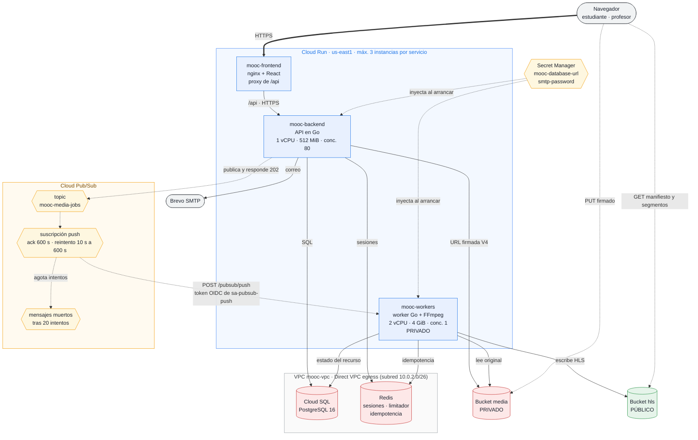
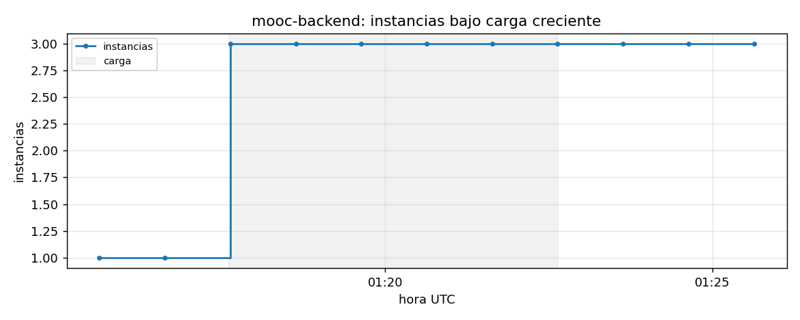
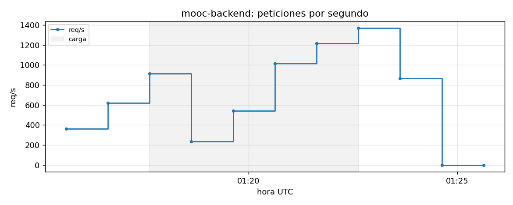
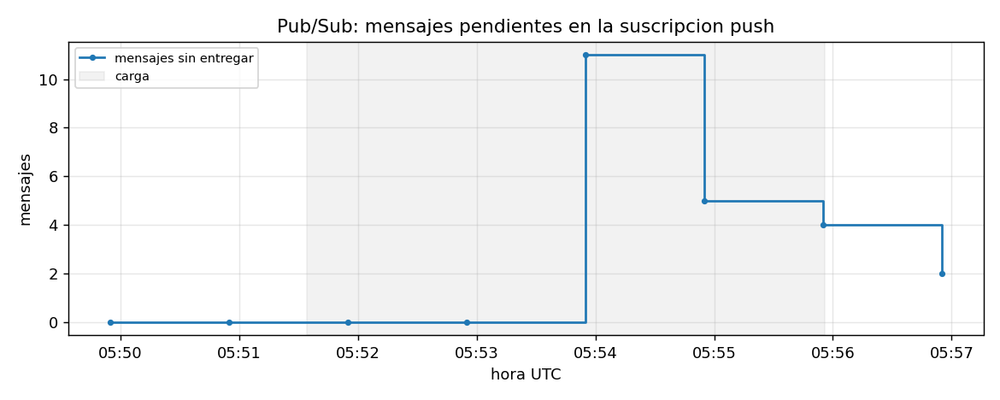
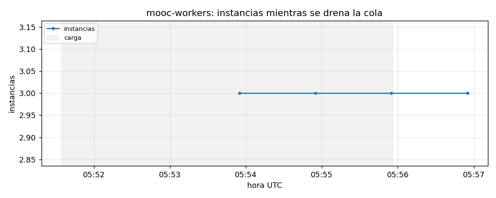

# Entrega 4 — Despliegue en Cloud Run y Cloud Pub/Sub

Frontend, backend y workers corren como **tres servicios independientes de Cloud Run**. La API ya no entrega los trabajos de
medios a Redis/asynq: **los publica en un topic de Cloud Pub/Sub**, y Pub/Sub los empuja (push autenticado) al servicio de
workers, que confirma solo cuando terminó y dejó el resultado guardado.

Proyecto `plataforma-mooc-entrega2` · región `us-east1`.

| Servicio | URL | Acceso |
| :--- | :--- | :--- |
| Frontend | `https://mooc-frontend-921648860819.us-east1.run.app` | público |
| Backend (API) | `https://mooc-backend-921648860819.us-east1.run.app` | público, protegido por la sesión y el CSRF de la propia API |
| Workers | `https://mooc-workers-921648860819.us-east1.run.app` | **privado**: solo la cuenta de la suscripción push tiene `run.invoker` (sin credencial responde 403) |

El navegador solo conoce el frontend: nginx reenvía `/api` al backend, así que página y API comparten origen y la cookie de
sesión (`SameSite=Lax`) sigue funcionando sin CORS ni cambios de autenticación.

## 1. Qué pide la entrega y dónde está

| Requisito | Dónde |
| :--- | :--- |
| Tres servicios independientes, máx. 3 instancias, una app por instancia, imágenes en Artifact Registry | §3 · `infra/terraform/cloudrun.tf` |
| Región, mínimo de instancias, CPU, memoria, concurrencia y timeout documentados | §3 |
| Réplicas sin depender de disco local | §3.1 |
| Frontend ↔ backend conectados, autenticación existente intacta | §2 y §3.2 |
| Backend y workers con acceso a Cloud SQL y Cloud Storage según su responsabilidad | §5 |
| Topic, suscripción push autenticada, publicación sin espera, confirmación tras persistir | §4 |
| Timeouts compatibles y tolerancia a reentregas | §4.2 y §4.3 |
| Mínimo privilegio, invocación de workers restringida, secretos en Secret Manager | §5 y §6 |
| Guía reproducible | §7 |
| Evidencia: URLs, límites, registros de una tarea de la publicación a la finalización | §8 |
| Verificación breve de escalado con métricas (instancias y mensajes pendientes) | §9 |

## 2. Arquitectura



| Trazo | Qué significa |
| :--- | :--- |
| `==>` gruesa | Tráfico que entra desde internet |
| `-->` fina | Llamada síncrona: la respuesta se espera |
| `-.->` punteada | Camino asíncrono o de control: nadie espera en línea |

**Lo que cambia frente a la Entrega 3.** Los grupos de VMs y el balanceador se sustituyen por servicios de Cloud Run, y la cola
asynq/Redis por Pub/Sub. Se conservan Cloud SQL, los dos buckets y **Redis, que ya no es cola** sino almacén compartido de
sesiones, limitador de intentos e idempotencia. El ambiente de la Entrega 3 queda apagado, no borrado.

### 2.1 El flujo de un video

1. El profesor sube el original **directo al bucket** con una URL firmada: los bytes no pasan por el backend.
2. `POST /media/uploads/{id}/complete`: el backend registra el objeto, **publica un mensaje** en el topic y responde `202`. No
   espera al worker (medido: 9 confirmaciones aceptadas en 157 ms, mientras el procesamiento tarda decenas de segundos).
3. Pub/Sub entrega el mensaje con `POST /pubsub/push` al servicio de workers, firmado con un token OIDC.
4. Cloud Run verifica el token contra IAM **antes** de que la petición llegue al código. Un worker descarga el original,
   transcodifica a HLS, sube los derivados al bucket público y marca el recurso `completed` en PostgreSQL.
5. **Solo entonces** responde `204`: esa es la confirmación (ack). Si falla antes, responde 5xx y Pub/Sub reintenta.

## 3. Cloud Run: configuración de los tres servicios

| | Frontend | Backend | Workers |
| :--- | :--- | :--- | :--- |
| Imagen (Artifact Registry `mooc/…`) | `web` | `api` | `worker` |
| Región | us-east1 | us-east1 | us-east1 |
| **Instancias mín. / máx.** | **0 / 3** | **1 / 3** | **0 / 3** |
| **CPU** | 1 vCPU | 1 vCPU | 2 vCPU |
| **Memoria** | 256 MiB | 512 MiB | 4 GiB |
| **Concurrencia por instancia** | 80 | 80 | **1** |
| **Timeout de petición** | 60 s | 60 s | **590 s** |
| Facturación de CPU | solo con petición | solo con petición | solo con petición |
| Cuenta de servicio | `sa-run-frontend` | `sa-web-server` | `sa-worker-server` |
| Acceso a la red privada | no | Direct VPC egress | Direct VPC egress |
| Invocación | pública | pública | solo `sa-pubsub-push` |

Una aplicación por instancia: cada servicio tiene **un solo contenedor** (sin sidecars).

**Por qué esos números.**

- **Backend, mínimo 1:** evita el arranque en frío de la primera petición (el login). Con la CPU facturada solo durante la
  petición, mantener una instancia ociosa cuesta poco.
- **Workers, concurrencia 1:** una instancia procesa un video a la vez. FFmpeg ya reparte el trabajo entre los dos núcleos, y
  así una instancia que se cae no se lleva consigo más que un trabajo. Es el mismo criterio de la Entrega 3 (nota A7).
- **Workers, 4 GiB:** en Cloud Run `/tmp` es memoria, y ahí se descarga el original y se escriben los segmentos HLS.
- **Workers, timeout 590 s:** tiene que ser **menor** que el plazo de confirmación de Pub/Sub (600 s, el máximo). Ver §4.2.

### 3.1 Sin depender del disco local

Ninguna réplica guarda estado propio: las **sesiones, el limitador y la idempotencia** viven en Redis; los **datos** en Cloud SQL;
los **archivos** en Cloud Storage. Lo único local es el directorio de trabajo del worker (`/tmp/mooc-media`), que es efímero por
construcción: se crea, se usa y se borra dentro de una misma petición.

### 3.2 Conexión frontend ↔ backend

El frontend lleva en su imagen un nginx que reenvía `/api` al backend por HTTPS, con el `Host` del backend (Cloud Run enruta por
`Host`). Las variables `API_UPSTREAM`, `API_SCHEME` y `API_HOST_HEADER` del frontend lo configuran; los valores por omisión de
la imagen siguen siendo los de la Entrega 3. El backend recibe como `APP_BASE_URL` y `CSRF_ALLOWED_ORIGINS` el origen del
frontend, así que la autenticación y la protección CSRF no cambian.

## 4. Cloud Pub/Sub y workers

### 4.1 Recursos

| Recurso | Valor |
| :--- | :--- |
| Topic | `mooc-media-jobs` (retención 24 h) |
| Suscripción | `mooc-media-jobs-push`, tipo **push** hacia `<workers>/pubsub/push` |
| Autenticación del push | token OIDC firmado por `sa-pubsub-push`, `audience` = URL del servicio de workers |
| Plazo de confirmación (ack) | **600 s** (el máximo de Pub/Sub) |
| Reintento | espera exponencial de **10 s a 600 s** |
| Mensajes muertos | tras **20 intentos** → topic `mooc-media-jobs-dead`, con suscripción `…-dead-pull` para inspeccionarlos |
| Quién publica | solo `sa-web-server`, con `roles/pubsub.publisher` **sobre este topic** |

Cada mensaje lleva en sus atributos `idempotency_key`, `task_type` y `resource_id`; el cuerpo es el mismo
`MediaProcessPayload` que usaba asynq.

### 4.2 Timeouts compatibles

`timeout de Cloud Run (590 s) < plazo de ack (600 s)`. Si una petición durara más que el ack, Pub/Sub la daría por perdida y la
reentregaría a otra instancia **mientras la primera sigue trabajando**. Con el timeout menor, Cloud Run corta la petición antes
que Pub/Sub la dé por perdida: el mensaje se reintenta limpiamente.

**Límite conocido:** un video cuyo procesamiento supere los ~590 s no puede completarse por esta vía. En la medición, un video de
120 s tarda 33–53 s en 2 vCPU; los videos de 10 y 30 minutos del perfil de la Entrega 3 **no se probaron** en Cloud Run. La
demostración usa videos cortos.

### 4.3 Tolerancia a reentregas

Pub/Sub entrega **al menos una vez**, así que el mismo mensaje puede llegar dos veces. Hay tres capas, de la más barata a la más
fuerte:

1. **Idempotencia compartida** (`internal/worker/push`): la clave `pubsub:<idempotency_key>` se guarda en Redis al terminar. Una
   reentrega de un trabajo ya terminado se confirma **sin hacer nada**.
2. **La propia canalización**: un recurso ya `completed` sobre el mismo objeto se omite.
3. **Efectos idempotentes**: los derivados HLS se escriben en rutas determinísticas, así que repetirlos no duplica nada.

Evidencia: en la corrida del recorrido completo, la API publicó dos veces el mismo video y el segundo mensaje quedó registrado
como `media job redelivered after it finished; acknowledged without work` (§8). En la prueba de escalado hubo reentregas reales
por falta de capacidad (§9) y **cada video se procesó una sola vez**.

### 4.4 Semántica de la respuesta del worker

| Caso | Respuesta | Efecto en Pub/Sub |
| :--- | :--- | :--- |
| Trabajo terminado y guardado | `204` | se confirma |
| Reentrega de un trabajo ya terminado | `204` | se confirma sin trabajo |
| Mensaje ilegible o fallo **permanente** (archivo corrupto) | `204` | se confirma tras registrarlo en el recurso (`failed`): reintentar repetiría el mismo fallo |
| Fallo **transitorio** (base de datos, red) | `500` | se reintenta |
| Cloud Run sin instancia libre | `429` / `500` de Cloud Run | se reintenta |

## 5. Identidad y mínimo privilegio

| Cuenta | Servicio | Permisos |
| :--- | :--- | :--- |
| `sa-web-server` | backend | lectura de `media`; creación de objetos en `originals/`, `documents/` y `thumbnails/` (nunca en derivados); firma de URLs sobre sí misma; publicar **solo** en `mooc-media-jobs`; leer `mooc-database-url` y `smtp-password` |
| `sa-worker-server` | workers | lectura de `media`; escritura en el bucket `hls`; leer `mooc-database-url` (no lee SMTP) |
| `sa-run-frontend` | frontend | **ningún rol** |
| `sa-pubsub-push` | (identidad de la suscripción) | **solo** `roles/run.invoker` sobre `mooc-workers` |
| Agente de servicio de Pub/Sub | — | `tokenCreator` sobre `sa-pubsub-push` (firma el token) y publicar en el topic de mensajes muertos |

Backend y workers reutilizan las cuentas de la Entrega 3: ya tienen exactamente los permisos de cada responsabilidad (ver
`storage.tf`, `mail.tf`, `database.tf`) y duplicarlos en cuentas nuevas solo permitiría que divergieran. Ninguna cuenta tiene
archivo de llave.

**Quién puede invocar los workers.** El servicio no es público. Sin credencial, una petición recibe `403` de Cloud Run y no llega
al código (comprobado: `POST /pubsub/push` sin token → 403). Solo `sa-pubsub-push` tiene `run.invoker`.

## 6. Configuración y secretos

- **Configuración por variables de entorno** (ninguna en la imagen). Las no secretas están en `cloudrun.tf`: `QUEUE_BACKEND=pubsub`,
  `PUBSUB_TOPIC`, `REDIS_URL`, `S3_BUCKET`, `MEDIA_HLS_BUCKET`, `APP_BASE_URL`, `CSRF_ALLOWED_ORIGINS`, límites del pool de
  conexiones, etc.
- **Secretos en Secret Manager**, inyectados por Cloud Run como variables al arrancar (el servicio solo guarda la referencia):
  - `mooc-database-url`: la cadena de conexión completa, con la contraseña. La compone Terraform a partir de `db_password`, que
    **no está en el repositorio ni en la imagen**: se toma de Secret Manager (`db-password`) en el momento del `apply`.
  - `smtp-password`: ya existía desde la Entrega 3.
- Cada cuenta solo lee los secretos que usa, con permiso **sobre el secreto**, no sobre el proyecto.

El estado de Terraform contiene la contraseña de la base (igual que en la Entrega 3): vive en un bucket privado, y los archivos
`.tfplan` se borran después de aplicar.

## 7. Guía de despliegue reproducible

Requisitos: `gcloud` y `terraform` (1.16.x, fijado en `versions.tf`) autenticados (`gcloud auth login` y `gcloud auth application-default login`). Además del
rol de edición, quien aplica necesita poder cambiar permisos de recursos: `roles/secretmanager.admin`, `roles/pubsub.admin` y
`roles/run.admin` (el rol `editor` no incluye `setIamPolicy` sobre secretos, topics ni servicios de Cloud Run: sin ellos el
`apply` falla con 403 en esos permisos).

**Paso 1 — publicar las imágenes** (api, worker y web, del mismo commit de `main`):

```bash
scripts/publish_images.sh                      # con Docker local
# o, sin Docker local (Cloud Build): ver el encabezado de scripts/e4_cloudbuild.yaml
```

**Paso 2 — encender lo que Cloud Run necesita.** Cloud SQL tiene que estar encendida (`db_activation_policy=ALWAYS`) y la VM de
Redis también:

```bash
gcloud compute instances start mooc-queue-server --zone us-east1-b
```

**Paso 3 — plan y apply desde un clon limpio de `main`** (nunca desde una rama):

```bash
cd infra/terraform
export TF_VAR_db_password="$(gcloud secrets versions access latest --secret=db-password | tr -d '\r\n')"
export TF_VAR_smtp_from='…' TF_VAR_smtp_username='…'          # no son secretos
export TF_VAR_image_tag='<SHA que corre hoy en las plantillas de la Entrega 3>'

terraform plan -out=e4.tfplan \
  -var cloudrun_enabled=true \
  -var cloudrun_image_tag=<SHA de las imágenes publicadas> \
  -var db_activation_policy=ALWAYS
terraform apply e4.tfplan
rm e4.tfplan                                                  # lleva la contraseña
```

`image_tag` **no debe cambiar**: lo leen las plantillas de los grupos de la Entrega 3 y cambiarlo las recrea. Cloud Run tiene su
propio `cloudrun_image_tag`. Sin `cloudrun_enabled=true` el plan no toca nada de esta entrega (y con él en `false` sobre un
ambiente que ya lo tiene, **destruye** los tres servicios: siempre se pasa).

El plan de un ambiente limpio crea **24 recursos**: los tres servicios, el topic con su cola de mensajes muertos, la suscripción
push, la subred de Cloud Run, la regla de Redis, las dos cuentas nuevas, el secreto de conexión y los permisos.

**Si el `apply` falla.** El 403 por permisos se resuelve con los roles de arriba y repitiendo `plan` + `apply`. Si el permiso del
agente de servicio de Pub/Sub falla porque el agente aún no existe: `gcloud beta services identity create --service=pubsub.googleapis.com`.
Si el backend no arranca, mira primero Redis encendida (`ping redis: i/o timeout` en el registro).

**Paso 4 — comprobar:**

```bash
curl https://mooc-backend-<n>.us-east1.run.app/api/v1/health            # {"status":"pass",…,"database":"up"}
curl https://mooc-frontend-<n>.us-east1.run.app/api/v1/health           # lo mismo, a través del proxy del frontend
curl -X POST https://mooc-workers-<n>.us-east1.run.app/pubsub/push -d '{}'   # 403: privado
go run ./scripts/e2e_cloud -base https://mooc-frontend-<n>.us-east1.run.app -video <mp4 corto> -salida <dir>
```

**Paso 5 — apagar al terminar** (los servicios con mínimo 0 no cuestan en reposo; el backend con mínimo 1, Cloud SQL y la VM de
Redis sí): `terraform apply` sin `cloudrun_enabled` (destruye lo de esta entrega), `-var db_activation_policy=NEVER` y
`gcloud compute instances stop mooc-queue-server`.

## 8. Evidencia del despliegue

Recorrido completo ejecutado contra el frontend de Cloud Run con `scripts/e2e_cloud` (el mismo de la Entrega 3): registro,
curso, subida y transcodificación de video, PDF e imagen, quiz, progreso, insignia, sesión, revocación y suspensión.

**103 pasos verificados · 0 fallos.** Los tres trabajos de medios (video, PDF e imagen) pasaron por Pub/Sub, se procesaron en los
workers y terminaron en `completed` (reconciliación 3/3).

Seguimiento de una tarea (mismo `message_id` en los dos servicios, registros de Cloud Logging):

```text
00:21:29.335  mooc-backend  media job published      message_id=22257174190970960 task_type=malware_scan
00:21:30.373  mooc-workers  media job received       message_id=22257174190970960 delivery_attempt=1
00:21:30.430  mooc-workers  media job completed      took=54ms
00:21:30.431  mooc-workers  media job acknowledged   message_id=22257174190970960 delivery_attempt=1
```

Reentrega tolerada (el video se confirmó dos veces en esa corrida):

```text
00:21:25.733  mooc-workers  media job received       message_id=22257174190935276 delivery_attempt=1
00:21:25.743  mooc-workers  media job redelivered after it finished; acknowledged without work
```

Los límites de instancias, CPU, memoria, concurrencia y timeout de cada servicio están en §3 y se leen de la consola con
`gcloud run services describe <servicio> --region us-east1`.

## 9. Verificación de escalado

Carga **controlada y repetible** (`scripts/e4_escalado`), generada desde `mooc-load-generator`, una VM en la misma región, para que
la red del operador no limite la medición. Las métricas salen de Cloud Monitoring (`scripts/e4_escalado/metricas.py`), con
resolución de un minuto.

### 9.1 Backend: usuarios concurrentes → instancias

`GET /api/v1/courses?limit=20` autenticado, por escalones de 50, 200 y 500 usuarios concurrentes, 100 s cada uno, contra el
backend.

| Escalón | Usuarios | Peticiones | Errores | Req/s | p50 | p95 | p99 |
| :--- | ---: | ---: | ---: | ---: | ---: | ---: | ---: |
| 1 | 50 | 56 320 | 0 | 563 | 87 ms | 116 ms | 133 ms |
| 2 | 200 | 120 072 | 0 | 1 201 | 167 ms | 230 ms | 260 ms |
| 3 | 500 | 137 877 | 0 | 1 379 | 149 ms | 1,30 s | 1,42 s |

**Instancias del backend (Cloud Monitoring, `run.googleapis.com/container/instance_count`):** 1 antes de subir la carga y **3, el
máximo, desde el primer minuto del escalón de 200 usuarios**; se mantuvieron en 3 hasta el final. 3 instancias × 80 de
concurrencia son 240 peticiones simultáneas, y en el escalón de 500 usuarios el p95 sube a 1,3 s: lo más probable es que ahí se
alcanzara el techo de 3 instancias (no se midió la CPU); en ningún escalón hubo errores.

Notas de lectura:

- La columna «instancias distintas vistas» de `fase_api.md` dice 1 porque la cabecera `X-Instance-ID` de la API vale lo mismo en
  todas las instancias de Cloud Run (no es un identificador por contenedor allí). **La fuente del conteo es la métrica de Cloud
  Run**, no esa cabecera.
- Las dos primeras filas de `metricas_api.csv` (01:15 y 01:16) pertenecen a una corrida previa de 45 s por escalón con solo 20,
  60 y 150 usuarios: no escaló (1 instancia hasta 1 322 req/s). El autoescalador de Cloud Run tarda del orden de un minuto en
  reaccionar, así que los escalones cortos no lo ven. Se repitió con escalones de 100 s.
- La resolución de la métrica es de un minuto. El tiempo de bajada no se midió.




### 9.2 Workers: mensajes pendientes → instancias

Se confirman a la vez N videos de 120 s (1280×720, el perfil corto de la Entrega 3). Cada confirmación publica un mensaje; con
workers de concurrencia 1 y máximo 3 instancias, lo que no cabe espera en la cola de Pub/Sub.

| | Corrida 1 (`max_delivery_attempts=5`) | Corrida 2 (`max_delivery_attempts=20`) |
| :--- | ---: | ---: |
| Videos / mensajes | 9 | 12 |
| Confirmaciones aceptadas (`202`) en | 157 ms | 195 ms |
| Instancias de workers | 0 → **3** | 0 → **3** |
| Mensajes pendientes, máximo | **9** | **11** |
| Edad del mensaje más viejo sin entregar | 139 s | 186 s |
| Primer video listo | 40 s | 40 s |
| Último video listo | 2 min 51 s | 4 min 11 s |
| Procesamiento por video | 33 – 53 s | 32 – 52 s |
| Terminados / fallidos | 9 / 0 | 12 / 0 |
| Intentos de entrega por mensaje | 6 de 9 necesitaron 3 a 5 (2 llegaron al 5.º y último) | 11 de 12 en el 1.º, 1 en el 2.º |
| Rechazos de Cloud Run («sin instancia libre») | 17 (11 × `429`, 6 × `500`) | 1 (`429`) |
| Mensajes a la cola de mensajes muertos | 0 (por poco) | 0 |




**Qué se ve.**

- **El backend no espera.** Las confirmaciones se aceptan en menos de 200 ms mientras el trabajo real tarda decenas de segundos:
  la cola desacopla a quien publica de quien procesa.
- **Los workers escalan con la cola.** Con la cola vacía no hay instancias (mínimo 0); al llegar los mensajes, Cloud Run sube a 3,
  el máximo, y la cola se drena a ese ritmo: 3 videos de ~45 s por «ola». 12 videos son 4 olas, ≈ 4 min.
- **Las curvas de Pub/Sub van atrasadas.** `num_undelivered_messages` y `oldest_unacked_message_age` se publican con un retraso de
  1 a 2 minutos y con resolución de un minuto, así que el máximo de mensajes pendientes aparece en el minuto siguiente a la
  publicación y la curva no muestra el último cero. Los tiempos exactos están en el rastro por mensaje.
- **El hallazgo de la corrida 1.** Con 5 intentos, dos mensajes se confirmaron en el último permitido: cada rechazo de Cloud Run
  por falta de capacidad cuenta como intento, y una tanda mayor que las instancias disponibles los acumula. Se subió el límite a
  20 (el rechazo por capacidad no es un fallo del trabajo) y la corrida 2 se hizo con **más** carga (12 vs 9) y casi sin
  reentregas. La evidencia de la corrida 1 se conserva en `evidencias/escalado/workers_corrida1_5_intentos/`.
- **Cero trabajo duplicado.** En las dos corridas hubo un `media job completed` por mensaje, aunque hubo reentregas (§4.3).

El rastro completo de cada mensaje (publicación → recepción → confirmación) está en
[`traza_mensajes.md`](evidencias/escalado/traza_mensajes.md) y, para la corrida 1,
[`workers_corrida1_5_intentos/`](evidencias/escalado/workers_corrida1_5_intentos/traza_mensajes.md).

**Alcance de esta verificación.** Es una prueba breve y controlada, no de capacidad: un solo perfil de video (120 s), tandas de 9 y
12, y un límite de 3 instancias que se alcanza enseguida. No dice cuánto soporta el sistema sin ese techo ni cómo se comporta con
videos de 10 o 30 minutos.

## 10. Decisiones y limitaciones

- **Redis sigue en una VM.** Sesiones, limitador e idempotencia lo necesitan y el enunciado no pide migrarlo; es un punto único de
  falla heredado (ver `docs/entrega3/deuda-tecnica.md`). Además la VM tiene que estar encendida para que el backend arranque.
- **`TRUSTED_PROXY_IP` sin IP fija.** La API solo cree en `X-Forwarded-For` si viene de una IP de confianza, y en Cloud Run no hay
  una IP fija. Se declara una dirección de documentación (`192.0.2.1`), con lo que las cabeceras `X-Forwarded-*` se ignoran y el
  limitador de intentos de login ve la IP del intermediario de Google: **todos los clientes comparten el mismo cupo**. Por eso
  `RATE_LIMIT_LOGIN_ATTEMPTS` sube a 1000. Es una limitación real, no una decisión de seguridad.
- **Videos largos.** Ver §4.2: el techo es el plazo de 10 minutos de Pub/Sub.
- **Cuentas reutilizadas** (`sa-web-server`, `sa-worker-server`): menos superficie que duplicarlas, pero Cloud Run y el ambiente de
  la Entrega 3 comparten identidad mientras ambos existan.
- **Entrega 3 apagada, no destruida.** Los grupos están en 0, sin balanceador ni autoescaladores; Terraform los conserva en el
  estado y vuelven a encenderse con las banderas de su propia guía.
