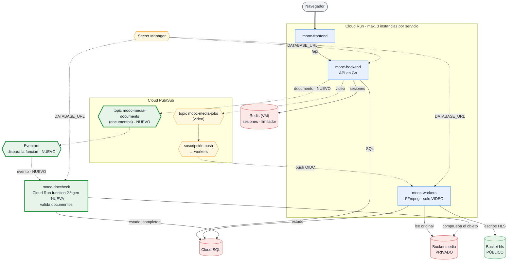

# Análisis serverless — Entrega 5

Qué de la plataforma ya es serverless, qué podría serlo, qué se implementó y por qué esa tarea y no otra.

## 1. Qué ya es serverless (tras las Entregas 3 y 4)

| Componente | Servicio | Por qué cuenta como serverless |
| :--- | :--- | :--- |
| Frontend, backend y workers | **Cloud Run** | Sin servidores que administrar; escala de 0 a 3 instancias según solicitudes; se paga por uso. |
| Cola de tareas | **Cloud Pub/Sub** | Sin brokers propios; entrega, reintentos y mensajes muertos los gestiona el servicio. |
| Archivos (originales y derivados HLS) | **Cloud Storage** | Sin capacidad que dimensionar; se paga por GB y por operación. |
| Credenciales | **Secret Manager** | Almacén administrado; sin disco ni proceso propio. |
| Imágenes | **Artifact Registry** | Repositorio administrado. |
| Validación de documentos *(esta entrega)* | **Cloud Run functions** + **Eventarc** | Una función de 2.ª generación disparada por Pub/Sub. |

**Lo que no es serverless, dicho tal cual:**

| Componente | Qué es | Por qué sigue así |
| :--- | :--- | :--- |
| Cloud SQL (PostgreSQL 16) | Base administrada **con instancia** (se paga encendida, tiene tamaño fijo y una ventana de mantenimiento) | Es un servicio administrado, pero no escala a cero ni por solicitud. |
| Redis (sesiones, limitador, idempotencia) | **Una VM** de Compute Engine | Es IaaS: la parchamos, la encendemos y es un punto único de falla heredado de la Entrega 3. |
| VPC, subred, Cloud NAT | Red administrada | Infraestructura base; no tiene equivalente serverless. |

## 2. Oportunidades

Cada oportunidad: el componente actual, el servicio propuesto, el beneficio y las limitaciones. **Solo la primera se implementó**;
las demás se documentan, como pide el enunciado.

| # | Componente actual | Servicio propuesto | Beneficio | Limitaciones | Estado |
| :--: | :--- | :--- | :--- | :--- | :--- |
| 1 | **Validación de documentos** (`malware_scan`) en el worker de Cloud Run | **Cloud Run function (2.ª gen)** + Eventarc/Pub/Sub | Sin servicio que mantener: se escribe solo la lógica del evento. Escala a 0, se paga por invocación, y un fallo se reintenta sin que el worker (que además carga FFmpeg y 4 GiB) tenga que arrancar para validar un PDF. | Límite de tiempo por invocación; arranque en frío; salida a Cloud SQL por la VPC; el código se compila desde fuente en Cloud Build. | ✅ **Implementada** |
| 2 | **Transcodificación HLS** de video en Cloud Run (concurrencia 1, 4 GiB, ≤ 590 s) | **Cloud Run Jobs** o **Transcoder API** | Quita el techo de ~10 min que impone el plazo de confirmación de Pub/Sub (hoy los videos largos no caben): un Job puede durar horas. La Transcoder API ahorra además mantener FFmpeg. | Cambia el modelo: Pub/Sub dispara una petición, no un job, así que haría falta un lanzador; la Transcoder API cobra por minuto de video y cambia el perfil de calidad (hoy: ladder 360p/720p propia). | Documentada |
| 3 | **Correo de verificación y recuperación**: hoy `mailer.Send` envía por SMTP **dentro de la petición** de registro (`internal/auth/service.go`) | **Cloud Run function** disparada por Pub/Sub | El registro deja de esperar al proveedor SMTP (hoy un SMTP lento retrasa o rompe el registro); reintentos gestionados. | Hay que decidir qué pasa si el correo falla *después* de haber respondido al usuario (hoy se reporta el error); el mensaje llevaría un token en el cuerpo del evento, que habría que tratar como dato sensible. | Documentada |
| 4 | **Sesiones, limitador e idempotencia** en una VM de Redis | **Memorystore** (administrado) o **Firestore** (serverless) | Quita la VM y su punto único de falla. Firestore escala a 0 y expira documentos por TTL. | Memorystore sigue siendo una instancia (no serverless) y cuesta más que la VM actual. Firestore obliga a reescribir la capa de sesiones y el limitador (ventana deslizante), con latencias de decenas de ms. | Documentada |
| 5 | **Reconciliación y limpieza** (recursos que quedan en `processing`, subidas incompletas) | **Cloud Scheduler** + función | Tarea periódica sin mantener una instancia ni un cron propio: el servicio la dispara en horario y la función corre solo el tiempo que dura. | Necesita decidir una política (a los cuántos minutos se considera atascado) y un permiso de escritura sobre el recurso. | Documentada |
| 6 | **Frontend estático** servido por nginx en Cloud Run | **Cloud Storage + Cloud CDN** tras un balanceador | Costo y latencia menores para archivos estáticos; sin instancias del frontend. | La cookie de sesión es `SameSite=Lax`: exige un solo origen para página y API, así que el CDN y la API tendrían que colgar del mismo balanceador (vuelve el balanceador de la Entrega 3, con su costo fijo). | Documentada |
| 7 | **PostgreSQL** en Cloud SQL | — | — | No hay un PostgreSQL serverless de primera parte en GCP con las mismas garantías; moverlo a otro modelo (p. ej. Firestore) es reescribir el dominio relacional. | Se deja como está |

## 3. Por qué se migró la validación de documentos

El enunciado pide migrar **al menos una tarea del worker**, conservando su comportamiento y resultado. El worker hoy ejecuta dos:
transcodificar video y validar documentos. La elección:

| Criterio | Validar documentos | Transcodificar video |
| :--- | :--- | :--- |
| Duración medida | **~50 ms** | 33–53 s por video de 120 s |
| Recursos | Lee metadatos del objeto y escribe una fila | FFmpeg, 2 vCPU, 4 GiB de `/tmp` |
| Estado en disco | Ninguno | Descarga el original y escribe segmentos |
| Separación en el código | Ya es una rama propia (`processDocument`) | Es el grueso del pipeline |
| Riesgo de cambiar el resultado | Bajo: el efecto es marcar el recurso `completed` | Alto: el perfil de calidad es parte del resultado |
| Encaje en una función | **Bueno** (corta, sin estado, sin binarios) | Malo (necesita un binario nativo y minutos) |

**Función frente a otro servicio de Cloud Run.** Una función de 2.ª generación *es* un servicio de Cloud Run por debajo, pero a cambio
de escribir solo la lógica del evento: no hay servidor HTTP que mantener, ni imagen que construir (se despliega **desde fuente**), ni
suscripción push que configurar a mano: **Eventarc** crea la suscripción, firma el token y autoriza la invocación. Para una tarea de
50 ms eso es toda la diferencia: el worker de Cloud Run es la herramienta correcta para el video, y sería desproporcionado para validar
un PDF.

## 4. Arquitectura resultante

Verde grueso: lo nuevo de esta entrega. El **enrutamiento** está en quien publica: el backend decide por tipo de tarea a qué topic va,
y el worker deja de ejecutar la tarea migrada, así que cada tarea tiene **un solo dueño**.
